<p align="center">
  <a href="https://normansrule.github.io/transistor-foundry-expedition/">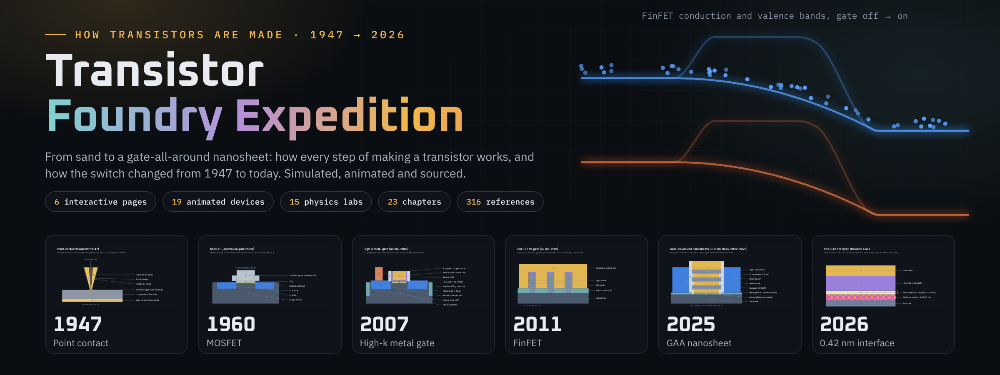</a>
</p>

<p align="center">
  <b>How transistors are made, and how they changed, 1947 → 2026.</b><br>
  Every step from sand to chip, how the switch changed shape, what an electron sees inside each one, and what might replace silicon.<br>
  <sub>Transistor Foundry Expedition was formerly Transistor Odyssey (github.com/Normansrule/transistor-odyssey); old links redirect.</sub>
</p>

<p align="center">
  <a href="https://normansrule.github.io/transistor-foundry-expedition/"><b>Website</b></a> &nbsp;·&nbsp;
  <a href="https://normansrule.github.io/transistor-foundry-expedition/fab.html"><b>Fab Journey</b></a> &nbsp;·&nbsp;
  <a href="https://normansrule.github.io/transistor-foundry-expedition/devices.html"><b>Device Atlas</b></a> &nbsp;·&nbsp;
  <a href="https://normansrule.github.io/transistor-foundry-expedition/physics.html"><b>Physics Lab</b></a> &nbsp;·&nbsp;
  <a href="https://normansrule.github.io/transistor-foundry-expedition/circuits.html"><b>Circuit Lab</b></a> &nbsp;·&nbsp;
  <a href="https://normansrule.github.io/transistor-foundry-expedition/process.html"><b>Process Lab</b></a> &nbsp;·&nbsp;
  <a href="https://normansrule.github.io/transistor-foundry-expedition/analog.html"><b>Analog &amp; RF Lab</b></a> &nbsp;·&nbsp;
  <a href="docs/README.md"><b>Chapters</b></a> &nbsp;·&nbsp;
  <a href="#quick-start"><b>Quick start</b></a>
</p>

<p align="center">
  <a href="https://normansrule.github.io/transistor-foundry-expedition/"></a>
  <a href=".github/workflows/ci.yml"></a>
  <a href="REFERENCES.md"></a>
  <a href="docs/README.md"></a>
  <a href="LICENSE"></a>
</p>

<br>

<p align="center"><a href="https://normansrule.github.io/transistor-foundry-expedition/devices.html#finfet">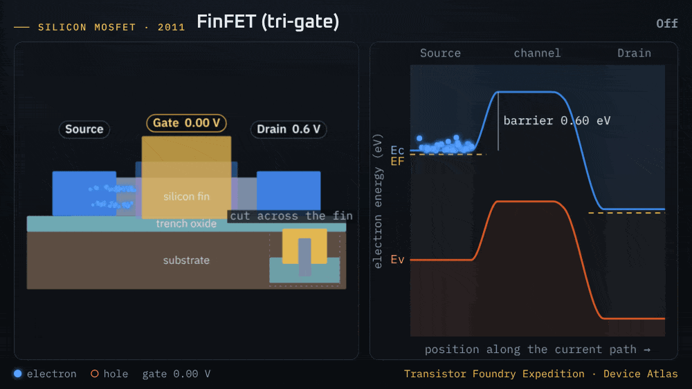</a></p>

<p align="center"><sub>The FinFET from the <a href="https://normansrule.github.io/transistor-foundry-expedition/devices.html#finfet">Device Atlas</a>. The gate sweeps from off to on; electrons (blue) pile up behind the source barrier, then flow over it as the gate pulls it down. Recorded from the live page.</sub></p>

## Overview

Transistor Foundry Expedition (formerly Transistor Odyssey) follows the transistor from a 50 µm gold contact on germanium to gate-all-around nanosheets, IBM's 7 Å nanostack and a 0.42 nm oxide on one-molecule-thick molybdenum disulfide (MoS₂), and through the gallium nitride (GaN), gallium arsenide (GaAs), silicon carbide (SiC) and diamond devices that compete with silicon. It is three things at once:

| | |
|---|---|
| **A website** | An animated history, a [Fab Journey](https://normansrule.github.io/transistor-foundry-expedition/fab.html) that follows one wafer lot through 13 process areas with a computed lithography theatre, logic gates shown in silicon and a Virtual Fab, a [Device Atlas](https://normansrule.github.io/transistor-foundry-expedition/devices.html) of 19 transistors with live energy band diagrams, a [Physics Lab](https://normansrule.github.io/transistor-foundry-expedition/physics.html) of 15 simulations, and a [Circuit Lab](https://normansrule.github.io/transistor-foundry-expedition/circuits.html) that zooms from wafer to atom and builds gates, an adder, SRAM and flash, a [Process Lab](https://normansrule.github.io/transistor-foundry-expedition/process.html) on oxidation, implantation, yield and electromigration, checked against a real university cleanroom run, and an [Analog & RF Lab](https://normansrule.github.io/transistor-foundry-expedition/analog.html) on gain, bandwidth, distortion and noise. Everything runs in the browser; nothing is pre-rendered. |
| **A textbook** | [26 chapters](docs/README.md), from the point contact to packaging, memory, manufacturing, amplifiers, the fab journey, a real teaching-cleanroom run and fourteen experiments you can run yourself, with 369 cited sources. Every number traces to a reference. |
| **A simulation package** | Python models in [`sim/transistor_sim`](sim/transistor_sim) that draw every figure here, each with a browser twin checked against it by 383 tests in continuous integration. |

> [!IMPORTANT]
> **About "0.42 nm".** No foundry manufactures a 0.42 nm (or 0.7 nm) process. As of September 2026 the most advanced production nodes are 2 nm-class (TSMC N2 and Intel 18A, both in volume since Q4 2025), with TSMC A16 ramping. **0.7 nm** is IBM's *research* node announced on 25 June 2026. **0.42 nm** is the measured thickness of an aluminium-oxide interface layer in a 2026 NYCU + TSMC monolayer-MoS₂ transistor whose channel is ~100 nm long. This repository explains all three and why node names stopped being lengths. See [Chapter 8](docs/08-gaa-and-angstrom-era.md) and [Chapter 9](docs/09-2d-materials.md).

### Where to start

| You are… | Suggested path |
|---|---|
| **New to semiconductors** | [How to read a band diagram](https://normansrule.github.io/transistor-foundry-expedition/devices.html#primer) → the [planar MOSFET](https://normansrule.github.io/transistor-foundry-expedition/devices.html#planar_mosfet) and [bipolar transistor](https://normansrule.github.io/transistor-foundry-expedition/devices.html#bjt) in the atlas → Physics Lab parts [I](https://normansrule.github.io/transistor-foundry-expedition/physics.html#crystal) and [II](https://normansrule.github.io/transistor-foundry-expedition/physics.html#pn) → the [self-test quiz](https://normansrule.github.io/transistor-foundry-expedition/devices.html#quiz) |
| **An engineer asking why FinFET and GAA** | [Physics Lab 09: 2D electrostatics](https://normansrule.github.io/transistor-foundry-expedition/physics.html#short) → [the side-by-side comparison](https://normansrule.github.io/transistor-foundry-expedition/devices.html#compare) → [Labs 13–15: inverter, ballistic limit, wires](https://normansrule.github.io/transistor-foundry-expedition/physics.html#part-vi) → [Chapter 6](docs/06-finfet.md), [Chapter 8](docs/08-gaa-and-angstrom-era.md) and [the process flow](docs/16-process-flow.md) |
| **Working in power or radio frequency** | [Analog & RF Lab: gain, Miller effect and speed records](https://normansrule.github.io/transistor-foundry-expedition/analog.html#bode) → [materials chart](https://normansrule.github.io/transistor-foundry-expedition/devices.html#align) → [GaN HEMT](https://normansrule.github.io/transistor-foundry-expedition/devices.html#gan_hemt) → [heterojunction builder](https://normansrule.github.io/transistor-foundry-expedition/devices.html#hetero) → [self-heating lab](https://normansrule.github.io/transistor-foundry-expedition/physics.html#heat) → [Chapters 10](docs/10-compound-semiconductors.md), [13](docs/13-diamond-electronics.md) and [23](docs/23-analog-rf-lab.md) |
| **Curious how a computer is built from them** | [The powers-of-ten zoom](https://normansrule.github.io/transistor-foundry-expedition/circuits.html#zoom) → [gate builder](https://normansrule.github.io/transistor-foundry-expedition/circuits.html#gates) → [8-bit adder](https://normansrule.github.io/transistor-foundry-expedition/circuits.html#adder) → [SRAM](https://normansrule.github.io/transistor-foundry-expedition/circuits.html#sram) and [flash](https://normansrule.github.io/transistor-foundry-expedition/circuits.html#flash) cells → [Chapter 21](docs/21-circuit-lab.md) |
| **Interested in how chips are manufactured** | [Process flow animation](https://normansrule.github.io/transistor-foundry-expedition/process.html) → [oxidation](https://normansrule.github.io/transistor-foundry-expedition/process.html#oxide) → [implant and anneal](https://normansrule.github.io/transistor-foundry-expedition/process.html#implant) → [yield and cost](https://normansrule.github.io/transistor-foundry-expedition/process.html#yield) → [electromigration](https://normansrule.github.io/transistor-foundry-expedition/process.html#em) → [a real cleanroom run](https://normansrule.github.io/transistor-foundry-expedition/process.html#labrun) → [Chapters 16](docs/16-process-flow.md), [22](docs/22-process-lab.md) and [25](docs/25-real-cleanroom-run.md) |
| **Teaching** | Every figure is CC BY 4.0 and regenerated by `python sim/make_figures.py`; the atlas deep-links to any device (`devices.html#finfet`), and the quiz draws new questions each round. [Fourteen tiered experiments](https://normansrule.github.io/transistor-foundry-expedition/experiments.html) (eight at tier 1) fit students’ own readings in the browser. |

## Contents

1. [How each transistor works](#how-each-transistor-works)
2. [Energy band diagrams for every device and material](#energy-band-diagrams-for-every-device-and-material)
3. [The interactive site](#the-interactive-site)
4. [The Physics Lab](#the-physics-lab)
5. [From transistor to computer: the Circuit Lab](#from-transistor-to-computer-the-circuit-lab)
6. [The physics of making chips: the Process Lab](#the-physics-of-making-chips-the-process-lab)
7. [The transistor as an amplifier: the Analog & RF Lab](#the-transistor-as-an-amplifier-the-analog--rf-lab)
8. [A history in cross-sections](#a-history-in-cross-sections)
9. [The data](#the-data)
10. [Chapters](#chapters)
11. [Quick start](#quick-start)
12. [Repository layout](#repository-layout) · [Accuracy](#accuracy-policy) · [Credits](#credits-and-inspiration) · [License](#license) · [Cite](#cite)

## How each transistor works

Each animation is recorded from the [Device Atlas](https://normansrule.github.io/transistor-foundry-expedition/devices.html). The left panel is the device's cross-section, with electrons (filled blue) and holes (open orange) moving along the current path; the right panel is the energy band diagram along that path, computed from the same model. [Chapter 20](docs/20-how-transistors-work.md) walks through all 19 devices in text.

### Planar MOSFET · 1960

<p align="center"><a href="https://normansrule.github.io/transistor-foundry-expedition/devices.html#planar_mosfet">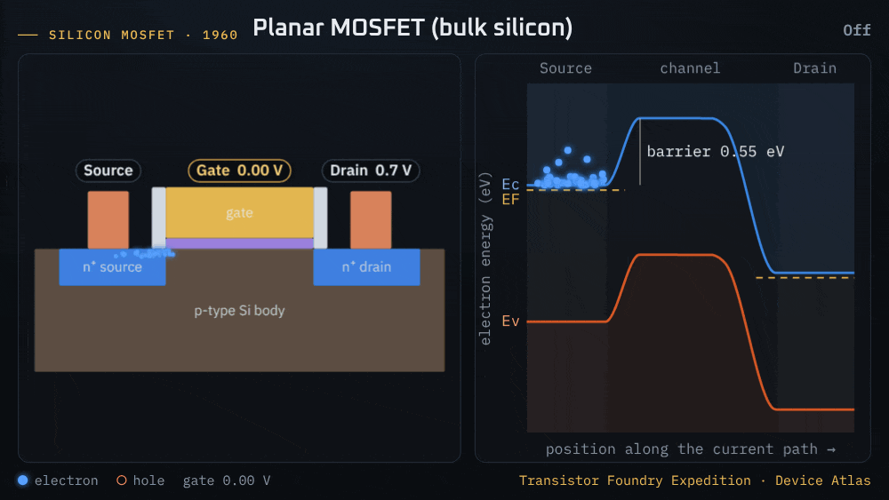</a></p>

The gate pulls the conduction band under it down. Below threshold, electrons must climb a barrier between source and channel and the current falls tenfold for every 60 mV of gate voltage; above threshold an inversion layer forms and the barrier is gone.

### Why the FinFET had to happen

<p align="center"><a href="https://normansrule.github.io/transistor-foundry-expedition/devices.html#compare">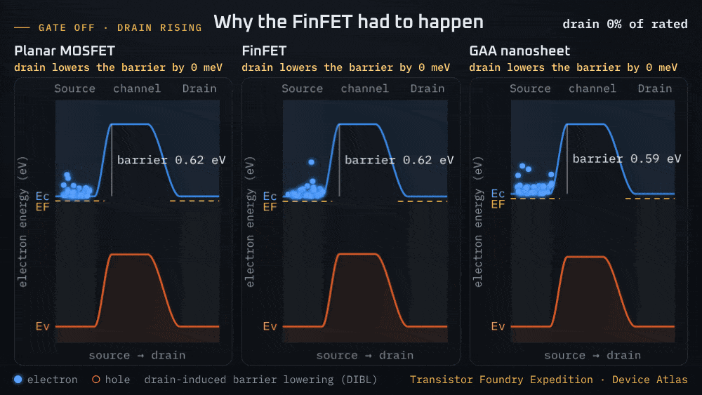</a></p>

All three silicon devices with the gate off and the drain voltage rising. The drain reaches around a single planar gate and pulls its barrier down by about 120 meV; wrapping the gate around a fin cuts that to about 40 meV, and around stacked nanosheets to about 22 meV. Every 60 meV is a factor of ten in leakage. Try it live in the [comparison](https://normansrule.github.io/transistor-foundry-expedition/devices.html#compare).

### Gate-all-around nanosheet · 2022–25

<p align="center"><a href="https://normansrule.github.io/transistor-foundry-expedition/devices.html#gaa">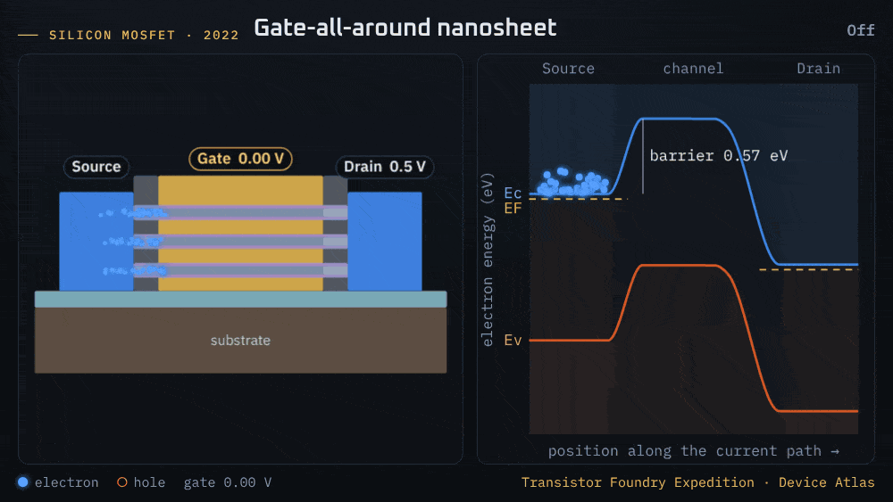</a></p>

The 2 nm generation (Samsung SF3, TSMC N2, Intel 18A): stacked silicon sheets about 5 nm thick, with the gate on all four sides of each.

### AlGaN/GaN high-electron-mobility transistor · 1993

<p align="center"><a href="https://normansrule.github.io/transistor-foundry-expedition/devices.html#gan_hemt">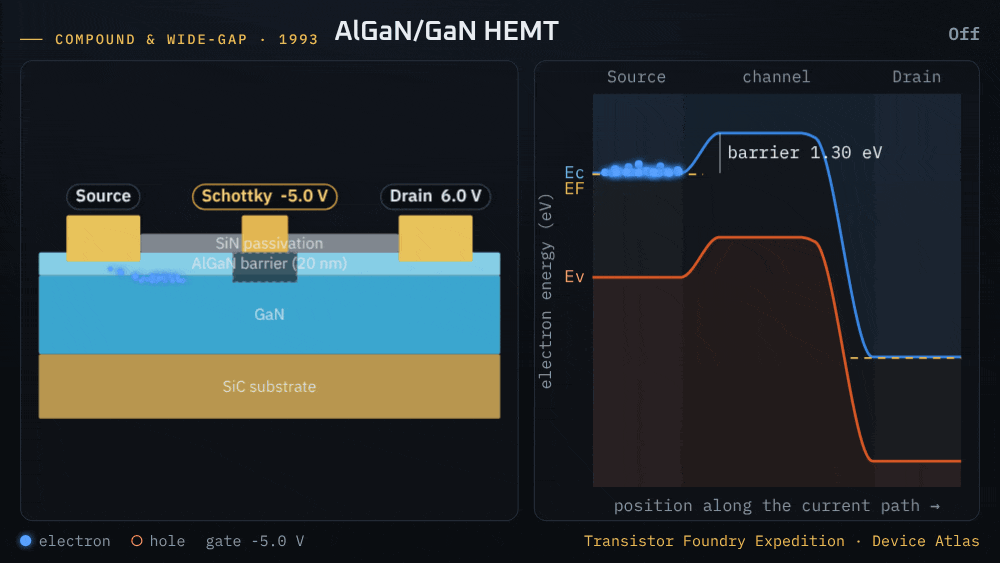</a></p>

Polarization charge at the aluminium gallium nitride / gallium nitride interface creates a sheet of about 10¹³ electrons/cm² with no doping at all. The device is normally on: a negative gate voltage lifts the quantum well above the Fermi level to switch it off.

### Bipolar junction transistor · 1951

<p align="center"><a href="https://normansrule.github.io/transistor-foundry-expedition/devices.html#bjt">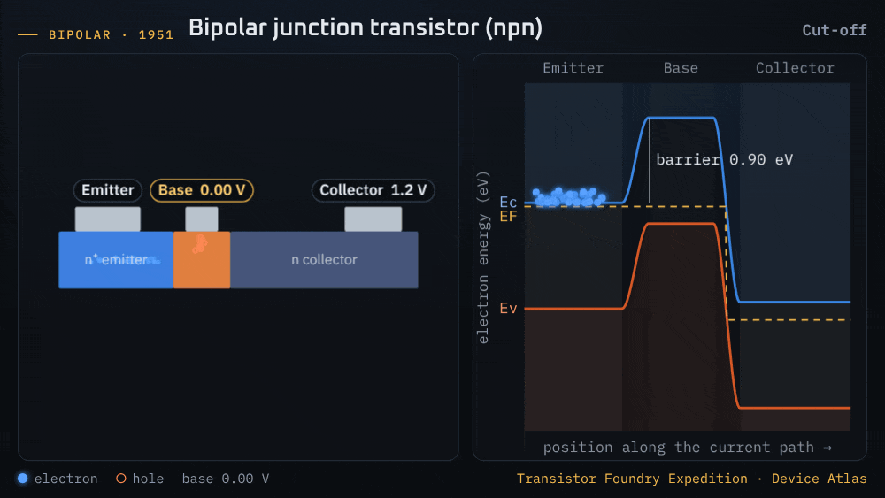</a></p>

No insulated gate: forward bias on the emitter–base junction lowers its built-in barrier, electrons diffuse across a thin base, and fall down the reverse-biased collector junction.

<details>
<summary><b>Four more: tunnel FET, IGBT, carbon-nanotube FET and diamond FET</b></summary>

### Tunnel FET · 2004

<p align="center"><a href="https://normansrule.github.io/transistor-foundry-expedition/devices.html#tfet">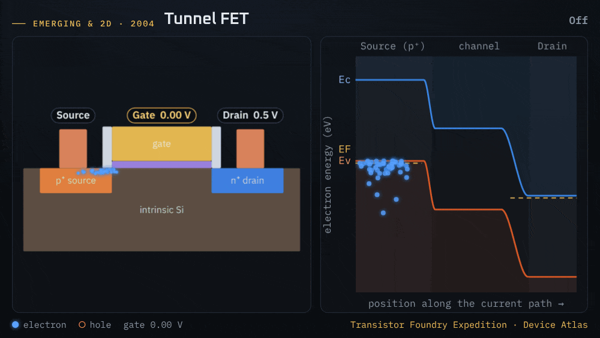</a></p>

Electrons tunnel sideways from the source valence band into the channel conduction band once the gate opens an energy window, so the swing can beat 60 mV per decade.

### Insulated-gate bipolar transistor · 1982

<p align="center"><a href="https://normansrule.github.io/transistor-foundry-expedition/devices.html#igbt">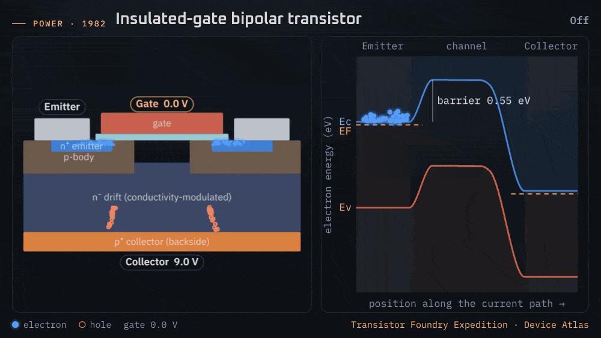</a></p>

A MOS channel feeds electrons into a thick drift region; the p⁺ layer at the back injects holes, and the region floods with both carriers, conducting far better than its doping alone allows.

### Carbon-nanotube FET · 1998

<p align="center"><a href="https://normansrule.github.io/transistor-foundry-expedition/devices.html#cnt_fet">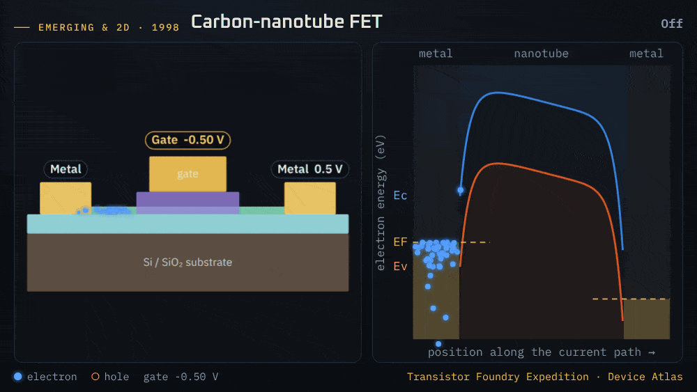</a></p>

Metal contacts form Schottky barriers at each end of a 1.5 nm nanotube; the gate thins those barriers until electrons tunnel through.

### Hydrogen-terminated diamond FET · 1994

<p align="center"><a href="https://normansrule.github.io/transistor-foundry-expedition/devices.html#diamond_fet">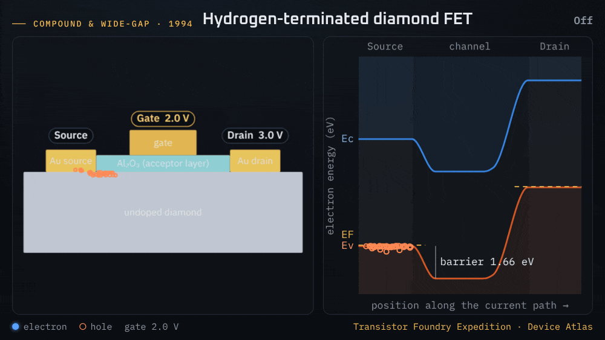</a></p>

Surface transfer doping gives diamond a sheet of holes with no dopant atoms; the device conducts holes, so its bands bend the other way.

</details>

## Energy band diagrams for every device and material

<p align="center">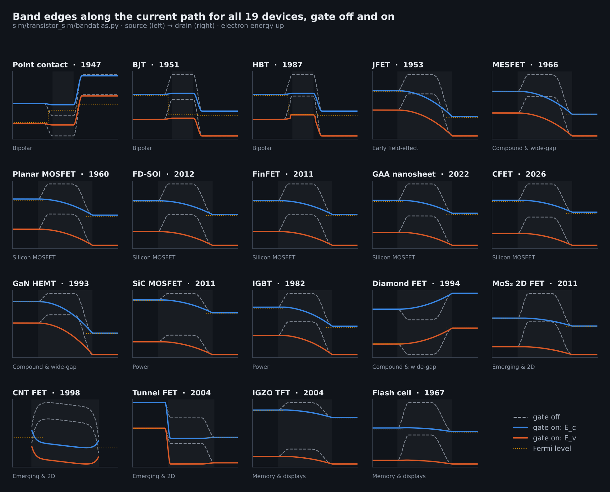</p>

<sub>All 19 devices along the current path, gate off (grey, dashed) and on (colour), from <code>sim/transistor_sim/bandatlas.py</code>. One figure per device, with the cut through the gate, is in <a href="figures/bands">figures/bands/</a>.</sub>

<p align="center">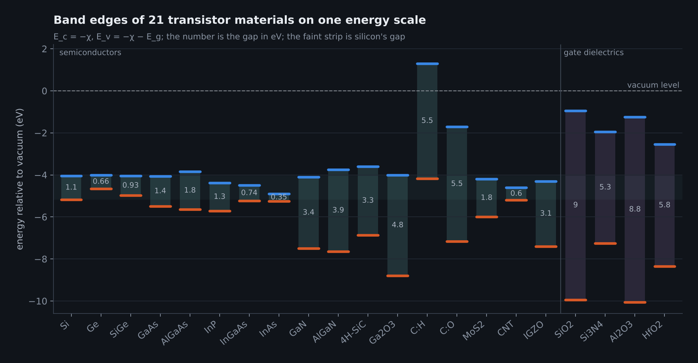</p>

<sub>21 channel and gate materials on one energy scale, from electron affinity and band gap. The gaps between them decide where carriers collect and how much a gate leaks.</sub>

<p align="center">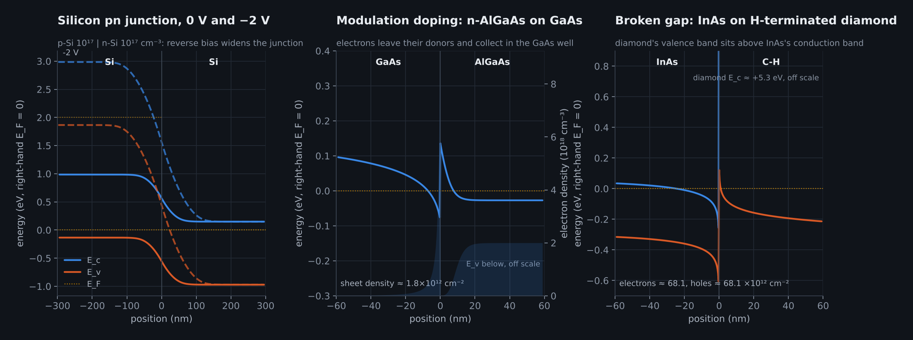</p>

<sub>New in this version: a Poisson solver for any pair of the 21 materials (<code>sim/transistor_sim/physics/hetero.py</code>). Left, a silicon pn junction at 0 V and −2 V; middle, modulation doping, where electrons leave their donors in AlGaAs and collect in GaAs; right, a broken-gap junction between InAs and hydrogen-terminated diamond.</sub>

<p align="center"><a href="https://normansrule.github.io/transistor-foundry-expedition/devices.html#hetero">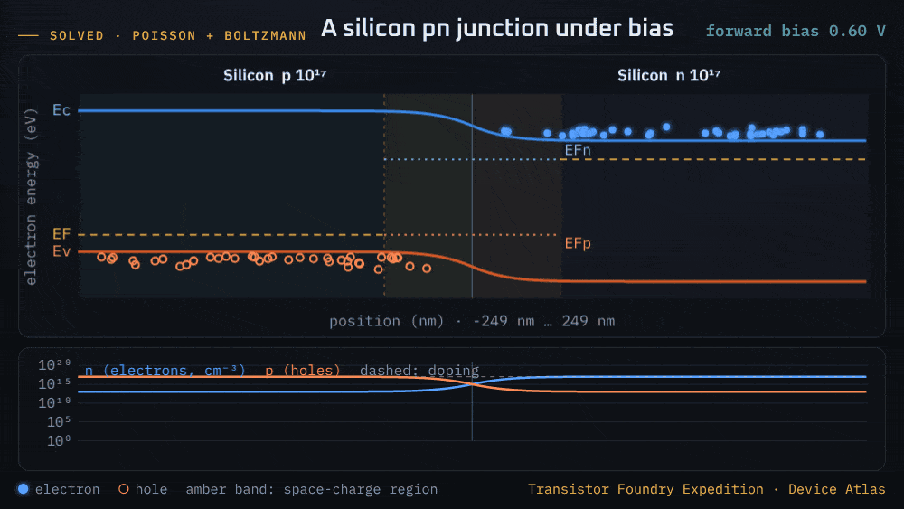</a></p>

<p align="center"><sub>The same solver, live in the <a href="https://normansrule.github.io/transistor-foundry-expedition/devices.html#hetero">heterojunction builder</a>: a silicon pn junction swept from −2 V to +0.6 V, with the space-charge region (amber) shrinking under forward bias.</sub></p>

<!-- manuals:start · generated by scripts/build_manuals.py, edit data/manuals.json -->
## Step-by-step process manuals

Illustrated manuals in the style of a building-brick instruction book: one picture per step, the new part outlined, a parts list, and a check at the end of each step. Open any step for the engineer’s operation specification (tool, cited parameter ranges, control and what to do when it goes wrong). Every web manual has a Save as PDF button, and `node scripts/qa/print_manuals.mjs` prints them all as one book, `dist/manuals/process-manuals-book.pdf`.

| Manual | Steps | Web | GitHub |
|---|---|---|---|
| **1 · Grow the crystal and cut the wafer** · Czochralski growth: melt, seed, neck, body, grind, slice, polish, sort | 6 | [web](https://normansrule.github.io/transistor-foundry-expedition/manuals/wafer.html) | [read](docs/manuals/wafer.md) |
| **2 · Clean the wafer before every furnace** · Wafer cleaning, explained conceptually: count, remove films, oxide, particles and metals, rinse and count again | 6 | [web](https://normansrule.github.io/transistor-foundry-expedition/manuals/cleaning.html) | [read](docs/manuals/cleaning.md) |
| **3 · Grow glass on the silicon** · Thermal oxidation: load, ramp, oxidise dry or wet, anneal, unload, measure | 6 | [web](https://normansrule.github.io/transistor-foundry-expedition/manuals/oxidation.html) | [read](docs/manuals/oxidation.md) |
| **4B · Make the photomask** · Mask making: blank, write, develop, etch the chrome, strip, measure, inspect and repair, mount the pellicle | 8 | [web](https://normansrule.github.io/transistor-foundry-expedition/manuals/photomask.html) | [read](docs/manuals/photomask.md) |
| **4A · Print a pattern with light** · Photolithography: prime, coat, bake, align, expose, develop, inspect | 10 | [web](https://normansrule.github.io/transistor-foundry-expedition/manuals/lithography.html) | [read](docs/manuals/lithography.md) |
| **5 · Carve the pattern into the film** · Plasma (reactive ion) etch: load, pump down, flow gas, strike plasma, etch, endpoint, over-etch, strip, measure | 9 | [web](https://normansrule.github.io/transistor-foundry-expedition/manuals/etch.html) | [read](docs/manuals/etch.md) |
| **6A · Bake the dopant into the silicon** · Furnace diffusion: open windows, predeposit, remove the source, drive in, measure | 6 | [web](https://normansrule.github.io/transistor-foundry-expedition/manuals/diffusion.html) | [read](docs/manuals/diffusion.md) |
| **6B · Fire dopant atoms into the silicon** · Ion implantation: mask, tilt, implant, see the damage, anneal, measure | 6 | [web](https://normansrule.github.io/transistor-foundry-expedition/manuals/implant.html) | [read](docs/manuals/implant.md) |
| **7A · Wire it up with aluminium** · Metallization in a teaching process: open contacts, evaporate aluminium, measure, pattern, etch, sinter | 7 | [web](https://normansrule.github.io/transistor-foundry-expedition/manuals/metal.html) | [read](docs/manuals/metal.md) |
| **7B · Coat every surface evenly** · Thin-film deposition: chemical vapour deposition (CVD) and atomic layer deposition (ALD) | 6 | [web](https://normansrule.github.io/transistor-foundry-expedition/manuals/deposition.html) | [read](docs/manuals/deposition.md) |
| **8 · Make the surface flat again** · Planarization: spin-on glass in older processes, chemical mechanical polishing (CMP) today | 7 | [web](https://normansrule.github.io/transistor-foundry-expedition/manuals/planarize.html) | [read](docs/manuals/planarize.md) |
| **9 · Build the transistor in three dimensions** · Device modules: isolation, high-k metal gate, fins, a silicon–germanium stack, release and gate wrap | 6 | [web](https://normansrule.github.io/transistor-foundry-expedition/manuals/modules.html) | [read](docs/manuals/modules.md) |
| **10 · Wire the chip in copper** · Dual damascene: insulator, trench, barrier, seed, plate, polish, measure | 6 | [web](https://normansrule.github.io/transistor-foundry-expedition/manuals/damascene.html) | [read](docs/manuals/damascene.md) |
| **11 · Find the good dies and package them** · Back end: probe test structures, test every die, map, saw, pick, bond and test again | 7 | [web](https://normansrule.github.io/transistor-foundry-expedition/manuals/probe.html) | [read](docs/manuals/probe.md) |
| **12 · Make a transistor on glass** · An oxide thin-film transistor (IGZO): another process family, built at low temperature with no crystal at all | 6 | [web](https://normansrule.github.io/transistor-foundry-expedition/manuals/tft.html) | [read](docs/manuals/tft.md) |
| **13 · Make a planar transistor the 1959 way** · Hoerni’s planar process: grow oxide, open a window, predeposit, drive in under the oxide, evaporate leads, test breakdown | 6 | [web](https://normansrule.github.io/transistor-foundry-expedition/manuals/history.html) | [read](docs/manuals/history.md) |

<details><summary><b>Manual 1 · Grow the crystal and cut the wafer</b> in 6 steps</summary>

<table>
<tr>
<td width="50%" valign="top">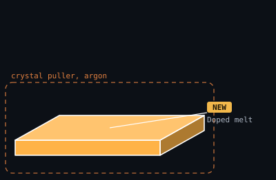<br><b>1 · Melt the silicon and add the dopant</b><br>Load polysilicon into a quartz crucible, add the dopant and melt it all under argon. The melt is doped richer than the target, because the crystal will take in only a fraction k of it.</td>
<td width="50%" valign="top">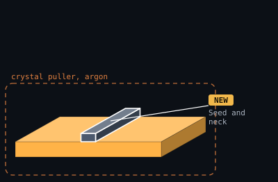<br><b>2 · Dip the seed and pull a thin neck</b><br>Lower a small seed crystal of the chosen orientation into the melt, let it wet, then pull a thin neck before widening.</td>
</tr>
<tr>
<td width="50%" valign="top">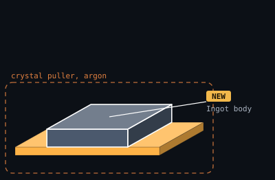<br><b>3 · Pull the body</b><br>Widen to the full diameter, then pull the crystal slowly upward while seed and crucible turn in opposite directions.</td>
<td width="50%" valign="top">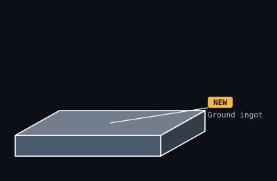<br><b>4 · Grind and mark the orientation</b><br>Grind the ingot to an exact diameter and cut a notch or flat along it that marks the crystal orientation.</td>
</tr>
<tr>
<td width="50%" valign="top">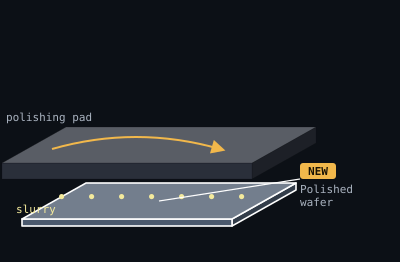<br><b>5 · Slice, flatten and polish</b><br>Saw the ingot into thin wafers, remove the sawing damage and polish one face to a mirror.</td>
<td width="50%" valign="top">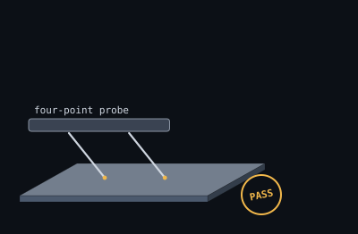<br><b>6 · Measure and sort</b><br>Measure resistivity at points along the ingot and on each wafer. Wafers inside the customer’s band are prime; the rest go to looser uses.</td>
</tr>
</table>

</details>

<details><summary><b>Manual 2 · Clean the wafer before every furnace</b> in 6 steps</summary>

<table>
<tr>
<td width="50%" valign="top">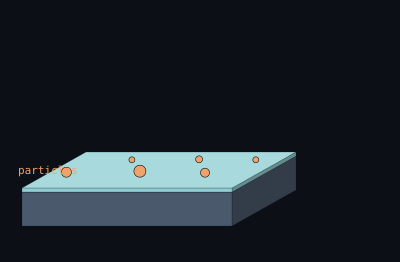<br><b>1 · Count what is on the wafer</b><br>Scan the wafer with a laser particle counter before it is cleaned. Every speck that scatters light is logged with its size and place.</td>
<td width="50%" valign="top">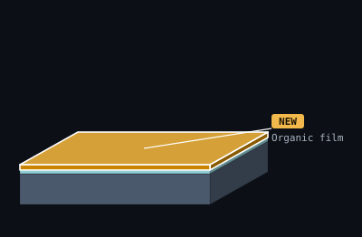<br><b>2 · Remove organic films</b><br>The first bath turns oily films from resist, handling and the air into gas. They would otherwise shield everything underneath from the later stages.</td>
</tr>
<tr>
<td width="50%" valign="top"><br><b>3 · Dissolve the thin oxide</b><br>A short dip dissolves the thin skin of oxide on top. Metals and particles trapped inside it come away with it, and bare silicon is left.</td>
<td width="50%" valign="top">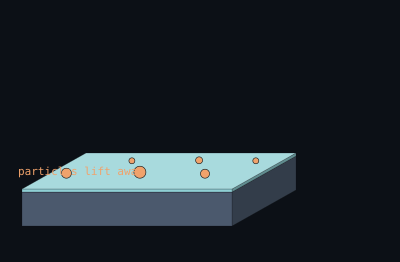<br><b>4 · Lift the particles off</b><br>A gentle bath, often helped by sound waves, undercuts each grain by a whisker of material and charges grains and wafer alike so they push apart.</td>
</tr>
<tr>
<td width="50%" valign="top">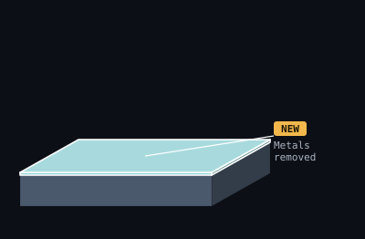<br><b>5 · Pull out metal traces</b><br>A last bath takes metal atoms such as iron off the surface before any furnace can drive them into the silicon.</td>
<td width="50%" valign="top">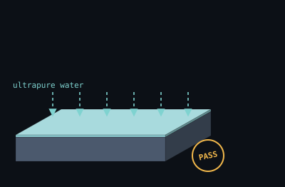<br><b>6 · Rinse, dry and count again</b><br>Rinse in ultrapure water, spin dry, and scan the wafer again. Only a wafer that passes may go into a shared furnace.</td>
</tr>
</table>

</details>

<details><summary><b>Manual 3 · Grow glass on the silicon</b> in 6 steps</summary>

<table>
<tr>
<td width="50%" valign="top">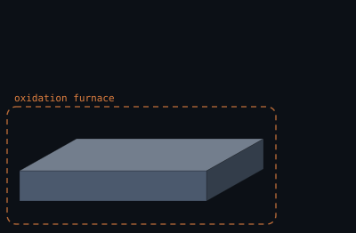<br><b>1 · Load the boat</b><br>Stand the wafers in a quartz boat with a monitor wafer at each end and push it slowly into the furnace while it idles under nitrogen.</td>
<td width="50%" valign="top"><br><b>2 · Ramp up in nitrogen</b><br>Raise the furnace to the oxidation temperature under nitrogen, so no oxide grows until the temperature is steady.</td>
</tr>
<tr>
<td width="50%" valign="top">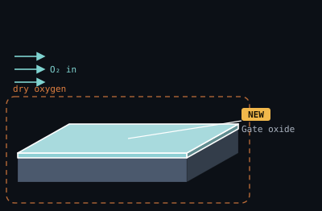<br><b>3 · Grow a gate oxide in dry oxygen</b><br>Switch the gas to dry oxygen. A thin, dense oxide grows slowly and evenly from the surface down.</td>
<td width="50%" valign="top">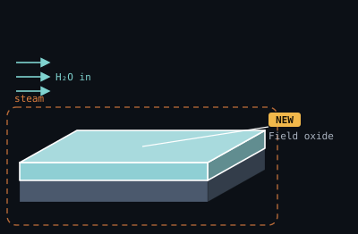<br><b>4 · Grow a field oxide in steam</b><br>For thick isolation, run a short dry step, a long step in steam, and a short dry step again. Steam carries far more oxidant through the oxide, so it grows many times faster.</td>
</tr>
<tr>
<td width="50%" valign="top">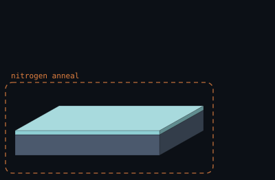<br><b>5 · Anneal in nitrogen</b><br>Switch back to nitrogen and hold the temperature for a while. The oxide does not grow, but its charge settles.</td>
<td width="50%" valign="top">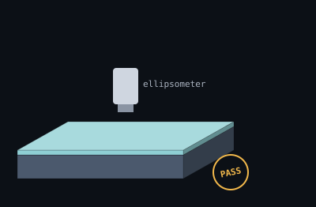<br><b>6 · Unload and measure</b><br>Ramp down slowly, pull the boat out, and measure the monitor wafers at several points with an ellipsometer or a reflectometer.</td>
</tr>
</table>

</details>

<details><summary><b>Manual 4B · Make the photomask</b> in 8 steps</summary>

<table>
<tr>
<td width="50%" valign="top">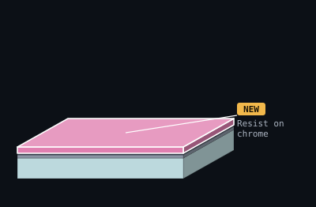<br><b>1 · Start with a blank</b><br>Take a plate of fused silica (quartz) or soda-lime glass coated with chrome, an anti-reflective layer and resist.</td>
<td width="50%" valign="top">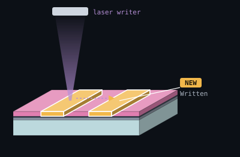<br><b>2 · Write the pattern</b><br>A laser or electron beam scans the layout into the resist, piece by piece, straight from the design file.</td>
</tr>
<tr>
<td width="50%" valign="top">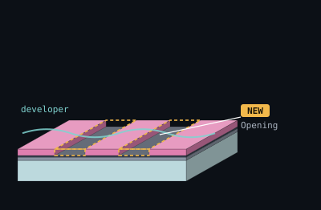<br><b>3 · Develop</b><br>Dissolve the written resist so the chrome shows through where the pattern must become clear.</td>
<td width="50%" valign="top">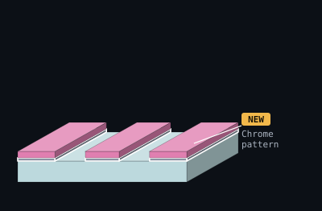<br><b>4 · Etch the chrome</b><br>Remove the chrome through the resist openings so light can pass there.</td>
</tr>
<tr>
<td width="50%" valign="top">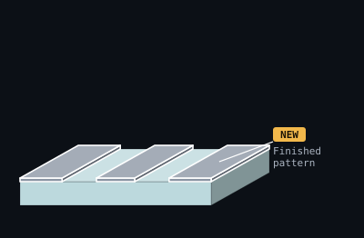<br><b>5 · Strip the resist</b><br>Remove the remaining resist. What is left is the chrome pattern on glass.</td>
<td width="50%" valign="top">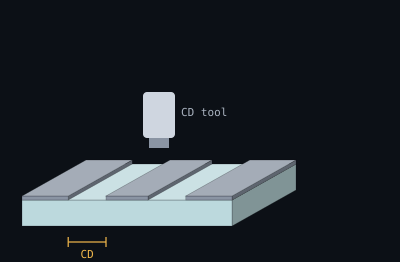<br><b>6 · Measure the critical dimensions</b><br>Measure line widths at many points and check them against the design.</td>
</tr>
<tr>
<td width="50%" valign="top">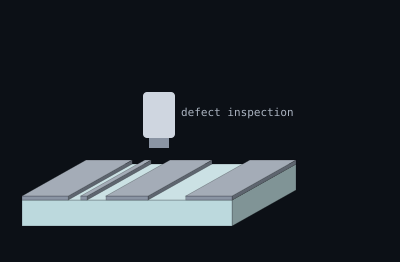<br><b>7 · Inspect and repair</b><br>Compare the whole mask against the design to find any defect, and repair it if possible.</td>
<td width="50%" valign="top">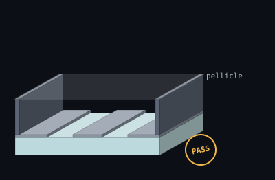<br><b>8 · Mount the pellicle</b><br>Glue a frame over the pattern with a thin transparent film stretched across it. Dust now lands on the film, out of focus.</td>
</tr>
</table>

</details>

<details><summary><b>Manual 4A · Print a pattern with light</b> in 10 steps</summary>

<table>
<tr>
<td width="50%" valign="top">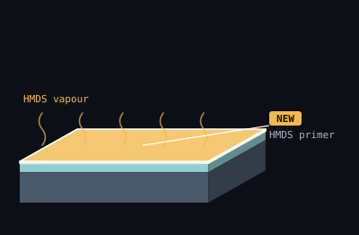<br><b>1 · Prime the surface</b><br>Expose the wafer to hexamethyldisilazane (HMDS) vapour. It turns the oxide surface water-repellent so the resist sticks.</td>
<td width="50%" valign="top">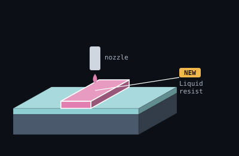<br><b>2 · Dispense the resist</b><br>Drop a few millilitres of liquid resist onto the centre of the wafer.</td>
</tr>
<tr>
<td width="50%" valign="top">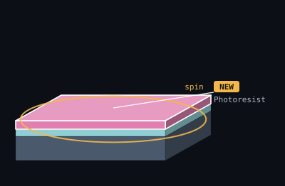<br><b>3 · Spin it thin</b><br>Spin the wafer fast. The resist flings outward and thins to an even film as its solvent evaporates.</td>
<td width="50%" valign="top">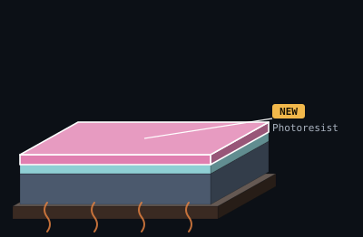<br><b>4 · Soft bake</b><br>Bake the wafer briefly on a hotplate to drive out most of the remaining solvent.</td>
</tr>
<tr>
<td width="50%" valign="top">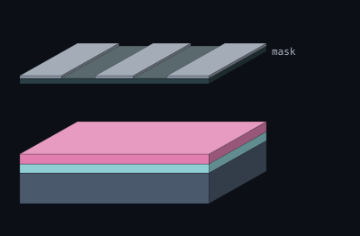<br><b>5 · Align the mask</b><br>Load the photomask, a glass plate with a chrome pattern, and line its marks up with the marks the last layer left on the wafer.</td>
<td width="50%" valign="top">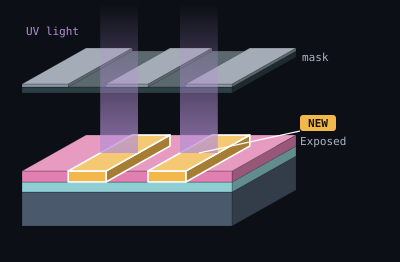<br><b>6 · Expose</b><br>Flash ultraviolet light through the mask. Where light lands, the resist changes chemistry and will later wash away.</td>
</tr>
<tr>
<td width="50%" valign="top">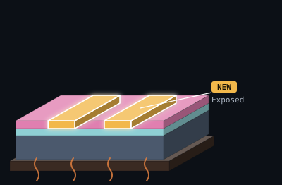<br><b>7 · Post-exposure bake</b><br>Bake again. In chemically amplified resist the light made a little acid, and the heat lets each acid molecule change many more.</td>
<td width="50%" valign="top">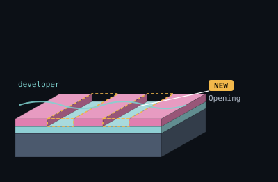<br><b>8 · Develop</b><br>Flood the wafer with developer. The exposed resist dissolves and the oxide shows through the openings.</td>
</tr>
<tr>
<td width="50%" valign="top">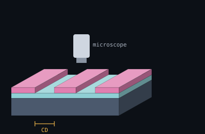<br><b>9 · Inspect and measure</b><br>Look at the pattern under a microscope, then measure line width and overlay.</td>
<td width="50%" valign="top">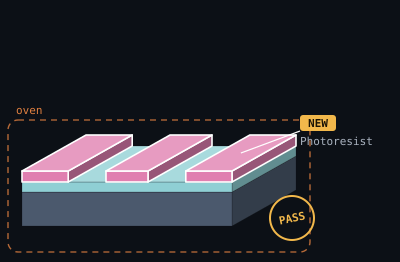<br><b>10 · Hard bake</b><br>Bake the patterned resist in an oven so it is tough enough to survive the etch or implant that comes next.</td>
</tr>
</table>

</details>

<details><summary><b>Manual 5 · Carve the pattern into the film</b> in 9 steps</summary>

<table>
<tr>
<td width="50%" valign="top">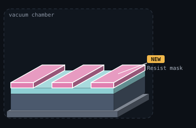<br><b>1 · Load the patterned wafer</b><br>Place the wafer on the lower electrode of the etcher. The hard-baked resist covers everything that must stay.</td>
<td width="50%" valign="top"><br><b>2 · Pump down</b><br>Close the chamber and pump the air out until the pressure is very low.</td>
</tr>
<tr>
<td width="50%" valign="top"><br><b>3 · Flow the process gas</b><br>Let a measured flow of etch gas into the chamber. Fluorine-based gases etch silicon, oxide and nitride.</td>
<td width="50%" valign="top"><br><b>4 · Strike the plasma</b><br>Switch on the radio-frequency power. The gas glows: it has become a plasma of ions and reactive fragments.</td>
</tr>
<tr>
<td width="50%" valign="top"><br><b>5 · Etch straight down</b><br>Ions accelerate across the sheath and strike the wafer head-on. Where the resist is open the film is etched downward, and the walls stay vertical.</td>
<td width="50%" valign="top"><br><b>6 · Stop at the layer below</b><br>Watch for the moment the film clears and the layer underneath shows. That is the endpoint.</td>
</tr>
<tr>
<td width="50%" valign="top"><br><b>7 · Over-etch a little</b><br>Keep etching for a short extra time so thin spots and slow, narrow openings clear too.</td>
<td width="50%" valign="top"><br><b>8 · Strip the resist</b><br>Burn the leftover resist off in an oxygen plasma, then clean the wafer.</td>
</tr>
<tr>
<td width="50%" valign="top"><br><b>9 · Measure the result</b><br>Measure the etched lines and compare them with the drawn widths and with the resist before etch.</td>
</tr>
</table>

</details>

<details><summary><b>Manual 6A · Bake the dopant into the silicon</b> in 6 steps</summary>

<table>
<tr>
<td width="50%" valign="top"><br><b>1 · Check the windows are open</b><br>Look at the wafer under the microscope. Where the oxide has been etched away, bare silicon shows; everywhere else oxide will block the dopant.</td>
<td width="50%" valign="top"><br><b>2 · Coat the dopant source</b><br>A thin film rich in dopant is put on the wafer by trained staff. It touches the silicon only where the windows are open.</td>
</tr>
<tr>
<td width="50%" valign="top"><br><b>3 · Predeposit in the furnace</b><br>In the hot furnace dopant atoms hop from the film into the open silicon. The silicon near the surface fills up first.</td>
<td width="50%" valign="top"><br><b>4 · Remove the source</b><br>The spent film is removed, so the amount of dopant in the silicon is now fixed.</td>
</tr>
<tr>
<td width="50%" valign="top"><br><b>5 · Drive in and grow oxide</b><br>A second, longer bake without any source spreads the same dopant deeper. The same bake grows an oxide over everything.</td>
<td width="50%" valign="top"><br><b>6 · Measure the sheet resistance</b><br>Touch four needles in a line to a diffused test resistor or the control wafer. Push current through the outer two and read the voltage across the inner two.</td>
</tr>
</table>

</details>

<details><summary><b>Manual 6B · Fire dopant atoms into the silicon</b> in 6 steps</summary>

<table>
<tr>
<td width="50%" valign="top"><br><b>1 · Check the mask is thick enough</b><br>Measure the resist. It must stop every ion where the silicon should stay undoped, and its edges decide where the doped region starts.</td>
<td width="50%" valign="top"><br><b>2 · Make the ion beam</b><br>Trained staff run the ion source, which ionises a dopant-bearing feed. A magnet then picks out only the ions of the right mass.</td>
</tr>
<tr>
<td width="50%" valign="top"><br><b>3 · Implant at a tilt</b><br>Accelerate the ions and scan the beam across the tilted wafer until the meter has counted the full dose.</td>
<td width="50%" valign="top"><br><b>4 · See the damage</b><br>Look at what the ions left behind: every one displaced many silicon atoms, and a heavy dose leaves the top layer amorphous. Most dopant is not yet active.</td>
</tr>
<tr>
<td width="50%" valign="top"><br><b>5 · Strip the resist and anneal</b><br>Remove the resist, then heat the wafer briefly. The crystal repairs itself and the dopant moves onto lattice sites, where it conducts.</td>
<td width="50%" valign="top"><br><b>6 · Measure the result</b><br>Map the sheet resistance across a monitor wafer with a four-point probe. Less often, a lab sputters a crater and counts the dopant depth by depth.</td>
</tr>
</table>

</details>

<details><summary><b>Manual 7A · Wire it up with aluminium</b> in 7 steps</summary>

<table>
<tr>
<td width="50%" valign="top"><br><b>1 · Check the contact holes</b><br>Under the microscope, look into each contact hole. The oxide must be gone right down to the doped silicon, or the metal will not touch it.</td>
<td width="50%" valign="top"><br><b>2 · Load and pump down</b><br>Mount the wafers face down above the source in the evaporator and pump the chamber to high vacuum.</td>
</tr>
<tr>
<td width="50%" valign="top"><br><b>3 · Evaporate the aluminium</b><br>Heat the source until aluminium evaporates. A thin, even film condenses over the whole wafer and into every contact hole.</td>
<td width="50%" valign="top"><br><b>4 · Measure the film</b><br>Put a four-point probe on the blanket aluminium and read its sheet resistance.</td>
</tr>
<tr>
<td width="50%" valign="top"><br><b>5 · Pattern the wires</b><br>Coat, expose and develop resist with the metal mask, exactly as in Manual 4A. Resist now covers the wires and pads you want to keep.</td>
<td width="50%" valign="top"><br><b>6 · Etch the aluminium</b><br>Exposed aluminium is etched away by trained staff, leaving wires and pads under the resist. The resist is then removed.</td>
</tr>
<tr>
<td width="50%" valign="top"><br><b>7 · Sinter the contacts</b><br>Bake the wafer gently so the aluminium and silicon bond at every contact and the contact resistance falls.</td>
</tr>
</table>

</details>

<details><summary><b>Manual 7B · Coat every surface evenly</b> in 6 steps</summary>

<table>
<tr>
<td width="50%" valign="top"><br><b>1 · Load and pump down</b><br>Place the wafer in the chamber through a load lock and pump it down to low pressure, then bring it to the deposition temperature.</td>
<td width="50%" valign="top"><br><b>2 · Let in the precursors</b><br>Trained staff run the gas cabinet. The tool meters a precursor vapour into the chamber, where it meets the hot wafer.</td>
</tr>
<tr>
<td width="50%" valign="top"><br><b>3 · Grow the film by CVD</b><br>Let the precursor react on the hot surfaces. The film grows on the top, the walls and the floor of every trench at once, fastest where the gas arrives first.</td>
<td width="50%" valign="top"><br><b>4 · Grow it one layer at a time (ALD)</b><br>Pulse the first precursor until it has covered every surface, purge, pulse the second to react with that layer, purge again. Each cycle adds one thin layer everywhere, top to floor.</td>
</tr>
<tr>
<td width="50%" valign="top"><br><b>5 · Build a high-k gate dielectric</b><br>On a gate stack, use ALD to lay down a hafnium-based insulator a few nanometres thick, then cap it with the gate metal.</td>
<td width="50%" valign="top"><br><b>6 · Measure thickness and coverage</b><br>Measure the blanket thickness by ellipsometry, then cut a test trench and compare the film on the floor and walls with the top.</td>
</tr>
</table>

</details>

<details><summary><b>Manual 8 · Make the surface flat again</b> in 7 steps</summary>

<table>
<tr>
<td width="50%" valign="top"><br><b>1 · See the problem</b><br>Look at the wafer after deposition. The oxide copies every line underneath, so the top is a row of bumps.</td>
<td width="50%" valign="top"><br><b>2 · Older fix: spin-on glass</b><br>Spin a liquid glass onto the wafer like resist. It flows into the low places, then a bake turns it solid.</td>
</tr>
<tr>
<td width="50%" valign="top"><br><b>3 · Mount face down on the pad</b><br>Hold the wafer upside down in a carrier and press it onto a rotating polishing pad wetted with slurry.</td>
<td width="50%" valign="top"><br><b>4 · Polish the high spots first</b><br>Spin pad and wafer. The pad touches the bumps first, so they wear away fastest.</td>
</tr>
<tr>
<td width="50%" valign="top"><br><b>5 · Stop when it is flat</b><br>Keep polishing until the bumps are gone and the oxide over the lines has the target thickness.</td>
<td width="50%" valign="top"><br><b>6 · Mind the pattern density</b><br>Check dense and sparse regions. Dense patterns polish more slowly, sparse ones faster, so the die is not perfectly flat.</td>
</tr>
<tr>
<td width="50%" valign="top"><br><b>7 · Clean off the slurry</b><br>Scrub and rinse the wafer so no slurry particles stay behind.</td>
</tr>
</table>

</details>

<details><summary><b>Manual 9 · Build the transistor in three dimensions</b> in 6 steps</summary>

<table>
<tr>
<td width="50%" valign="top"><br><b>1 · Isolate each transistor</b><br>Etch shallow trenches around every active area, fill them with oxide and polish flat, so neighbouring transistors cannot talk to each other.</td>
<td width="50%" valign="top"><br><b>2 · Put a high-k metal gate on a flat channel</b><br>Grow a thin interface oxide, deposit a high-k insulator by ALD and cap it with a metal gate. This was the planar transistor’s last big change.</td>
</tr>
<tr>
<td width="50%" valign="top"><br><b>3 · Stand the channel up as a fin</b><br>Pattern and etch narrow silicon walls, then recess the isolation oxide so the top of each wall stands free. The gate will wrap three sides.</td>
<td width="50%" valign="top"><br><b>4 · Grow a silicon–germanium stack</b><br>For nanosheets, grow alternating layers of silicon and silicon–germanium on the wafer, then etch them into fins.</td>
</tr>
<tr>
<td width="50%" valign="top"><br><b>5 · Release the sheets and wrap the gate</b><br>With the source and drain in place, remove the dummy gate, etch the silicon–germanium away selectively and fill the gaps with high-k and gate metal, so the gate surrounds every sheet.</td>
<td width="50%" valign="top"><br><b>6 · Measure the transistors</b><br>Probe test transistors for drive current, leakage and threshold, and cut cross-sections to check every sheet.</td>
</tr>
</table>

</details>

<details><summary><b>Manual 10 · Wire the chip in copper</b> in 6 steps</summary>

<table>
<tr>
<td width="50%" valign="top"><br><b>1 · Lay down the insulator</b><br>Deposit the insulating layer that the wires will sit in, often a low-k film that lowers the capacitance between neighbouring lines.</td>
<td width="50%" valign="top"><br><b>2 · Pattern and etch the trenches and vias</b><br>Print the via holes and the line trenches with lithography and etch both into the insulator, so one fill later makes the vias and the lines together.</td>
</tr>
<tr>
<td width="50%" valign="top"><br><b>3 · Line it with a barrier and a seed</b><br>Coat every surface with a thin barrier that copper cannot cross, then a thin copper seed for the plating to grow from.</td>
<td width="50%" valign="top"><br><b>4 · Fill by electroplating</b><br>Trained staff run the plating cell. Copper grows from the seed until every trench is full, and a little beyond.</td>
</tr>
<tr>
<td width="50%" valign="top"><br><b>5 · Polish back to the insulator</b><br>Polish away the copper and barrier on top until only the copper in the trenches remains.</td>
<td width="50%" valign="top"><br><b>6 · Measure the wires</b><br>Probe test structures: long serpentines for resistance, interleaved combs for shorts.</td>
</tr>
</table>

</details>

<details><summary><b>Manual 11 · Find the good dies and package them</b> in 7 steps</summary>

<table>
<tr>
<td width="50%" valign="top"><br><b>1 · Probe the test structures</b><br>Lower needles onto the test resistors, capacitors and transistors beside the dies and measure them first. They tell you whether the process worked before any chip is tested.</td>
<td width="50%" valign="top"><br><b>2 · Test every die</b><br>Step the wafer under the probe card die by die and run the test patterns. Each die passes or is put in a failure bin.</td>
</tr>
<tr>
<td width="50%" valign="top"><br><b>3 · Make the wafer map</b><br>Colour each die by its result. The pattern of failures says as much as their number.</td>
<td width="50%" valign="top"><br><b>4 · Saw the wafer apart</b><br>Mount the wafer on tape in a frame and cut along the scribe lanes with a diamond blade. The dies stay on the tape.</td>
</tr>
<tr>
<td width="50%" valign="top"><br><b>5 · Pick the good dies</b><br>The picker reads the wafer map and lifts only the dies that passed. Each is inspected before it goes into a tray or onto a package.</td>
<td width="50%" valign="top"><br><b>6 · Bond wires to the pads</b><br>Glue the die into its package, then join each pad to a package lead with a fine wire.</td>
</tr>
<tr>
<td width="50%" valign="top"><br><b>7 · Test again, packaged</b><br>Test the packaged part at speed and temperature. Assembly can damage a die, and some faults are only reachable through the package.</td>
</tr>
</table>

</details>

<details><summary><b>Manual 12 · Make a transistor on glass</b> in 6 steps</summary>

<table>
<tr>
<td width="50%" valign="top"><br><b>1 · Pattern a metal gate on the glass</b><br>Deposit a metal film on the glass and pattern it into gate lines. The gate sits at the bottom of this transistor.</td>
<td width="50%" valign="top"><br><b>2 · Deposit the gate insulator</b><br>Cover everything with a thin insulating film by CVD or sputtering.</td>
</tr>
<tr>
<td width="50%" valign="top"><br><b>3 · Sputter the oxide semiconductor</b><br>Sputter a thin amorphous IGZO film over the gate and pattern it into islands. It works without being crystallised, and it can be made at room temperature.</td>
<td width="50%" valign="top"><br><b>4 · Add source and drain</b><br>Deposit and pattern metal over the ends of each island, leaving a gap over the gate: that gap is the channel length.</td>
</tr>
<tr>
<td width="50%" valign="top"><br><b>5 · Seal and anneal</b><br>Cover the transistor with a protective film and give it a mild bake, which steadies the oxide semiconductor.</td>
<td width="50%" valign="top"><br><b>6 · Measure and compare</b><br>Probe the transfer curve: drain current against gate voltage. Compare its on–off ratio and threshold with the silicon transistors in the other manuals.</td>
</tr>
</table>

</details>

<details><summary><b>Manual 13 · Make a planar transistor the 1959 way</b> in 6 steps</summary>

<table>
<tr>
<td width="50%" valign="top"><br><b>1 · Grow the masking oxide</b><br>Oxidise the whole wafer in a furnace. The glass will block the dopant everywhere except where a window is opened.</td>
<td width="50%" valign="top"><br><b>2 · Open a window</b><br>Print a window with photoresist and etch the oxide away inside it. Its edge sets where the junction will meet the surface.</td>
</tr>
<tr>
<td width="50%" valign="top"><br><b>3 · Predeposit the dopant</b><br>Trained staff run the dopant source in a furnace. A thin, heavily doped skin forms in the window only.</td>
<td width="50%" valign="top"><br><b>4 · Drive in under the oxide edge</b><br>Heat again with the source removed. The dopant spreads down and sideways, so the junction curves up and meets the surface under the oxide, not in the open.</td>
</tr>
<tr>
<td width="50%" valign="top"><br><b>5 · Evaporate aluminium leads over the oxide</b><br>Open contact holes, evaporate aluminium over the whole wafer and pattern it, so the leads run across the oxide to the junctions.</td>
<td width="50%" valign="top"><br><b>6 · Test the breakdown</b><br>Reverse-bias the junction on a curve tracer and find the voltage where current suddenly rises. The curved edge breaks down before the flat floor.</td>
</tr>
</table>

</details>

Manuals explain how a cleanroom works; they are not home procedures. Hazardous chemistry, gases, furnaces and high-power lasers are described conceptually only.
<!-- manuals:end -->

## Build a transistor, one layer at a time

The [layer builder](https://normansrule.github.io/transistor-foundry-expedition/fab.html#builder) on the Fab Journey page builds six transistors step by step and draws them to scale in nanometres: a 45 nm planar high-k metal gate device, the 22, 14 and 10 nm FinFETs, a gate-all-around nanosheet and a complementary FET with the pFET stacked on the nFET. Scrub through 8 to 14 steps (dummy gate, spacers, inner spacers, source and drain epitaxy, sheet release, high-k metal gate), cut the device open along the channel or through the gate, take a guided tour through all six, or set two side by side at the same scale. A table computes effective width, width per footprint, pair area and the natural length of each thin body from the drawing. The geometry comes from [`builder.py`](sim/transistor_sim/physics/builder.py) and its JavaScript twin, with cited fin and gate dimensions from Intel's 45, 22, 14 and 10 nm papers and IBM's first stacked nanosheets. See [Chapter 27](docs/27-layer-builder.md).

<p align="center"><a href="https://normansrule.github.io/transistor-foundry-expedition/fab.html#builder"></a></p>

## Read the node from the top of a chip

The [node-reading lab](https://normansrule.github.io/transistor-foundry-expedition/fab.html#nodelab) draws the top of a chip at its real pitches and hands you two measuring marks. Measure the gate pitch, the fin pitch, the tightest metal pitch and an SRAM bitcell on a mystery chip, and the lab ranks seven nodes (Intel 45 nm to TSMC N5) by how well they fit. Every pitch in its table is cited. The model is [`nodelab.py`](sim/transistor_sim/physics/nodelab.py) with its JavaScript twin. See [Chapter 28](docs/28-node-reading-lab.md).

<p align="center"><a href="https://normansrule.github.io/transistor-foundry-expedition/fab.html#nodelab"></a></p>

## Spot the defect

[Spot the defect](https://normansrule.github.io/transistor-foundry-expedition/fab.html#defects) shows four features made in one step: four trenches filled together, four openings etched together, four blocks polished together. One of them failed, and the step’s own process model decided which: the narrow trench that closed over a void, the narrow opening that never cleared, the sparse block polished out of focus, the wide nanosheet stack that kept its SiGe, the copper line longer than its Blech length, the particle wider than the space, the field lifted out of focus. Find it, name the cause, then apply the fix and watch it go. The model is [`defects.py`](sim/transistor_sim/physics/defects.py) with its JavaScript twin. See [Chapter 29](docs/29-spot-the-defect.md).

<p align="center"><a href="https://normansrule.github.io/transistor-foundry-expedition/fab.html#defects"></a></p>

## Use it offline

The site is an installable progressive web app (PWA). Open it once in Chrome, Edge or Safari and choose "Install" (or "Add to Home Screen"): every page, lab and manual then works with no network. Photos hotlinked from Wikimedia Commons are kept for offline use once you have seen them. `scripts/build_pwa.py` writes the manifest and the service worker's file list; `make pwa` reruns it after any change to the site.
<p align="center"><sub>The layer builder: a nanosheet transistor cut along its channel after its last step, drawn to scale, with the twelve build steps and the cited dimensions.</sub></p>

## Experiments you can run

The [Experiments page](https://normansrule.github.io/transistor-foundry-expedition/experiments.html) has fourteen experiments that stand in for real process steps: yield (sand on a paper wafer), diffusion (dye in gelatin), lithography (a CD’s tracks with a Class 2 laser pointer, and printing with sunlight), the gate capacitor (foil and paper), junctions (a diode, LEDs and a diode thermometer), the MOSFET threshold, contact resistance (pencil lines), crystal growth, the four-point probe and an etch-rate series. Four are tier 0, eight tier 1, one tier 2 (a teaching lab) and one tier 3 (institution-only, no recipe). Each turns its readings into a straight line and fits it in the browser by least squares, with the same code in Python ([`fitting.py`](sim/transistor_sim/physics/fitting.py)) checked by the parity tests. See [Chapter 26](docs/26-experiments.md).

## The interactive site

| Page | What it does |
|---|---|
| [**History**](https://normansrule.github.io/transistor-foundry-expedition/) | WebGL fluid hero, scroll-pinned timeline of 20 structures, three.js explorer that explodes seven architectures, compact-model device lab, Moore's-law chart, die photographs beside generated drawings, materials ranking, diamond lab, 14-step fab animation, niche atlas of 31 devices, lithography calculator and searchable bibliography |
| [**Fab Journey**](https://normansrule.github.io/transistor-foundry-expedition/fab.html) | A lens that dives from the planet to the atoms, a stamped map of 13 process areas on three routes, a lithography theatre whose cross-section is computed from Fourier optics and photon shot noise (2D and 3D, seven stages, three depths, four failure modes), thirteen more theatres for Czochralski crystal growth with dopant segregation along the ingot, wafer cleaning (particles, killer size and iron lifetime, with no chemistry), oxidation, implantation, diffusion from a surface source, rapid thermal and spike anneals on a thermal budget, plasma etch with RIE lag, trench filling by PVD, CVD and ALD, CMP over three pattern densities, damascene copper lines with barrier and size-effect resistivity, wafer probe with a live wafer map, cost per good die and test escapes, the release of stacked nanosheets by a selective etch, and the 1959 planar process with the breakdown of its curved junction edge, each computed from its model, a gate-to-silicon view that shows nine logic gates from the inverter to XOR, a 28-transistor full adder and a 6T SRAM cell (also tiled into a 4-bit adder and a 4 × 4 memory array) as symbol, schematic, dimensioned mask layout, an explodable 3D cell and a cross-section in planar, FinFET and nanosheet form, a layer builder that builds five transistors from planar to CFET step by step to scale with cutaways, a tour and a same-scale comparison, and a Virtual Fab that checks your process order and computes the cross-section your traveler builds from the theatre models, at their defaults or at your own theatre settings |
| [**Device Atlas**](https://normansrule.github.io/transistor-foundry-expedition/devices.html) | 19 animated transistors with band diagrams along the current path and through the gate, step-by-step walk-throughs, side-by-side comparison, 21-material band chart, heterojunction builder with doping and bias, and an 8-question self-test |
| [**Physics Lab**](https://normansrule.github.io/transistor-foundry-expedition/physics.html) | 15 simulations in six parts, from crystal lattices to lithography optics, CMOS logic, ballistic transport and on-chip wires, each with guided experiments and typeset equations |
| [**Circuit Lab**](https://normansrule.github.io/transistor-foundry-expedition/circuits.html) | A powers-of-ten zoom from a 300 mm wafer to one silicon bond, a switch-level gate builder with logical effort, an event-driven 8-bit adder, a six-transistor SRAM cell with butterfly curves, and a floating-gate flash cell with Fowler–Nordheim programming |
| [**Process Lab**](https://normansrule.github.io/transistor-foundry-expedition/process.html) | An animated process flow, Deal–Grove oxidation, LSS ion implantation with diffusion anneals, a Monte Carlo wafer map with yield models and the cost per chip by node, an electromigration stress solver with the Blech length and Black's law, and a real teaching-cleanroom run (ten steps, measured oxides, etch bias, thresholds and capacitors) set against the models |
| [**Experiments**](https://normansrule.github.io/transistor-foundry-expedition/experiments.html) | Fourteen experiments in four safety tiers, from sand on a paper wafer to a diode thermometer and a CD read with a laser pointer. Paste or upload readings as CSV and each one is fitted to a straight line in the browser, with residuals, standard errors and the cited value beside it ([Chapter 26](docs/26-experiments.md)). |
| [**Analog & RF Lab**](https://normansrule.github.io/transistor-foundry-expedition/analog.html) | The radio spectrum from audio to 2 THz, a common-source amplifier with live distortion, g_m/I_D and intrinsic gain across six generations, Bode plots with the Miller effect beside record f_T and f_max, and thermal and 1/f noise |

<p align="center"><a href="https://normansrule.github.io/transistor-foundry-expedition/fab.html"></a></p>
<p align="center"><sub>Fab Journey (v1.12): follow one lot through the fab, seven scopes from the planet to the atoms.</sub></p>

<p align="center"><a href="https://normansrule.github.io/transistor-foundry-expedition/fab.html#litho"></a></p>
<p align="center"><sub>Lithography theatre: EUV at 15 mJ/cm² delivers about 10 photons per nm², and counting noise breaks and bridges the lines.</sub></p>

<p align="center"><a href="https://normansrule.github.io/transistor-foundry-expedition/fab.html#gates"></a></p>
<p align="center"><sub>Gate to silicon: an AOI22 in a 5 nm FinFET cell, as symbol, schematic, dimensioned layout, exploded 3D view and cross-section. Pick any of nine gates, the full adder or the SRAM cell, in three technologies.</sub></p>

<p align="center"><a href="https://normansrule.github.io/transistor-foundry-expedition/devices.html#gan_hemt"></a></p>
<p align="center"><sub>Device Atlas: the GaN HEMT, with the solved quantum well in the lower band diagram.</sub></p>

<p align="center"><a href="https://normansrule.github.io/transistor-foundry-expedition/devices.html#hetero"></a></p>
<p align="center"><sub>Heterojunction builder: flat-band alignment above, the solved junction below, with carrier densities and the charge collected at the interface.</sub></p>

<table>
<tr>
<td width="50%"><a href="https://normansrule.github.io/transistor-foundry-expedition/devices.html#compare"></a><br><sub>Side-by-side comparison with guided presets.</sub></td>
<td width="50%"><a href="https://normansrule.github.io/transistor-foundry-expedition/devices.html#quiz"></a><br><sub>Self-test: questions are generated from the models each round.</sub></td>
</tr>
<tr>
<td><a href="https://normansrule.github.io/transistor-foundry-expedition/"></a><br><sub>The history page.</sub></td>
<td><a href="https://normansrule.github.io/transistor-foundry-expedition/physics.html#short"></a><br><sub>Physics Lab 09: a live 2D Poisson solver.</sub></td>
</tr>
</table>

## The Physics Lab

The [Physics Lab](https://normansrule.github.io/transistor-foundry-expedition/physics.html) turns the semiconductor physics behind the history into fifteen experiments you can run, grouped as materials → junctions and gates → quantum effects → scaling and transport → manufacturing → transistor to circuit. Each lab has sliders, guided "try this" experiments, the equations typeset with KaTeX, and a note on why it matters for transistors. The same models render these figures:

<table>
<tr>
<td width="50%"><br><sub>A 2D Poisson solve shows the drain lowering the source barrier, and a second gate cutting DIBL several-fold: the case for the FinFET.</sub></td>
<td width="50%"><br><sub>Transfer-matrix tunnelling: SiO₂ leaks ~10× more per 2 Å thinner; HfO₂ at the same EOT leaks orders of magnitude less.</sub></td>
</tr>
<tr>
<td><br><sub>Ensemble Monte Carlo reproduces silicon's measured mobility and ~10⁷ cm/s saturation velocity.</sub></td>
<td><br><sub>Exact MOS-capacitor C–V at three oxide thicknesses, low and high frequency.</sub></td>
</tr>
<tr>
<td><br><sub>Charge, field and band bending across an abrupt junction.</sub></td>
<td><br><sub>Why wide-gap semiconductors survive heat.</sub></td>
</tr>
<tr>
<td><br><sub>Self-consistent Schrödinger–Poisson: the AlGaN/GaN two-dimensional electron gas with no doping at all.</sub></td>
<td><br><sub>Band gaps open where the crystal Bragg-reflects the electron wave.</sub></td>
</tr>
<tr>
<td><br><sub>The long-channel MOSFET from the exact surface potential: subthreshold, linear and saturation in one model.</sub></td>
<td><br><sub>2D heat conduction: the substrate, and the interface to it, set how hot a GaN amplifier runs.</sub></td>
</tr>
<tr>
<td colspan="2"><br><sub>Abbe imaging: coherent light stops at λ/NA, tilted light reaches λ/2NA, and defocus washes the image out.</sub></td>
</tr>
</table>

**Part VI, from transistor to circuit.** Three labs follow the transistor into a chip: the CMOS inverter built from the compact model, the ballistic limit on drive current, and the copper wires that now dominate delay.

<p align="center"></p>
<p align="center"></p>
<p align="center"></p>

## From transistor to computer: the Circuit Lab

The [Circuit Lab](https://normansrule.github.io/transistor-foundry-expedition/circuits.html) follows the switch into the machine. It opens on a zoom through nine powers of ten, from a 300 mm wafer to a silicon–silicon bond, and then builds the circuits in between from the same compact transistor model. [Chapter 21](docs/21-circuit-lab.md) explains each model.

<p align="center"><a href="https://normansrule.github.io/transistor-foundry-expedition/circuits.html#zoom"></a></p>
<p align="center"><sub>Wafer → die → core → standard cells → gates → one NAND2 cell → a nanosheet transistor → atoms → one covalent bond. The dimensions in the captions are real for a 2 nm-class process.</sub></p>

<table>
<tr>
<td width="50%"><a href="https://normansrule.github.io/transistor-foundry-expedition/circuits.html#gates"></a><br><sub><b>Gate builder.</b> Ten static CMOS gates simulated switch by switch, with truth tables and logical effort derived from the netlists (NAND2 g = 4/3, NOR2 g = 5/3).</sub></td>
<td width="50%"><a href="https://normansrule.github.io/transistor-foundry-expedition/circuits.html#adder"></a><br><sub><b>8-bit adder.</b> An event-driven simulation in which the carry ripples right to left and sum bits glitch on the way: 14 of the 22 transitions in 255 + 1 are wasted.</sub></td>
</tr>
<tr>
<td><a href="https://normansrule.github.io/transistor-foundry-expedition/circuits.html#sram"></a><br><sub><b>Six-transistor SRAM.</b> A read cycle: the word line opens, the bitline on the 0 side discharges and the stored 0 is lifted by the read disturb.</sub></td>
<td><a href="https://normansrule.github.io/transistor-foundry-expedition/circuits.html#flash"></a><br><sub><b>Flash cell.</b> Electrons tunnel through 8 nm of oxide at ~10 MV/cm (Fowler–Nordheim), one stepped pulse at a time; on the right is the triangular barrier they cross.</sub></td>
</tr>
</table>

<p align="center"></p>
<p align="center"></p>
<p align="center"></p>

## The physics of making chips: the Process Lab

The [Process Lab](https://normansrule.github.io/transistor-foundry-expedition/process.html) covers the factory side: how an oxide grows, where implanted dopants stop, how many dies survive on a wafer, and how copper wires wear out. It opens on an animated cross-section built step by step, from bare wafer to copper wiring. [Chapter 22](docs/22-process-lab.md) explains each model.

<table>
<tr>
<td width="50%"><a href="https://normansrule.github.io/transistor-foundry-expedition/process.html#oxide"></a><br><sub><b>Thermal oxidation.</b> Water molecules diffuse through the growing oxide and react at the interface, which moves down into the silicon (Deal–Grove).</sub></td>
<td width="50%"><a href="https://normansrule.github.io/transistor-foundry-expedition/process.html#implant"></a><br><sub><b>Ion implantation.</b> Arsenic ions zig-zag through the lattice and stop in a Gaussian around the LSS projected range; an anneal then sets the junction.</sub></td>
</tr>
<tr>
<td><a href="https://normansrule.github.io/transistor-foundry-expedition/process.html#yield"></a><br><sub><b>Yield.</b> A Monte Carlo wafer with clustered defects: each die hit by a defect turns red. The yield matches the negative-binomial model.</sub></td>
<td><a href="https://normansrule.github.io/transistor-foundry-expedition/process.html#em"></a><br><sub><b>Electromigration.</b> The electron wind builds tension at the cathode and compression at the anode until a void opens; lines shorter than the Blech length never fail.</sub></td>
</tr>
</table>

<p align="center"></p>
<p align="center"></p>
<p align="center"></p>

## The transistor as an amplifier: the Analog & RF Lab

The [Analog & RF Lab](https://normansrule.github.io/transistor-foundry-expedition/analog.html) treats the transistor as an amplifier rather than a switch. It opens on the radio spectrum from audio to 2 THz, drawn as a chirp, with the bands each generation of transistors made usable and the fastest devices on record. [Chapter 23](docs/23-analog-rf-lab.md) explains each model.

<table>
<tr>
<td width="50%"><a href="https://normansrule.github.io/transistor-foundry-expedition/analog.html#amp"></a><br><sub><b>Common-source amplifier.</b> A 180 nm transistor and a 10 kΩ resistor give a gain of about 10; as the input grows the output clips against the rails and the harmonics rise.</sub></td>
<td width="50%"><a href="https://normansrule.github.io/transistor-foundry-expedition/analog.html#gain"></a><br><sub><b>Intrinsic gain.</b> The tangent to the output curve is g_ds = 1/r_o. Gain g_m·r_o falls from 24 at 180 nm to 8 at 45 nm, then recovers to 22 with FinFETs.</sub></td>
</tr>
<tr>
<td><a href="https://normansrule.github.io/transistor-foundry-expedition/analog.html#bode"></a><br><sub><b>Frequency response.</b> Past the bandwidth set by the Miller-multiplied gate–drain capacitance, the output shrinks and lags behind its low-frequency self.</sub></td>
<td><a href="https://normansrule.github.io/transistor-foundry-expedition/analog.html#noise"></a><br><sub><b>Noise.</b> A 10 µV signal over the audio band: as the transistor gets wider its 1/f noise falls and the signal emerges.</sub></td>
</tr>
</table>

<p align="center"></p>
<p align="center"></p>
<p align="center"></p>

## A history in cross-sections

<table>
<tr>
<td width="33%"><br><b>1947 · Point contact</b><br><sub>Two gold foils ~50 µm apart on germanium. Bardeen & Brattain.</sub></td>
<td width="33%"><br><b>1959 · Planar process & IC</b><br><sub>Oxide masks diffusion and stays on. Hoerni, Kilby, Noyce.</sub></td>
<td width="33%"><br><b>1968 · Self-aligned silicon gate</b><br><sub>Faggin & Klein; the Intel 4004's 10 µm pMOS.</sub></td>
</tr>
<tr>
<td><br><b>2003 · Strained silicon</b><br><sub>Embedded SiGe squeezes pMOS channels (90 nm).</sub></td>
<td><br><b>2007 · High-k metal gate</b><br><sub>HfO₂ replaces SiO₂ at 45 nm.</sub></td>
<td><br><b>2011 · FinFET</b><br><sub>Gate on three sides of a silicon fin (22 nm).</sub></td>
</tr>
<tr>
<td><br><b>2022–25 · Gate-all-around</b><br><sub>Samsung SF3E, TSMC N2, Intel 18A RibbonFET.</sub></td>
<td><br><b>2026 · IBM 7 Å nanostack</b><br><sub>Stacked, staggered nanosheet tiers (research).</sub></td>
<td><br><b>2026 · 0.42 nm AlOx on MoS₂</b><br><sub>NYCU + TSMC: ~1 nm EOT on a 2D channel.</sub></td>
</tr>
</table>

<sub>All 21 drawings: <code>python sim/make_figures.py</code> → <a href="figures/cross_sections">figures/cross_sections/</a>. The full era list with sources is in <a href="data/timeline.json">data/timeline.json</a>.</sub>

<details>
<summary><b>Physical chips next to their simulations</b></summary>

| Photograph (Wikimedia Commons) | Generated by this repo |
|---|---|
| <br><sub>Intel C4004, 1971 · 10 µm · 2,300 transistors · CC BY-SA 4.0</sub> | <br><sub>CMOS-equivalent inverter at λ = 5 µm (GDS in <code>figures/layout</code>)</sub> |
| <br><sub>MOS 6502 die, 1975 · 8 µm nMOS · Pauli Rautakorpi, CC BY 3.0</sub> | <br><sub>Silicon-gate nMOS cross-section</sub> |
| <br><sub>Intel 80486 DX2 · first x86 above 1 M transistors · Pauli Rautakorpi, CC BY 3.0</sub> | <br><sub>Inverter at λ = 0.75 µm</sub> |
| <br><sub>AMD Zen 2 core, TSMC N7 FinFET · Fritzchens Fritz, CC0</sub> | <br><sub>Gridded FinFET inverter, 51 nm CPP / 28 nm MMP</sub> |

<sub>Full attribution: <a href="CREDITS.md">CREDITS.md</a>. <code>python scripts/fetch_images.py</code> mirrors the photos locally and refreshes author and license from the Commons API.</sub>

</details>

<details>
<summary><b>Build one: the 14-step nanosheet process flow</b></summary>

<table>
<tr>
<td width="33%"><br><sub>2 · Si/SiGe superlattice</sub></td>
<td width="33%"><br><sub>11 · Release the nanosheets</sub></td>
<td width="33%"><br><sub>14 · Backside power</sub></td>
</tr>
</table>

</details>

<details>
<summary><b>Diamond, niche and exotic devices</b></summary>

<table>
<tr>
<td width="33%"><br><b>2024 · Vertical diamond MOSFET</b><br><sub>Waseda: 2D hole gas on trench walls, 0.7 A per device.</sub></td>
<td width="33%"><br><b>Surface transfer doping</b><br><sub>How H-terminated diamond conducts without bulk dopants.</sub></td>
<td width="33%"><br><b>NV centre</b><br><sub>A room-temperature spin in the diamond lattice.</sub></td>
</tr>
<tr>
<td><br><b>IGZO thin-film transistor</b><br><sub>Displays and the bendable Flex-RV CPU (2024).</sub></td>
<td><br><b>3D NAND string</b><br><sub>200+ stacked word lines around one channel.</sub></td>
<td><br><b>Tunnel FET</b><br><sub>Band-to-band tunnelling beats 60 mV/decade.</sub></td>
</tr>
</table>

<table>
<tr>
<td width="50%"><br><sub>Boron in diamond is ~0.5% ionized at room temperature; boron in silicon ~90–100%.</sub></td>
<td width="50%"><br><sub>Tunnel and negative-capacitance FETs versus the thermionic limit.</sub></td>
</tr>
</table>

</details>

## The data

<p align="center"></p>

<table>
<tr>
<td width="50%"><br><sub>Node labels kept shrinking after 2010; gate and metal pitches levelled off.</sub></td>
<td width="50%"><br><sub>Wrapping the gate (FinFET, GAA) or thinning the channel (MoS₂) steepens turn-off.</sub></td>
</tr>
<tr>
<td><br><sub>Output curves from the compact model, four eras.</sub></td>
<td><br><sub>Supply voltage and clock stall around 2005.</sub></td>
</tr>
<tr>
<td><br><sub>Why power electronics moved to SiC and GaN.</sub></td>
<td><br><sub>AlGaN/GaN polarization creates a 2DEG with no doping.</sub></td>
</tr>
</table>

### Beyond silicon

| Material | Gap (eV) | µₙ (cm²/V·s) | E꜀ (MV/cm) | k (W/cm·K) | Baliga FOM (× Si) | Where it wins |
|---|---|---|---|---|---|---|
| Si | 1.12 | 1,400 | 0.3 | 1.5 | 1 | logic, integration |
| GaAs | 1.42 | 8,500 | 0.4 | 0.55 | ~16 | RF HBT/pHEMT, optics |
| InP | 1.34 | 5,400 | 0.5 | 0.68 | ~19 | fastest HEMT/HBT, lasers |
| 4H-SiC | 3.26 | 900 | 2.5 | 3.7 | ~310 | EV traction, kV switches |
| GaN | 3.4 | 1,200 (2DEG ~2,000) | 3.3 | 1.3 | ~880 | chargers, data-center power, 5G/radar |
| β-Ga₂O₃ | 4.8 | 200 | 8 | 0.27 | ~2,300 | future kV power |
| Diamond | 5.47 | 2,200 | 10 | 22 | ~28,000 | heat, voltage, radiation, NV quantum |
| MoS₂ (1L) | 1.8 | 10–200 | — | — | — | 0.7 nm channels for 2D logic |

<sub>Representative 300 K values from <a href="data/materials.json">data/materials.json</a>; FOMs computed by <code>sim/transistor_sim/materials.py</code>. Details and caveats in <a href="docs/10-compound-semiconductors.md">Chapter 10</a> and <a href="docs/11-diamond-and-beyond.md">Chapter 11</a>.</sub>

## Chapters

<details open>
<summary><b>All 29 chapters</b>. Citations are written <code>[@key]</code>; each key resolves to <a href="REFERENCES.md">REFERENCES.md</a>.</summary>

1. [Origins: the point contact and the junction](docs/01-origins.md) — 1947–1954
2. [Oxide, the planar process and the integrated circuit](docs/02-planar-and-ic.md) — 1957–1961
3. [The MOSFET, CMOS and the silicon gate](docs/03-mosfet-and-cmos.md) — 1960–1971
4. [Moore, Dennard and the scaling era](docs/04-scaling-era.md) — 1965–2005
5. [Strained silicon and high-k metal gates](docs/05-strain-and-hkmg.md) — 2003–2011
6. [FinFET: the transistor stands up](docs/06-finfet.md) — 2011–2022
7. [Lithography: printing the pattern](docs/07-lithography.md)
8. [Gate-all-around, backside power and the ångström era](docs/08-gaa-and-angstrom-era.md) — 2022–2026
9. [Two-dimensional channels and the 0.42 nm interface](docs/09-2d-materials.md)
10. [Compound semiconductors: GaAs, InP, GaN, SiC, Ga₂O₃](docs/10-compound-semiconductors.md)
11. [Diamond, carbon nanotubes and beyond-CMOS](docs/11-diamond-and-beyond.md)
12. [How the simulations work](docs/12-simulation.md)
13. [Diamond electronics in depth](docs/13-diamond-electronics.md) — doping, transfer doping, kV MOSFETs, wafers, GaN-on-diamond, NV centres
14. [Niche and forgotten transistors](docs/14-niche-and-forgotten.md) — alloy junction, JFET, IGBT, IGZO/organic/flexible, flash & 3D NAND, FD-SOI, junctionless, VTFET
15. [Steep-slope and exotic switches](docs/15-steep-slope-and-exotic.md) — TFET, NC-FET/FeFET, single-electron, spin FET, memristor, vacuum, RSFQ
16. [How a 2 nm-class transistor is built](docs/16-process-flow.md) — 14-step GAA nanosheet flow, wafer to backside power
17. [Packaging and 3D integration](docs/17-packaging-and-3d.md) — CoWoS interposers, HBM4, hybrid bonding
18. [Glossary](docs/18-glossary.md)
19. [The Physics Lab: semiconductor physics you can run](docs/19-physics-lab.md) — what each of the fifteen simulations solves and leaves out
20. [How each transistor works: cross-sections and energy band diagrams](docs/20-how-transistors-work.md) — all 19 devices of the Device Atlas, with animations, band diagrams and heterojunctions
21. [From transistor to computer: the Circuit Lab](docs/21-circuit-lab.md) — powers of ten, switch-level gates, logical effort, adders, SRAM noise margins, flash and 3D NAND
22. [The physics of making chips: the Process Lab](docs/22-process-lab.md) — Deal–Grove oxidation, LSS implantation and diffusion, yield and cost per transistor, electromigration
23. [The transistor as an amplifier: the Analog & RF Lab](docs/23-analog-rf-lab.md) — common-source gain and distortion, g_m/I_D and intrinsic gain, the Miller effect, f_T and f_max records, thermal and 1/f noise
24. [The Fab Journey: one lot through the fab](docs/24-fab-journey.md) — the lot traveler, three routes, the lithography theatre with photon shot noise, process theatres for crystal growth, cleaning, oxidation, implant, diffusion, anneal, etch, deposition, CMP, nanosheet release, copper wiring, wafer probe and the 1959 planar process, gate to silicon, and the computed Virtual Fab
25. [A real cleanroom run, checked against the models](docs/25-real-cleanroom-run.md) — one university teaching-cleanroom NMOS wafer: Deal–Grove against measured oxides, wet-etch bias, threshold voltage and oxide charge, capacitors, resistors and a 25 nm design exercise
26. [Experiments you can run](docs/26-experiments.md) — fourteen tiered experiments fitted in the browser by least squares
27. [The layer builder: planar to FinFET to nanosheet to CFET](docs/27-layer-builder.md) — six transistors built step by step to scale, effective width, footprint and natural length
28. [Reading the node from the top of a chip](docs/28-node-reading-lab.md) — gate, fin and metal pitch and the SRAM bitcell, measured and matched to seven cited nodes
29. [Spot the defect](docs/29-spot-the-defect.md) — seven process defects placed by the process models: find each one, name its cause and apply the fix

</details>

## Quick start

On Ubuntu or Windows Subsystem for Linux (WSL2). A browser download from Windows lands in the Windows Downloads folder, which WSL sees as `/mnt/c/Users/<you>/Downloads/`, not `~`:

```bash
ZIP=$(ls -t /mnt/c/Users/$USER/Downloads/transistor-foundry-expedition*.zip | head -1) && echo "$ZIP"
mkdir -p ~/projects && cd ~/projects
[ -d transistor-foundry-expedition ] && mv transistor-foundry-expedition "transistor-foundry-expedition.old.$(date +%s)"
unzip -q "$ZIP" && cd transistor-foundry-expedition && bash scripts/setup_ubuntu.sh
```

`scripts/setup_ubuntu.sh` builds a private `.venv`, regenerates everything, runs the tests, creates `Normansrule/transistor-foundry-expedition`, pushes over the `github-normansrule` SSH alias, enables GitHub Pages and starts the deploy. Override with `OWNER=… REPO=… SSH_HOST=…`, or `SKIP_GITHUB=1` to build locally only. It stops at the first error.

Day-to-day:

```bash
source .venv/bin/activate
make figures     # regenerate cross-sections, GDS layouts, charts, site data
make test        # physics + data checks (+ JS parity if Node.js is installed)
make serve       # website at http://localhost:8000
make spice       # optional: needs `sudo apt install ngspice`
make qa          # browser QA: screenshots at 1440 and 390 px, overflow, nav, click-through (needs Node.js + Playwright)
make gifs        # re-record the README animations from the live pages, each under 1.5 MB
make zip         # build transistor-foundry-expedition-vX.Y.zip and check it is under 30 MiB
```

Playwright for `make qa` and `make gifs`, once: `sudo apt install nodejs npm && sudo npm i -g playwright && sudo npx playwright install --with-deps chromium`.

Open a generated layout in KLayout: `klayout figures/layout/inverter_22_nm_FinFET.gds`.

## Repository layout

```
transistor-foundry-expedition/
├── site/                  GitHub Pages website: index.html (history) · fab.html (Fab Journey) · devices.html (Device Atlas) · physics.html (Physics Lab) · circuits.html (Circuit Lab) · process.html (Process Lab) · analog.html (Analog & RF Lab), css/, js/, vendor/ (three.js, GSAP, KaTeX, fonts)
│   ├── js/physics/        browser twins of the Python physics, checked by tests/js_parity.mjs
│   ├── js/devices/        Device Atlas: band models, scenes, animated renderers, comparison, quiz, junction builder
│   ├── js/circuitlab/     Circuit Lab: powers-of-ten zoom, gate builder, adder, SRAM and flash labs
│   ├── js/processlab/     Process Lab: process-flow hero, oxidation, implantation, yield and electromigration labs
│   └── js/analoglab/      Analog & RF Lab: spectrum hero, amplifier, gain, frequency-response and noise labs
├── docs/                  25 chapters, citations as [@key]
├── sim/
│   ├── transistor_sim/    mosfet · hemt · bjt · dopants · steep · process · materials · scaling · crosssection · layout · bandatlas
│   │   └── physics/       carriers · bandstructure · junction · hetero · moscap · chargesheet · tunnel · qwell · poisson2d · montecarlo · thermal · litho · crystal · inverter · ballistic · interconnect · logic · sram · flash · oxidation · implant · yieldcost · electromigration · analog
│   ├── spice/             ngspice netlists
│   └── make_figures.py    renders everything in figures/
├── figures/               generated charts, bands/ (per-device band diagrams), anim/ (GIFs), screens/, cross_sections/, layout/ (SVG + GDS)
├── data/                  devices · band_alignment · memory · fab_economics · rf_records · chips · nodes · materials · timeline · niche · diamond · dopants · process · images · references
├── scripts/               setup_ubuntu.sh · build_data.py (site bundle, REFERENCES.md, CREDITS.md) · build_nav.py (one navigation for every page) · make_zip.py · fetch_images.py · banner.html
│   └── qa/                qa.mjs (screens, overflow, nav, click-through) · record_gifs.mjs + gifs.json · render_banner.mjs
├── tests/                 pytest suite
├── REFERENCES.md          332 sources, generated
└── CREDITS.md             photo attribution, generated
```

**What is in it:** 19 devices and 21 band alignments · 33 landmark chips · 25 process nodes · 12 semiconductors · 20 structural eras · 31 niche devices · 16 diamond milestones · 9 dopants · 12 SRAM bitcells · 11 NAND milestones · 11 wafer prices · 7 speed records · 14 process steps · 7 crystal structures ([data/](data)) · 43 labelled cross-sections, 14 process-flow drawings, 12 GDS mask layouts, 39 charts, 19 band-diagram figures and 25 animations ([figures/](figures)) · ngspice netlists ([sim/spice](sim/spice)) · 15 seed fab steps ([data/fab_steps.json](data/fab_steps.json)) · 14 process theatres ([data/theatres.json](data/theatres.json)) · one measured cleanroom run ([data/lab_runs.json](data/lab_runs.json)) · 9 logic gates, a full adder and a 6T SRAM cell in three technologies ([data/gate_cells.json](data/gate_cells.json)) · 345 tests ([tests/](tests)).

## Accuracy policy

* Transistor counts, dates and process facts come from manufacturer releases, peer-reviewed papers or the Computer History Museum; each record lists its `refs`.
* Estimates are labelled "est." or "approx." in the data and on the site.
* Compact-model presets are **educational approximations** tuned to published anchors (tests state which). They are not foundry models.
* Post-2025 items (N2/18A volume production, A16, IBM's nanostack, the NYCU/TSMC interface) are cited to the announcing organization plus independent coverage.
* Found an error? Open an issue with a source; see [CONTRIBUTING.md](CONTRIBUTING.md).
* The Device Atlas band diagrams say which parts are **solved** (MOS electrostatics, the HEMT quantum well) and which are **schematic** shapes tuned to published threshold, swing and DIBL values.
* The heterojunction solver uses Boltzmann statistics and Anderson's rule; it leaves out interface dipoles and traps, polarization, quantization and degeneracy, and the page says so.

## Credits and inspiration

Photographs: Wikimedia Commons contributors including Pauli Rautakorpi and Fritzchens Fritz ([CREDITS.md](CREDITS.md)). Libraries: [three.js](https://threejs.org/) (MIT) and [GSAP](https://gsap.com/) (standard "no charge" license), vendored in `site/vendor/`. Visual direction drew on [react-bits](https://github.com/DavidHDev/react-bits), [magicui](https://github.com/magicuidesign/magicui), [Animate UI](https://animate-ui.com/), [motion-primitives](https://github.com/ibelick/motion-primitives), [WebGL-Fluid-Simulation](https://github.com/PavelDoGreat/WebGL-Fluid-Simulation), [folio-2019](https://github.com/brunosimon/folio-2019), [Remotion](https://github.com/remotion-dev/remotion), [llm-viz](https://github.com/bbycroft/llm-viz), [Transformer Explainer](https://github.com/poloclub/transformer-explainer), [gods-eye-view](https://github.com/bilawalsidhu/gods-eye-view) and [worldmonitor](https://github.com/koala73/worldmonitor). No code was copied from those projects; the fluid solver is an original implementation of Stam's *Stable Fluids*.

## License

Code: [MIT](LICENSE). Text, data and generated figures: [CC BY 4.0](LICENSE). Photographs keep their original Commons licenses.

## Cite

```bibtex
@misc{transistor_foundry_expedition_2026,
  title  = {Transistor Foundry Expedition: an open, simulated history of how transistors are made, 1947--2026},
  author = {Norman, Aleksander},
  year   = {2026},
  url    = {https://github.com/Normansrule/transistor-foundry-expedition}
}
```
