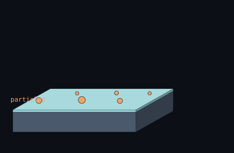
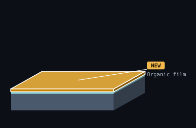
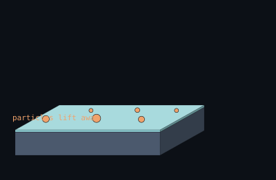
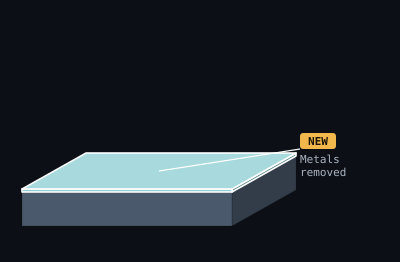
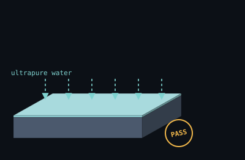

<!-- generated by scripts/build_manuals.py from data/manuals.json; edit there -->
# Manual 2 · Clean the wafer before every furnace

**Wafer cleaning, explained conceptually: count, remove films, oxide, particles and metals, rinse and count again.** A wafer that looks spotless still carries oily films, a thin skin of oxide, dust and single metal atoms. Any of them can ruin a transistor: a particle bridges two lines, a trace of iron kills the electrons that should carry current. Fabs clean before every hot step. The chemistry is institution-only, so this manual shows what each stage removes and why, never how to mix or handle anything.

The stages follow Kern’s cleaning sequence and his review of how it evolved[1](#sources),[2](#sources); particle sizes and killer defects follow Stapper[3](#sources); iron in silicon follows Istratov and co-workers[4](#sources). The cleaning theatre computes what is left after each stage.

[Open the web manual](https://normansrule.github.io/transistor-foundry-expedition/manuals/cleaning.html) (Save as PDF from there) · [All manuals](README.md)

> **Read this first.** This manual explains how a cleanroom does each step. It is not a procedure to try at home. Tier 2 and 3 steps use heat, vacuum and high-voltage equipment or hazardous chemicals that only trained staff may handle.

| You need | |
|---|---|
| Wafer arriving from the last step | ×1 · Any manual |
| Wet bench run by trained staff | ×1 |
| Laser particle scanner | ×1 |

## 1 · Count what is on the wafer

**Do.** Scan the wafer with a laser particle counter before it is cleaned. Every speck that scatters light is logged with its size and place.

- small particles far outnumber large ones[3](#sources)
- a map shows where they came from

**Check.** The count and the map go on the traveler.

Operation specification · Tier 0 · safe

| | |
|---|---|
| Tool | Laser particle scanner |
| Purpose | Know the starting contamination |
| Control | Particles per wafer above the inspection size |
| Out of control | Count far above normal: look for the tool that added them |

**Process engineer.** Particle sizes follow roughly an inverse cube law, so most of the count is small particles. What matters is how many are larger than the narrowest line, the killer size, because those can short or break a wire[3](#sources).

## 2 · Remove organic films

**Do.** The first bath turns oily films from resist, handling and the air into gas. They would otherwise shield everything underneath from the later stages.

- organics go first because they hide the rest
- institution-only chemistry

**Check.** The surface wets evenly: no beading.

Operation specification · Tier 3 · institution-only

| | |
|---|---|
| Tool | Wet bench with fume extraction |
| Purpose | Strip organic contamination |
| Control | Bath age and temperature, set by the lab |
| Out of control | Beading or stains: the wafer is re-cleaned |

**Process engineer.** A strongly oxidising treatment turns organic residues into gases and leaves a thin chemical oxide behind[2](#sources). Nothing about the mixture is published here: it is handled only by trained staff under the lab’s own rules.

## 3 · Dissolve the thin oxide

**Do.** A short dip dissolves the thin skin of oxide on top. Metals and particles trapped inside it come away with it, and bare silicon is left.

- frees what the oxide had trapped
- institution-only chemistry

**Check.** The surface sheds water: bare silicon is hydrophobic.

Operation specification · Tier 3 · institution-only

| | |
|---|---|
| Tool | Wet bench with fume extraction |
| Purpose | Remove native and chemical oxide |
| Control | Dip time and bath condition, set by the lab |
| Out of control | Water still sheets on the wafer: oxide left behind |

**Process engineer.** The etchant for this stage is among the most dangerous chemicals in a fab. It is institution-only, handled only under supervision, and this manual shows only its result: clean, bare silicon that must move on quickly before it reoxidises.

## 4 · Lift the particles off

**Do.** A gentle bath, often helped by sound waves, undercuts each grain by a whisker of material and charges grains and wafer alike so they push apart.

- each pass removes a fixed share of what is left
- institution-only chemistry

**Check.** A test wafer shows the particle count fell by the expected share.

Operation specification · Tier 3 · institution-only

| | |
|---|---|
| Tool | Wet bench, often with megasonic agitation |
| Purpose | Remove particles |
| Control | Removal efficiency on monitor wafers |
| Out of control | Particles return: the bath or rinse water is dirty |

**Process engineer.** If one pass removes a fraction η, the count after n passes is N₀(1 − η)ⁿ, so a second pass helps far less than the first. The cleaning theatre lets you try it.

## 5 · Pull out metal traces

**Do.** A last bath takes metal atoms such as iron off the surface before any furnace can drive them into the silicon.

- iron shortens the life of every electron
- institution-only chemistry

**Check.** Lifetime or surface-photovoltage maps on a monitor wafer stay clean.

Operation specification · Tier 3 · institution-only

| | |
|---|---|
| Tool | Wet bench with fume extraction |
| Purpose | Remove metal ions |
| Control | Metal levels on monitor wafers |
| Out of control | Short lifetimes on monitors: stop the furnace queue |

**Process engineer.** Interstitial iron is a recombination centre. The electron lifetime falls as τ = 1/(σₙ v_th N_Fe): at 10¹⁰ iron atoms per cm³ it is about 180 µs, at 10¹² about 1.8 µs[4](#sources),[5](#sources). Image sensors and solar cells notice first.

## 6 · Rinse, dry and count again

**Do.** Rinse in ultrapure water, spin dry, and scan the wafer again. Only a wafer that passes may go into a shared furnace.

- ultrapure water between and after every bath[2](#sources)
- a dirty wafer contaminates every lot after it

**Check.** Particle count below the lab’s limit, and the wafer goes straight to the furnace.

Operation specification · Tier 1 · care

| | |
|---|---|
| Tool | Spin rinser-dryer and laser particle scanner |
| Purpose | Leave a dry, clean, counted wafer |
| Control | Particle count; time from clean to furnace |
| Out of control | Too many particles: clean again before the furnace |

**Process engineer.** Killer particles become the defect density D₀ that the yield model turns into lost dies[3](#sources). Kern’s review traces how cleaning methods evolved as the particles that mattered grew smaller[2](#sources).

## Four kinds of dirt, four kinds of damage

Each stage targets one kind of contamination, and each kind breaks a chip in its own way.

- The sequence was developed at RCA Laboratories in 1965 and published in 1970[1](#sources),[2](#sources)
- With an inverse-cube size distribution, halving the killer size makes four times as many particles deadly[3](#sources)
- Iron in silicon is one of the most harmful metal contaminants for carrier lifetime[4](#sources)
- At 10¹² iron atoms per cm³ the electron lifetime drops to about 1.8 µs[4](#sources),[5](#sources)

> **Institution-only.** Every cleaning bath in this manual uses chemistry that is handled only inside a cleanroom, by trained people, with the lab’s own procedures and protective equipment. None of it is described here, and none of it should ever be tried elsewhere.

## What the models leave out

- No chemistry, concentrations, temperatures or times are given for any bath: they are institution-only.
- Particle removal is modelled as a fixed fraction per pass; real removal depends on particle size, material and how long it has been stuck.
- Only iron is followed as a metal; copper, nickel and others behave differently.
- Drying marks, surface roughening and re-deposition from the rinse are not drawn.

## Sources

1. [W. Kern, D. A. Puotinen, "Cleaning Solutions Based on Hydrogen Peroxide for Use in Silicon Semiconductor Technology," RCA Review 31, 187 (1970).]() `kern1970`
2. [W. Kern, "The Evolution of Silicon Wafer Cleaning Technology," J. Electrochem. Soc. 137, 1887 (1990).](https://doi.org/10.1149/1.2086825) `kern1990`
3. [C. H. Stapper, "Modeling of Integrated Circuit Defect Sensitivities," IBM J. Res. Dev. 27, 549 (1983).](https://doi.org/10.1147/rd.276.0549) `stapper1983`
4. [A. A. Istratov, H. Hieslmair, E. R. Weber, "Iron and its Complexes in Silicon," Appl. Phys. A 69, 13 (1999).](https://doi.org/10.1007/s003390050968) `istratov1999`
5. [D. Macdonald, A. Cuevas, J. Wong-Leung, "Capture Cross Sections of the Acceptor Level of Iron–Boron Pairs in p-Type Silicon by Injection-Level Dependent Lifetime Measurements," J. Appl. Phys. 89, 7932 (2001).](https://doi.org/10.1063/1.1372156) `macdonald2001`
