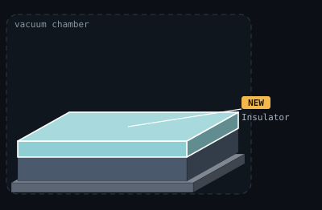
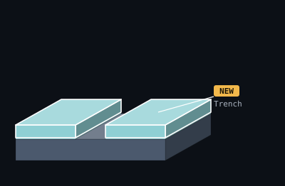
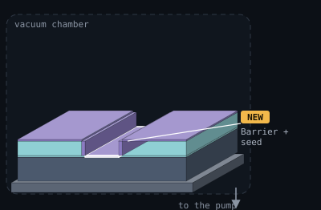
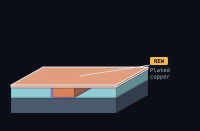
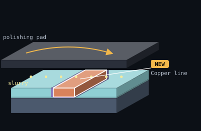
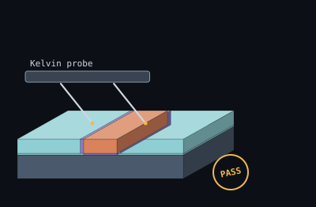

<!-- generated by scripts/build_manuals.py from data/manuals.json; edit there -->
# Manual 10 · Wire the chip in copper

**Dual damascene: insulator, trench, barrier, seed, plate, polish, measure.** Copper cannot be etched cleanly like aluminium, so it is wired the other way round. Grooves are cut into the insulator first, lined, filled with copper and polished flat, leaving copper only in the grooves, like an inlaid damascene sword. A modern chip repeats this for a dozen or more layers.

The wiring follows the dual-damascene scheme[1](#sources) and the first full copper process[2](#sources); line resistivity follows the size-effect models used by the Fab Journey’s copper theatre[3](#sources) with mean free paths from Gall[4](#sources); polishing follows the pattern-density model[5](#sources).

[Open the web manual](https://normansrule.github.io/transistor-foundry-expedition/manuals/damascene.html) (Save as PDF from there) · [All manuals](README.md)

> **Read this first.** This manual explains how a cleanroom does each step. It is not a procedure to try at home. Tier 2 and 3 steps use heat, vacuum and high-voltage equipment or hazardous chemicals that only trained staff may handle.

| You need | |
|---|---|
| Wafer with transistors and contacts | ×1 · Manual 8 · Planarization |
| Dielectric deposition, etch and lithography tools | ×1 |
| Barrier and seed chamber, plating cell (staff-run), polisher | ×1 |

## 1 · Lay down the insulator

**Do.** Deposit the insulating layer that the wires will sit in, often a low-k film that lowers the capacitance between neighbouring lines.

- a lower dielectric constant cuts the RC delay of every wire[6](#sources)

**Check.** Thickness and dielectric constant on monitors are on target.

Operation specification · Tier 2 · heat or equipment

| | |
|---|---|
| Tool | CVD or spin-on dielectric tool |
| Purpose | Make the layer the wires are inlaid into |
| Control | Thickness map; dielectric constant |
| Out of control | Dielectric constant high: the porous film was damaged; requalify |

**Process engineer.** Porous low-k films are fragile, and etching or stripping resist can raise their dielectric constant again, so the later steps are kept gentle[6](#sources).

## 2 · Pattern and etch the trenches and vias

**Do.** Print the via holes and the line trenches with lithography and etch both into the insulator, so one fill later makes the vias and the lines together.

- vias and lines filled in one step: dual damascene[1](#sources)

**Check.** Trench width and depth are on target.

Operation specification · Tier 2 · heat or equipment

| | |
|---|---|
| Tool | Scanner and plasma etcher |
| Purpose | Cut the shape of the wiring into the insulator |
| Control | Trench width (CD) and depth |
| Out of control | Trench too wide or too deep: rework before any metal goes in |

**Process engineer.** The ratio of depth to width, the aspect ratio, decides how hard the next steps are: the barrier and seed must reach the bottom corners, and the plating must fill without a seam[1](#sources).

## 3 · Line it with a barrier and a seed

**Do.** Coat every surface with a thin barrier that copper cannot cross, then a thin copper seed for the plating to grow from.

- copper must never touch silicon or oxide: the liner keeps it in[2](#sources)
- the barrier conducts poorly, so it is dead area in a narrow line[4](#sources)

**Check.** The barrier and seed are continuous down to the trench floor.

Operation specification · Tier 2 · heat or equipment

| | |
|---|---|
| Tool | PVD or ALD barrier and seed chamber |
| Purpose | Seal the copper in and give plating a start |
| Control | Sheet resistance of the seed; coverage on test trenches |
| Out of control | Gaps at the bottom corners: voids later in the plated line |

**Process engineer.** Copper diffuses quickly into silicon dioxide and silicon, where it ruins transistors, so the barrier wraps every line. The barrier must be thin, because in a 20 nm line every nanometre of it takes conductor away [@edelstein1997; @gall2016].

## 4 · Fill by electroplating

**Do.** Trained staff run the plating cell. Copper grows from the seed until every trench is full, and a little beyond.

- the plating bath is institution-only
- additives make the trench fill from the bottom up

**Check.** Every trench is filled with no seam; the overburden covers the wafer.

Operation specification · Tier 3 · institution-only

| | |
|---|---|
| Tool | Electroplating cell, staff only |
| Purpose | Fill the trenches with copper |
| Control | Set by the lab |
| Out of control | Seam or void in the fill: the lab adjusts the bath |

**Process engineer.** Additives in the bath slow growth at the trench mouth and speed it at the floor, so the trench fills from the bottom up without a seam[2](#sources). The bath chemistry is process know-how and stays with the lab; nothing about it is given here.

## 5 · Polish back to the insulator

**Do.** Polish away the copper and barrier on top until only the copper in the trenches remains.

- removal rate rises with pressure and speed: Preston’s law[7](#sources)
- wide lines dish and dense arrays erode[5](#sources)

**Check.** The field is clear of metal and no lines are shorted.

Operation specification · Tier 2 · heat or equipment

| | |
|---|---|
| Tool | Chemical-mechanical polisher |
| Purpose | Leave copper only where the wiring belongs |
| Control | Endpoint from friction or reflected light; dishing and erosion on test structures |
| Out of control | Residual copper between lines: polish more; dished lines: tune the pad and slurry |

**Process engineer.** Copper is softer than the insulator, so wide lines are polished below the surface (dishing) and dense regions lose insulator too (erosion). Both thin the line and raise its resistance[5](#sources).

## 6 · Measure the wires

**Do.** Probe test structures: long serpentines for resistance, interleaved combs for shorts.

- a 10 nm copper line conducts about three times worse than bulk would suggest: surfaces and grain boundaries scatter electrons[3](#sources)

**Check.** Line resistance and comb leakage within limits.

Operation specification · Tier 1 · care

| | |
|---|---|
| Tool | Parametric tester |
| Purpose | Confirm the wiring conducts and is isolated |
| Control | Resistance per micrometre; comb leakage |
| Out of control | Resistance high: thin line, dishing or voids; leakage: copper residue |

**Process engineer.** Narrow lines scatter electrons at their surfaces and grain boundaries, so resistivity rises well above the bulk value just as the cross-section shrinks. That is why ruthenium and other metals with short mean free paths are being considered for the tightest layers[4](#sources).

## From aluminium to copper

Copper conducts better and resists electromigration, but it needed a whole new way of patterning.

- Bulk copper resistivity is about 1.7 µΩ·cm, aluminium about 2.65[4](#sources)
- Dual damascene fills vias and lines in one step[1](#sources)
- IBM announced full copper wiring in production CMOS in 1997[2](#sources)
- Thin films conduct worse because electrons scatter at grain boundaries and surfaces[3](#sources)

> **Institution-only.** Plating baths, the acids around them and polishing slurries are handled only by trained staff, and copper must be kept out of every tool that touches bare silicon.

## What the models leave out

- The cross-section shows one trench; dual damascene cuts a via and a line in one opening.
- Resistivity follows the site’s size-effect model; real lines also depend on grain size after the anneal and on the barrier material.
- No plating chemistry, current or polishing slurry is given: those are institution-only.
- Electromigration and stress voiding are covered by the electromigration simulator, not this manual.

## Sources

1. [C. W. Kaanta et al., "Dual Damascene: A ULSI Wiring Technology," Proc. 8th IEEE VLSI Multilevel Interconnection Conf. (VMIC), 144 (1991).]() `kaanta1991`
2. [D. Edelstein et al., "Full Copper Wiring in a Sub-0.25 µm CMOS ULSI Technology," IEDM Tech. Dig., 773 (1997).]() `edelstein1997`
3. [A. F. Mayadas, M. Shatzkes, "Electrical-Resistivity Model for Polycrystalline Films: the Case of Arbitrary Reflection at External Surfaces," Phys. Rev. B 1, 1382 (1970).](https://doi.org/10.1103/PhysRevB.1.1382) `mayadas1970`
4. [D. Gall, "Electron Mean Free Path in Elemental Metals," J. Appl. Phys. 119, 085101 (2016).](https://doi.org/10.1063/1.4942216) `gall2016`
5. [B. E. Stine, D. O. Ouma, R. R. Divecha, D. S. Boning, J. E. Chung et al., "Rapid Characterization and Modeling of Pattern-Dependent Variation in Chemical-Mechanical Polishing," IEEE Trans. Semicond. Manuf. 11(1), 129 (1998).]() `stine1998`
6. [J. D. Plummer, M. D. Deal, P. B. Griffin, Silicon VLSI Technology: Fundamentals, Practice and Modeling, Prentice Hall (2000).]() `plummer2000`
7. [F. W. Preston, "The Theory and Design of Plate Glass Polishing Machines," J. Soc. Glass Technol. 11, 214 (1927).]() `preston1927`
