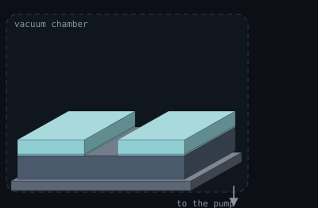
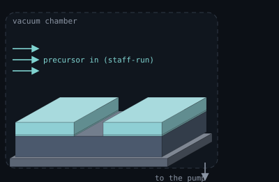
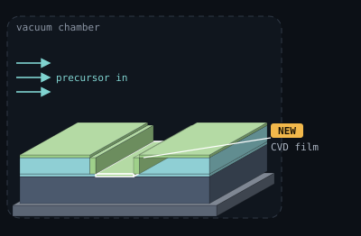
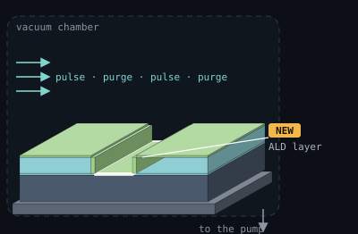
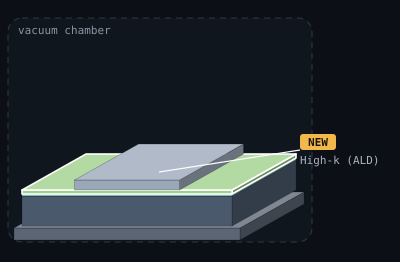
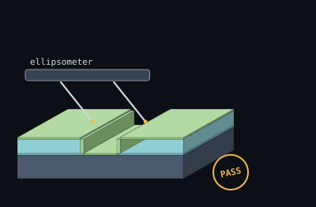

<!-- generated by scripts/build_manuals.py from data/manuals.json; edit there -->
# Manual 7B · Coat every surface evenly

**Thin-film deposition: chemical vapour deposition (CVD) and atomic layer deposition (ALD).** Not every film can be grown from the silicon itself. Chemical vapour deposition (CVD) lets gas molecules react on the hot wafer and leave a solid film behind. Atomic layer deposition (ALD) does the same one molecular layer at a time, so the film covers the floor and walls of a deep trench almost as thickly as the top. The precursor gases are institution-only, so those parts stay conceptual.

Step coverage follows the trench model in the Fab Journey’s deposition theatre, built on the CVD treatment in Plummer, Deal and Griffin[1](#sources); ALD growth per cycle and self-limiting chemistry follow George’s review[2](#sources); the high-k gate dielectric follows Intel’s 45 nm process[3](#sources).

[Open the web manual](https://normansrule.github.io/transistor-foundry-expedition/manuals/deposition.html) (Save as PDF from there) · [All manuals](README.md)

> **Read this first.** This manual explains how a cleanroom does each step. It is not a procedure to try at home. Tier 2 and 3 steps use heat, vacuum and high-voltage equipment or hazardous chemicals that only trained staff may handle.

| You need | |
|---|---|
| Wafer with etched trenches | ×1 · Manual 5 · Etch |
| CVD or ALD chamber (staff-run gas supply) | ×1 |
| Ellipsometer; cross-section microscope for coverage | ×1 |

## 1 · Load and pump down

**Do.** Place the wafer in the chamber through a load lock and pump it down to low pressure, then bring it to the deposition temperature.

- cluster tools pass wafers between chambers without air[1](#sources)

**Check.** Base pressure and wafer temperature are at the recipe values.

Operation specification · Tier 2 · heat or equipment

| | |
|---|---|
| Tool | CVD or ALD chamber with load lock |
| Purpose | Start from a clean, heated, evacuated wafer |
| Control | Base pressure, leak-up rate, wafer temperature |
| Out of control | Leak-up too fast: the chamber is checked before any wafer runs |

**Process engineer.** At low pressure molecules travel in straight lines between wall hits rather than colliding with each other. That is what lets them reach the bottom of a trench, and it is the regime the deposition theatre assumes[1](#sources).

## 2 · Let in the precursors

**Do.** Trained staff run the gas cabinet. The tool meters a precursor vapour into the chamber, where it meets the hot wafer.

- precursor gases are institution-only
- the tool, not the user, handles every gas line

**Check.** Flows are steady at the recipe values set by the lab.

Operation specification · Tier 3 · institution-only

| | |
|---|---|
| Tool | Gas cabinet and mass-flow controllers, staff only |
| Purpose | Bring the reacting molecules to the wafer |
| Control | Set by the lab |
| Out of control | Flow alarm: the tool stops and staff check the line |

**Process engineer.** Many CVD and ALD precursors are toxic, flammable or ignite in air, so they are stored in ventilated cabinets with leak detection and handled only by trained staff[1](#sources). Nothing about their chemistry or settings is given here.

## 3 · Grow the film by CVD

**Do.** Let the precursor react on the hot surfaces. The film grows on the top, the walls and the floor of every trench at once, fastest where the gas arrives first.

- a molecule that reacts on its first hit coats only the mouth[1](#sources)
- a low sticking probability lets molecules bounce down to the floor[1](#sources)

**Check.** Thickness on a monitor wafer matches the target.

Operation specification · Tier 2 · heat or equipment

| | |
|---|---|
| Tool | CVD chamber (low-pressure or plasma-enhanced) |
| Purpose | Cover the wafer with an insulator or liner |
| Control | Deposition time against rate on monitors; temperature and pressure |
| Out of control | Floor too thin: lower the sticking probability or use ALD |

**Process engineer.** Inside a trench of width w, the gas concentration n falls with depth because every wall hit can consume it. The balance n″ = (3s/2w²)·n makes the film thin out over a depth of about w/√s, where s is the sticking probability. The Fab Journey’s deposition theatre solves that balance as the trench narrows.

## 4 · Grow it one layer at a time (ALD)

**Do.** Pulse the first precursor until it has covered every surface, purge, pulse the second to react with that layer, purge again. Each cycle adds one thin layer everywhere, top to floor.

- each half-reaction stops by itself once the surface is covered[2](#sources)
- aluminium oxide grows about 0.1 nm per cycle[2](#sources)

**Check.** Growth per cycle on a monitor wafer is at its expected value.

Operation specification · Tier 2 · heat or equipment

| | |
|---|---|
| Tool | ALD chamber |
| Purpose | Make a film of exact thickness that follows every surface |
| Growth per cycle, aluminium oxide | ≈ 0.1 nm[2](#sources) |
| Control | Cycle count; pulse and purge times long enough to saturate |
| Out of control | Growth per cycle too high: purges too short, so the gases met and did CVD |

**Process engineer.** Because each half-cycle saturates, ALD does not depend on how much gas reaches each spot, only on whether enough does. That self-limiting step makes it conformal in deep trenches and precise to a fraction of a nanometre, at the price of being slow[2](#sources).

## 5 · Build a high-k gate dielectric

**Do.** On a gate stack, use ALD to lay down a hafnium-based insulator a few nanometres thick, then cap it with the gate metal.

- high-k metal gates entered volume production at 45 nm in 2007[3](#sources)
- high-k gate dielectrics were the first big ALD product[2](#sources)

**Check.** Thickness and capacitance on monitors are on target.

Operation specification · Tier 2 · heat or equipment

| | |
|---|---|
| Tool | ALD chamber in a gate-stack cluster |
| Purpose | Thin the equivalent oxide without the leakage |
| First volume high-k metal gate node | 45 nm (2007)[3](#sources) |
| Control | Physical thickness, capacitance-equivalent thickness, leakage |
| Out of control | Leakage high: the film is too thin or has pinholes |

**Process engineer.** A hafnium-based insulator has a much higher dielectric constant than silicon dioxide, so it can be physically thicker for the same capacitance, which cuts tunnelling leakage[3](#sources). Only ALD could make it thin and even enough[2](#sources).

## 6 · Measure thickness and coverage

**Do.** Measure the blanket thickness by ellipsometry, then cut a test trench and compare the film on the floor and walls with the top.

- step coverage = thinnest wall or floor ÷ top thickness[1](#sources)

**Check.** Step coverage meets the spec for this layer.

Operation specification · Tier 1 · care

| | |
|---|---|
| Tool | Ellipsometer; cross-section electron microscope |
| Purpose | Confirm the film is thick enough everywhere |
| Control | Blanket thickness map; step coverage on test trenches |
| Out of control | Keyhole void or thin floor: change method, taper the trench or etch back and redeposit |

**Process engineer.** If the mouth closes before the floor fills, a void is sealed inside: a keyhole. Voids raise resistance and fail early. Low-sticking CVD and ALD fill from the walls inward and stay seamless[1](#sources).

## From sputtering to CVD to ALD

Each step down in trench width needed a method whose molecules reach further before they stick.

- Atomic layer epitaxy began in the 1970s for thin-film displays[2](#sources)
- ALD aluminium oxide grows about 0.1 nm per cycle[2](#sources)
- Hafnium-based high-k gate dielectrics entered volume CMOS at 45 nm in 2007[3](#sources)
- A low sticking probability gives better step coverage in CVD[1](#sources)

> **Institution-only.** CVD and ALD precursors are toxic, flammable or ignite in air, and the tools run hot and under vacuum. Only trained staff handle the gases.

## What the models leave out

- Sticking probability is one number per process; real precursors change it with temperature and surface.
- The trench model works in molecular flow, ignoring gas-phase reactions and the boundary layer above the wafer.
- No precursor, temperature or flow is given: those are institution-only.
- Film stress, density, impurities and the interface layer under a high-k film are described, not modelled.

## Sources

1. [J. D. Plummer, M. D. Deal, P. B. Griffin, Silicon VLSI Technology: Fundamentals, Practice and Modeling, Prentice Hall (2000).]() `plummer2000`
2. [S. M. George, "Atomic Layer Deposition: An Overview," Chem. Rev. 110, 111 (2010).](https://doi.org/10.1021/cr900056b) `george2010`
3. [K. Mistry et al., "A 45nm Logic Technology with High-k+Metal Gate Transistors, Strained Silicon, 9 Cu Interconnect Layers, 193nm Dry Patterning, and 100% Pb-free Packaging," IEDM (2007).](https://doi.org/10.1109/IEDM.2007.4418914) `mistry2007`
