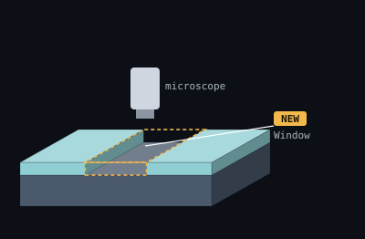
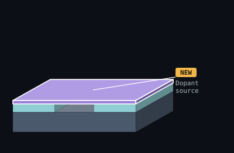
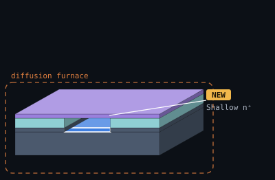
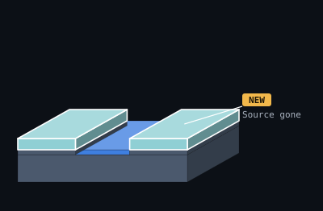
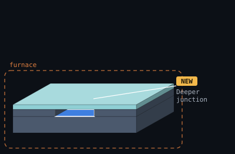
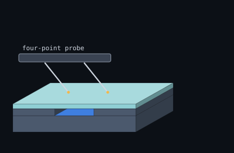

<!-- generated by scripts/build_manuals.py from data/manuals.json; edit there -->
# Manual 6A · Bake the dopant into the silicon

**Furnace diffusion: open windows, predeposit, remove the source, drive in, measure.** Before ion implanters, every junction was made in a furnace, and teaching cleanrooms still make them that way. A dopant-rich source sits on bare silicon, atoms soak in from the surface, the source is removed and a second bake drives them deeper. Oxide decides where the dopant can go. The dopant sources are institution-only, so those stages stay conceptual.

Profiles follow the textbook predeposition and drive-in solutions[1](#sources) with intrinsic diffusivities[2](#sources); oxide masking follows Frosch and Derick[3](#sources); run values come from a four-mask NMOS run in a university teaching cleanroom[4](#sources),[5](#sources).

[Open the web manual](https://normansrule.github.io/transistor-foundry-expedition/manuals/diffusion.html) (Save as PDF from there) · [All manuals](README.md)

> **Read this first.** This manual explains how a cleanroom does each step. It is not a procedure to try at home. Tier 2 and 3 steps use heat, vacuum and high-voltage equipment or hazardous chemicals that only trained staff may handle.

| You need | |
|---|---|
| Wafer with windows opened in the oxide | ×1 · Manual 5 · Etch |
| Diffusion furnace (staff-run) | ×1 |
| Four-point probe | ×1 |

## 1 · Check the windows are open

**Do.** Look at the wafer under the microscope. Where the oxide has been etched away, bare silicon shows; everywhere else oxide will block the dopant.

- oxide masks dopant diffusion[3](#sources)
- in MOS the gate masks the channel

**Check.** Windows are clean and fully open; no oxide film left in them.

Operation specification · Tier 1 · care

| | |
|---|---|
| Tool | Inspection microscope |
| Purpose | Confirm the openings |
| Control | Window size and cleanliness |
| Out of control | Film left in the window: the junction comes out uneven |

**Process engineer.** Dopants diffuse far more slowly in silicon dioxide than in silicon, so an oxide layer masks the silicon beneath it[3](#sources). Hoerni’s planar process made every junction this way, through windows in the oxide[6](#sources).

## 2 · Coat the dopant source

**Do.** A thin film rich in dopant is put on the wafer by trained staff. It touches the silicon only where the windows are open.

- the source keeps the surface concentration fixed
- dopant sources are institution-only

**Check.** The film covers the wafer evenly.

Operation specification · Tier 3 · institution-only

| | |
|---|---|
| Tool | Coater or source boat, staff only |
| Purpose | Supply dopant at the surface |
| Control | Set by the lab |
| Out of control | Uneven film: the lab strips and recoats |

**Process engineer.** The source can be a spun-on film, a solid source wafer or a dopant gas; all hold the silicon surface at a high, fixed concentration while the furnace runs[1](#sources). Every source chemistry is institution-only, and some are highly toxic.

## 3 · Predeposit in the furnace

**Do.** In the hot furnace dopant atoms hop from the film into the open silicon. The silicon near the surface fills up first.

- the surface stays pinned at the source’s concentration
- the dose grows only as the square root of time

**Check.** A control wafer travels with the batch.

Operation specification · Tier 3 · institution-only

| | |
|---|---|
| Tool | Horizontal tube furnace with the source, staff only |
| Purpose | Set the dopant dose |
| Control | Set by the lab; control wafer measured afterwards |
| Out of control | Control wafer out of range: the lab decides on a rerun |

**Process engineer.** With the surface pinned at Cs the profile is a complementary error function, and the dose grows as √t: double the time and only 41 % more dopant goes in[1](#sources). The furnace step with a dopant source is institution-only.

## 4 · Remove the source

**Do.** The spent film is removed, so the amount of dopant in the silicon is now fixed.

- from here the dose cannot change
- institution-only chemistry

**Check.** The control wafer’s sheet resistance confirms dopant went in.

Operation specification · Tier 3 · institution-only

| | |
|---|---|
| Tool | Wet bench, staff only |
| Purpose | Fix the dose |
| Control | Set by the lab |
| Out of control | Residue left: re-clean before the drive-in |

**Process engineer.** Removing the film is a wet chemical step and stays institution-only[1](#sources). Teaching labs keep a second control wafer so a weak predeposition can be repeated.

## 5 · Drive in and grow oxide

**Do.** A second, longer bake without any source spreads the same dopant deeper. The same bake grows an oxide over everything.

- teaching run: 1050 °C for 37 minutes[4](#sources)
- teaching run: 62.9 nm of oxide on the control[4](#sources)
- junction creeps sideways about 80 % of its depth[1](#sources)

**Check.** Oxide on the bare control wafer has the target thickness.

Operation specification · Tier 2 · heat or equipment

| | |
|---|---|
| Tool | Horizontal tube furnace |
| Purpose | Push the junction deeper and insulate the top |
| Temperature | 1050 °C[4](#sources) |
| Time | 37 min[4](#sources) |
| Oxide on bare control | 62.9 nm[4](#sources) |
| Control | Furnace profile; control-wafer oxide |
| Out of control | Oxide off target: check the furnace profile and the clean before it |

**Process engineer.** With a fixed dose the profile relaxes into a half-Gaussian, and Dt adds up over both bakes[1](#sources). The Virtual Fab follows this run’s drive-in and puts its computed oxide, 62.0 nm, beside the measured 62.9 nm.

## 6 · Measure the sheet resistance

**Do.** Touch four needles in a line to a diffused test resistor or the control wafer. Push current through the outer two and read the voltage across the inner two.

- teaching run: 57.1 Ω across a 201 µm × 11 µm resistor[5](#sources)
- that is about 3.1 Ω per square[5](#sources)

**Check.** The sheet resistance is in the expected range.

Operation specification · Tier 1 · care

| | |
|---|---|
| Tool | Four-point probe |
| Purpose | Check the doped layer conducts as designed |
| Resistor | 57.1 Ω, L 201 µm, W 11 µm[5](#sources) |
| Sheet resistance | ≈ 3.1 Ω/sq[5](#sources) |
| Control | Sheet resistance on control wafers and test resistors |
| Out of control | Too high: too little dose or too shallow; check the predeposition |

**Process engineer.** R_s = R·W/L. The four-point probe needs no correction for contact resistance because the voltage pins carry no current[1](#sources). The site’s intrinsic-diffusivity model gives about ten times this value: heavy phosphorus diffuses faster than the intrinsic rate[2](#sources).

## Furnace diffusion versus ion implantation

Both put dopant into the silicon. A furnace soaks it in from the surface; an implanter fires a counted dose to a chosen depth.

- Oxide masks dopant diffusion, the discovery that made planar windows possible[3](#sources)
- Hoerni’s planar process formed junctions by diffusion through oxide windows[6](#sources)
- Ion implantation took over most doping steps from the 1970s[1](#sources)
- Teaching run: a diffused resistor measured about 3.1 Ω per square[5](#sources)

> **Institution-only.** Dopant sources, whether spun-on films, solid sources or gases, are institution-only. So is stripping the source. This manual gives only what each stage does and what was measured afterwards.

## What the models leave out

- Diffusivity is the intrinsic value; heavy doping, oxidation and point defects speed real diffusion up, so real junctions are deeper.
- The predeposition time and surface concentration of the teaching run were not recorded.
- Dopant segregation into the growing oxide is ignored.
- No source chemistry or furnace procedure is given: those stages are institution-only.

## Sources

1. [J. D. Plummer, M. D. Deal, P. B. Griffin, Silicon VLSI Technology: Fundamentals, Practice and Modeling, Prentice Hall (2000).]() `plummer2000`
2. [University of Illinois Holonyak Micro & Nanotechnology Lab, "Silicon Diffusivity Data" (D₀ and Eₐ/k for B, P, As, Sb in Si).](https://fabweb.ece.illinois.edu/gt/gt/gt10.aspx) `uiuc_diffusivity`
3. [C. J. Frosch, L. Derick, "Surface Protection and Selective Masking during Diffusion in Silicon," J. Electrochem. Soc. 104, 547 (1957).](https://doi.org/10.1149/1.2428650) `frosch1957`
4. [R. Loberg and A. Norman, "Four-mask NMOS fabrication run: process record and in-line measurements," university teaching cleanroom (2024), unpublished; measured data shared by the authors.]() `cleanroom_run_fab2024`
5. [R. Loberg and A. Norman, "Four-mask NMOS fabrication run: electrical characterization," university teaching cleanroom (2024), unpublished; measured data shared by the authors.]() `cleanroom_run_char2024`
6. [J. A. Hoerni, "Method of Manufacturing Semiconductor Devices," U.S. Patent 3,025,589 (1962; filed 1959).](https://patents.google.com/patent/US3025589A) `hoerni1962`
