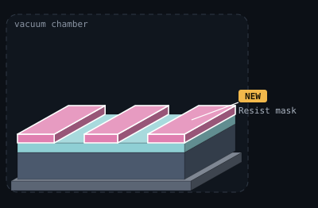
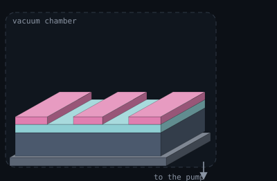
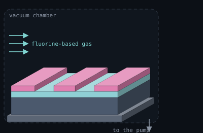
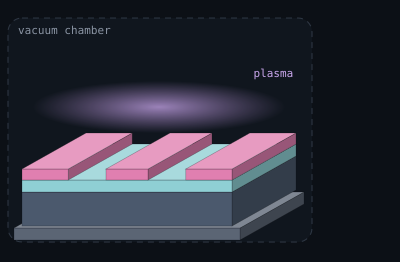
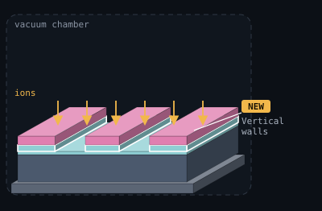
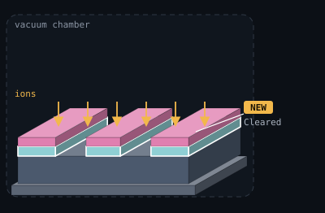
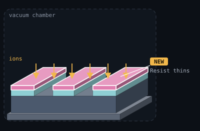
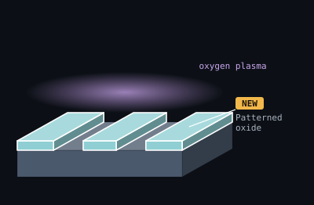
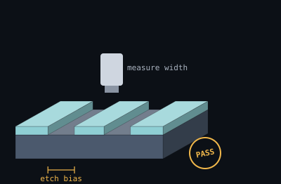

<!-- generated by scripts/build_manuals.py from data/manuals.json; edit there -->
# Manual 5 · Carve the pattern into the film

**Plasma (reactive ion) etch: load, pump down, flow gas, strike plasma, etch, endpoint, over-etch, strip, measure.** Lithography only draws the pattern in resist. Etching copies it into the film underneath: oxide, polysilicon, nitride or metal. A wet etch dissolves the film in liquid and eats sideways as fast as down. A plasma etch fires ions straight down, so the walls stay vertical and small features survive.

Tool facts come from public university cleanroom pages[1](#sources),[2](#sources). The wet-versus-dry comparison uses measured widths from a four-mask NMOS run in a university teaching cleanroom[3](#sources).

[Open the web manual](https://normansrule.github.io/transistor-foundry-expedition/manuals/etch.html) (Save as PDF from there) · [All manuals](README.md)

> **Read this first.** This manual explains how a cleanroom does each step. It is not a procedure to try at home. Tier 2 and 3 steps use heat, vacuum and high-voltage equipment or hazardous chemicals that only trained staff may handle.

| You need | |
|---|---|
| Wafer with patterned, hard-baked resist | ×1 · Manual 4A · Lithography |
| The film to etch (here oxide) | ×1 |
| Reactive ion etcher time | ×1 |

## 1 · Load the patterned wafer

**Do.** Place the wafer on the lower electrode of the etcher. The hard-baked resist covers everything that must stay.

- parallel-plate RIE, 13.56 MHz[1](#sources)

**Check.** Resist edges are sharp and the openings are clean.

Operation specification · Tier 0 · safe

| | |
|---|---|
| Tool | Reactive ion etcher, load lock or open chamber |
| Purpose | Bring the patterned wafer to the electrode |
| Control | Wafer seated flat; correct recipe selected |
| Out of control | Wafer chipped or off-centre: unload and inspect |

**Process engineer.** In a parallel-plate reactive ion etcher the wafer sits on the powered electrode. The BYU tool is an Anelva DEM-451 with a 14-inch cathode[1](#sources).

## 2 · Pump down

**Do.** Close the chamber and pump the air out until the pressure is very low.

- pump to 20 mTorr or less first[1](#sources)
- ultimate pressure mid 10⁻⁷ Torr on a turbo-pumped tool[2](#sources)

**Check.** The gauge reads the base pressure before any gas flows.

Operation specification · Tier 2 · heat or equipment

| | |
|---|---|
| Tool | Vacuum pumps and capacitance gauge |
| Purpose | Remove air and water before the process gas |
| Base pressure before etch | ≤ 20 mTorr[1](#sources) |
| Control | Base pressure and leak-up rate |
| Out of control | Will not pump down: check the door seal, then call staff |

**Process engineer.** Air and water vapour would react in the plasma and change the etch. Pumping first also makes the gas mixture repeatable from run to run. The tool’s guide warns never to switch on the RF power while the chamber is at high pressure[1](#sources).

## 3 · Flow the process gas

**Do.** Let a measured flow of etch gas into the chamber. Fluorine-based gases etch silicon, oxide and nitride.

- CF₄ with O₂ for Si, Si₃N₄ and SiO₂[1](#sources)
- gas supply is institution-only

**Check.** Flows and pressure settle at the recipe values.

Operation specification · Tier 3 · institution-only

| | |
|---|---|
| Tool | Mass-flow controllers, gas cabinet |
| Purpose | Supply the reactive species |
| Control | Flow readings and chamber pressure |
| Out of control | Flow will not stabilise: abort the run and call staff |

**Process engineer.** The gas is chosen for the film: fluorine chemistries for silicon and its oxide and nitride[1](#sources), chlorine for aluminium and compound semiconductors[2](#sources). Gas cylinders, cabinets and exhaust scrubbing are run by trained staff, so this manual names the gases but gives no handling procedure.

## 4 · Strike the plasma

**Do.** Switch on the radio-frequency power. The gas glows: it has become a plasma of ions and reactive fragments.

- 13.56 MHz at a few hundred watts[4](#sources)
- pressure rises 20–40 mTorr when RF turns on[1](#sources)
- reflected power 1–10 W[1](#sources)

**Check.** A steady glow, and reflected power stays small.

Operation specification · Tier 2 · heat or equipment

| | |
|---|---|
| Tool | RF generator and matching network |
| Purpose | Make ions and radicals |
| RF frequency | 13.56 MHz[1](#sources),[4](#sources) |
| Operating pressure | a few mTorr to a few hundred mTorr[4](#sources) |
| Reflected power | 1–10 W[1](#sources) |
| Control | Forward and reflected power; glow colour |
| Out of control | Reflected power high: retune the match or stop |

**Process engineer.** Electrons pick up energy from the RF field and break gas molecules into ions and radicals. Light electrons charge the wafer electrode negative, a DC self-bias of typically a few hundred volts[4](#sources). The RF supply is high voltage, so the chamber is interlocked.

## 5 · Etch straight down

**Do.** Ions accelerate across the sheath and strike the wafer head-on. Where the resist is open the film is etched downward, and the walls stay vertical.

- anisotropic unless run in a high-pressure, purely chemical mode[1](#sources)
- example: GaAs at 2 mTorr Cl₂, 350 V bias, about 200 nm/min[2](#sources)

**Check.** The film thins only in the openings.

Operation specification · Tier 2 · heat or equipment

| | |
|---|---|
| Tool | Reactive ion etcher |
| Purpose | Transfer the pattern into the film |
| Example rate (GaAs, Cl₂) | ≈ 200 nm/min at 2 mTorr, 350 V[2](#sources) |
| Control | Etch time against the measured rate on a monitor |
| Out of control | Sloped walls: lower the pressure so ions dominate |

**Process engineer.** Ion bombardment speeds the chemical reaction only on surfaces the ions hit, the floor of each opening, so the etch is anisotropic[4](#sources). Narrow openings etch more slowly than wide ones, because fewer reactive molecules find their way down a deep, narrow hole[5](#sources). The Fab Journey’s etch theatre simulates this lag.

## 6 · Stop at the layer below

**Do.** Watch for the moment the film clears and the layer underneath shows. That is the endpoint.

- selectivity: film rate ÷ stop-layer rate
- CF₄/O₂ rate falls from Si to Si₃N₄ to SiO₂[1](#sources)

**Check.** Every opening is clear down to the silicon.

Operation specification · Tier 2 · heat or equipment

| | |
|---|---|
| Tool | Reactive ion etcher with endpoint detection |
| Purpose | Stop on the underlying layer |
| Control | Endpoint signal or timed etch from monitor wafers |
| Out of control | Etched into the silicon: lower power, or choose a more selective chemistry |

**Process engineer.** Selectivity is the ratio of etch rates of the film and the layer that must survive. In a plain CF₄/O₂ plasma silicon etches faster than nitride, and nitride faster than oxide[1](#sources), so when oxide is etched down to silicon the silicon is the faster one: keep the over-etch short. Production oxide etches use other fluorocarbon chemistries to protect the silicon.

## 7 · Over-etch a little

**Do.** Keep etching for a short extra time so thin spots and slow, narrow openings clear too.

- strong loading effect: more open area etches slower[1](#sources)

**Check.** No film is left in any opening, even small ones.

Operation specification · Tier 2 · heat or equipment

| | |
|---|---|
| Tool | Reactive ion etcher |
| Purpose | Clear the slowest openings |
| Control | Over-etch as a percentage of the main etch |
| Out of control | Resist eroded through: thicker resist or a hard mask |

**Process engineer.** The etch rate depends on how much of the wafer is open, the loading effect[1](#sources), and on how narrow each opening is[5](#sources). Over-etch covers both. It also erodes the resist, which is why deep etches use a hard mask of oxide or nitride instead.

## 8 · Strip the resist

**Do.** Burn the leftover resist off in an oxygen plasma, then clean the wafer.

- oxygen plasma ashing[6](#sources)

**Check.** No resist residue under the microscope.

Operation specification · Tier 2 · heat or equipment

| | |
|---|---|
| Tool | Plasma asher |
| Purpose | Remove the resist mask |
| Control | Visual and microscope check |
| Out of control | Residue left: ash again |

**Process engineer.** An oxygen plasma turns the organic resist into carbon dioxide and water vapour[6](#sources). Wet strippers are also used, but they are institution-only chemistry.

## 9 · Measure the result

**Do.** Measure the etched lines and compare them with the drawn widths and with the resist before etch.

- teaching run, wet oxide etch: openings grew 2.48 µm on average[3](#sources)

**Check.** Etch bias (etched width minus resist width) is inside its limit.

Operation specification · Tier 0 · safe

| | |
|---|---|
| Tool | Optical microscope, CD-SEM, profilometer |
| Purpose | Accept, rework or scrap |
| Wet-etch bias, teaching run (ACTV) | +2.48 µm mean[3](#sources) |
| Control | Line width, etch depth, profile |
| Out of control | Bias too large: shorten the etch or switch from wet to dry |

**Process engineer.** A wet etch undercuts the resist by about the film thickness on each side, plus any over-etch. In the teaching run the openings in the field oxide came out 2.48 µm wider on average than the resist openings[3](#sources). A plasma etch keeps that bias near zero, which is what makes nanometre features possible.

## Wet etch versus plasma etch

Both remove film through the resist openings. The difference is direction: a liquid etches in every direction, a plasma etches mostly down.

- Wet chemical etching gives typically isotropic profiles; RIE gives very anisotropic ones[4](#sources)
- Teaching run: wet-etched oxide openings came out 2.48 µm wider than the resist on average[3](#sources)
- Teaching run: polysilicon gates came out 1.34 µm narrower after their wet etch[3](#sources)
- Inductively coupled plasma (ICP) sources reach very high plasma densities; a separate RF bias on the wafer then sets the ion energy[4](#sources)
- Deep reactive ion etching (the Bosch process) alternates etch and passivation to cut deep vertical trenches[4](#sources)
- Narrow openings etch slower than wide ones (aspect-ratio-dependent etching)[5](#sources)

> **Institution-only.** Wet etchants for oxide (hydrofluoric acid and buffered oxide etch) and for polysilicon are among the most dangerous chemicals in a cleanroom. They are named here only to explain the comparison. No concentrations or procedures are given.

**Which etch for which job**

|  | Wet etch | Plasma (RIE) |
|---|---|---|
| Direction | every direction (isotropic)[4](#sources) | mostly down (anisotropic)[4](#sources) |
| Width change | +2.48 µm on oxide openings in a teaching run[3](#sources) | close to zero |
| Where used | teaching labs, cleans, release etches | every critical layer in modern chips |

## What the models leave out

- Etch rates depend on the exact tool, gas mix, power and loading; the numbers here are examples from public tool pages, not a qualified recipe.
- Polymer build-up on sidewalls, plasma damage and charging are not drawn.
- Atomic layer etching and high-aspect-ratio memory etches are only mentioned.
- Gas handling and wet chemistry are named but never given as procedures.

## Sources

1. [BYU Integrated Microfabrication Lab, "RIE" (Anelva DEM-451 parallel-plate 13.56 MHz reactive ion etcher: CF₄/O₂ for Si, Si₃N₄ and SiO₂; pump to 20 mTorr or less; pressure rises 20–40 mTorr when RF is on).](https://www.cleanroom.byu.edu/rie) `byu_rie`
2. [UCSB Nanofabrication Facility wiki, "RIE 1 (Custom)" (chlorine reactive ion etcher at 13.56 MHz; GaAs at 2 mTorr Cl₂, 350 V bias, about 200 nm/min).](https://wiki.nanofab.ucsb.edu/wiki/RIE_1) `ucsb_rie1`
3. [R. Loberg and A. Norman, "Four-mask NMOS fabrication run: process record and in-line measurements," university teaching cleanroom (2024), unpublished; measured data shared by the authors.]() `cleanroom_run_fab2024`
4. [Wikipedia, "Reactive-ion etching" (pressure a few mTorr to a few hundred mTorr; 13.56 MHz at a few hundred watts; DC self-bias of a few hundred volts; ICP sources; deep RIE).](https://en.wikipedia.org/wiki/Reactive-ion_etching) `wiki_rie`
5. [J. W. Coburn, H. F. Winters, "Conductance Considerations in the Reactive Ion Etching of High Aspect Ratio Features," Appl. Phys. Lett. 55, 2730 (1989).](https://doi.org/10.1063/1.101937) `coburn1989`
6. [J. D. Plummer, M. D. Deal, P. B. Griffin, Silicon VLSI Technology: Fundamentals, Practice and Modeling, Prentice Hall (2000).]() `plummer2000`
