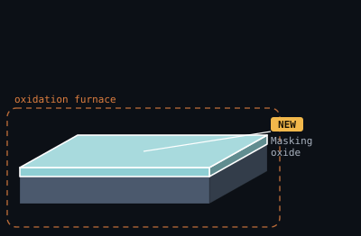
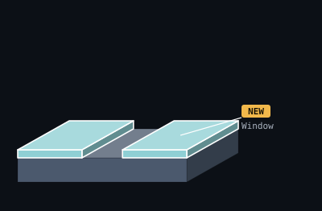
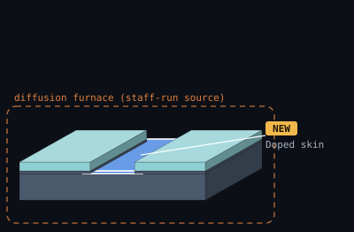
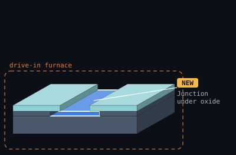
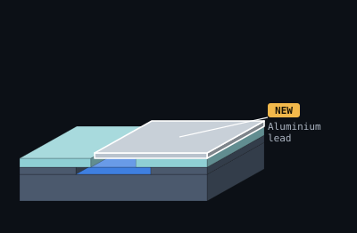
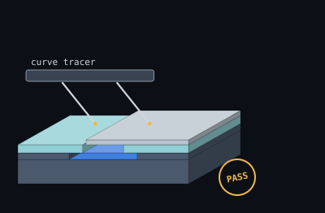

<!-- generated by scripts/build_manuals.py from data/manuals.json; edit there -->
# Manual 13 · Make a planar transistor the 1959 way

**Hoerni’s planar process: grow oxide, open a window, predeposit, drive in under the oxide, evaporate leads, test breakdown.** Before 1959 transistors were mesas: bumps etched out of the silicon with their junctions exposed at the sides, where dirt and moisture spoiled them. Jean Hoerni kept the oxide on. Dopant went in through a window, spread sideways under the oxide edge and ended under protecting glass, and the wafer stayed flat. Robert Noyce then ran aluminium leads over that oxide, which made the integrated circuit possible.

The sequence follows Hoerni’s patent[1](#sources) and Noyce’s lead structure[2](#sources), with oxide masking from Frosch and Derick[3](#sources); breakdown of the flat junction and its curved edge follows Sze and Gibbons [@sze_gibbons1966; @sze_gibbons_curv1966], as computed by the Fab Journey’s planar theatre; the history follows Riordan and Hoddeson[4](#sources).

[Open the web manual](https://normansrule.github.io/transistor-foundry-expedition/manuals/history.html) (Save as PDF from there) · [All manuals](README.md)

> **Read this first.** This manual explains how a cleanroom does each step. It is not a procedure to try at home. Tier 2 and 3 steps use heat, vacuum and high-voltage equipment or hazardous chemicals that only trained staff may handle.

| You need | |
|---|---|
| Lightly doped n-type silicon wafer | ×1 · Manual 1 · Wafer |
| Oxidation and diffusion furnaces (staff-run source) | ×1 |
| Mask aligner, evaporator, curve tracer | ×1 |

## 1 · Grow the masking oxide

**Do.** Oxidise the whole wafer in a furnace. The glass will block the dopant everywhere except where a window is opened.

- silicon dioxide masks the common dopants[3](#sources)
- a grown oxide also quiets the silicon surface[5](#sources)

**Check.** Oxide thickness even across the wafer.

Operation specification · Tier 2 · heat or equipment

| | |
|---|---|
| Tool | Oxidation furnace |
| Purpose | Cover the wafer in a dopant mask |
| Control | Oxide thickness by colour or ellipsometry |
| Out of control | Pinholes in the oxide: dopant leaks through; regrow |

**Process engineer.** Frosch and Derick found in 1957 that a grown oxide blocks boron and phosphorus, and Atalla showed that it also stabilises the silicon surface [@frosch1957; @atalla1959]. Hoerni put both to work.

## 2 · Open a window

**Do.** Print a window with photoresist and etch the oxide away inside it. Its edge sets where the junction will meet the surface.

- the window edge decides where the junction surfaces[1](#sources)

**Check.** Window clean to the silicon, edges sharp.

Operation specification · Tier 2 · heat or equipment

| | |
|---|---|
| Tool | Mask aligner and oxide etch |
| Purpose | Let dopant in only where it belongs |
| Control | Window size; no oxide left in it |
| Out of control | Oxide left in the window: etch again |

**Process engineer.** Pattern and etch follow Manuals 4A and 5. The etch chemistry for oxide is institution-only.

## 3 · Predeposit the dopant

**Do.** Trained staff run the dopant source in a furnace. A thin, heavily doped skin forms in the window only.

- the dopant source is institution-only
- the oxide stops it everywhere else

**Check.** Sheet resistance of a monitor wafer on target.

Operation specification · Tier 3 · institution-only

| | |
|---|---|
| Tool | Diffusion furnace, staff only |
| Purpose | Set the dose of dopant in the window |
| Control | Set by the lab |
| Out of control | Monitor out of range: the lab adjusts the source |

**Process engineer.** A constant-source predeposition fixes the dose, as in Manual 6A. The source chemistry stays with the lab; nothing about it is given here.

## 4 · Drive in under the oxide edge

**Do.** Heat again with the source removed. The dopant spreads down and sideways, so the junction curves up and meets the surface under the oxide, not in the open.

- the junction ends under protecting oxide[1](#sources)
- sideways spread is about 0.8 of the depth[6](#sources)

**Check.** Junction depth on a bevelled monitor on target.

Operation specification · Tier 2 · heat or equipment

| | |
|---|---|
| Tool | Diffusion furnace |
| Purpose | Bury the junction edge under glass |
| Drive-in, 1 h at 1100 °C on 10¹⁵ cm⁻³ (model) | xⱼ ≈ 2.05 µm[6](#sources) |
| Control | Drive-in temperature and time |
| Out of control | Junction too shallow: the edge curves sharply and breaks down early |

**Process engineer.** Because the dopant moves sideways about as far as down, the junction reaches the surface beneath the oxide edge. That is the whole trick: the edge, where mesa transistors failed, is sealed from the start [@hoerni1962; @riordan1997].

## 5 · Evaporate aluminium leads over the oxide

**Do.** Open contact holes, evaporate aluminium over the whole wafer and pattern it, so the leads run across the oxide to the junctions.

- leads over the oxide connected devices on one chip[2](#sources)

**Check.** Leads continuous; contacts ohmic.

Operation specification · Tier 2 · heat or equipment

| | |
|---|---|
| Tool | Vacuum evaporator, aligner, aluminium etch |
| Purpose | Wire the device without touching bare silicon |
| Control | Lead continuity; contact resistance |
| Out of control | Open lead over the oxide step: thicker metal or a gentler step |

**Process engineer.** Because the planar wafer is flat and covered in glass, a metal film can run over it from one device to the next. Noyce’s 1959 patent did exactly that, and the integrated circuit followed[2](#sources).

## 6 · Test the breakdown

**Do.** Reverse-bias the junction on a curve tracer and find the voltage where current suddenly rises. The curved edge breaks down before the flat floor.

- the curved edge breaks down first[7](#sources)
- 1 h at 1100 °C: flat 347 V, edge 150 V in the model[8](#sources)

**Check.** Breakdown above the specification.

Operation specification · Tier 1 · care

| | |
|---|---|
| Tool | Curve tracer |
| Purpose | Confirm the junction holds its voltage |
| Flat junction on 10¹⁵ cm⁻³ (model) | ≈ 347 V[8](#sources) |
| Curved edge, 2.05 µm deep (model) | ≈ 150 V[7](#sources) |
| Control | Breakdown voltage; leakage before breakdown |
| Out of control | Early breakdown: shallow junction or a damaged edge |

**Process engineer.** The field crowds at the curved edge, whose radius is about the junction depth, so it avalanches before the flat floor. A deeper drive-in gives a gentler curve: four hours at 1150 °C raise the edge from 43 to 60 % of the flat value in the planar theatre[7](#sources).

## From mesa to planar to the integrated circuit

Keeping the oxide on made transistors reliable, flat and wireable on one chip.

- Frosch and Derick found in 1957 that silicon dioxide masks dopant diffusion[3](#sources)
- Hoerni filed the planar process in 1959[1](#sources)
- Noyce filed aluminium leads over the oxide in 1959[2](#sources)
- A grown oxide stabilises the silicon surface[5](#sources)

> **Institution-only.** Diffusion sources are institution-only and furnaces run near 1100 °C; every step here runs in a staff-operated lab.

## What the models leave out

- The junction edge is a cylinder of radius equal to the depth; real edges also have corners, which break down even earlier.
- Breakdown uses Sze and Gibbons’ formulas for a one-sided abrupt junction; a diffused junction is graded.
- No dopant source or furnace setting beyond the model example is given: the source is institution-only.
- Surface charge in the oxide, which troubled early planar devices, is described, not modelled.

## Sources

1. [J. A. Hoerni, "Method of Manufacturing Semiconductor Devices," U.S. Patent 3,025,589 (1962; filed 1959).](https://patents.google.com/patent/US3025589A) `hoerni1962`
2. [R. N. Noyce, "Semiconductor Device-and-Lead Structure," U.S. Patent 2,981,877 (1961; filed 1959).](https://patents.google.com/patent/US2981877A) `noyce_patent`
3. [C. J. Frosch, L. Derick, "Surface Protection and Selective Masking during Diffusion in Silicon," J. Electrochem. Soc. 104, 547 (1957).](https://doi.org/10.1149/1.2428650) `frosch1957`
4. [M. Riordan, L. Hoddeson, Crystal Fire: The Birth of the Information Age, W. W. Norton (1997). ISBN 978-0-393-04124-8.]() `riordan1997`
5. [M. M. Atalla, E. Tannenbaum, E. J. Scheibner, "Stabilization of Silicon Surfaces by Thermally Grown Oxides," Bell Syst. Tech. J. 38, 749 (1959).](https://doi.org/10.1002/j.1538-7305.1959.tb03907.x) `atalla1959`
6. [J. D. Plummer, M. D. Deal, P. B. Griffin, Silicon VLSI Technology: Fundamentals, Practice and Modeling, Prentice Hall (2000).]() `plummer2000`
7. [S. M. Sze, G. Gibbons, "Effect of Junction Curvature on Breakdown Voltage in Semiconductors," Solid-State Electron. 9, 831 (1966).]() `sze_gibbons_curv1966`
8. [S. M. Sze, G. Gibbons, "Avalanche Breakdown Voltages of Abrupt and Linearly Graded p-n Junctions in Ge, Si, GaAs, and GaP," Appl. Phys. Lett. 8, 111 (1966).]() `sze_gibbons1966`
