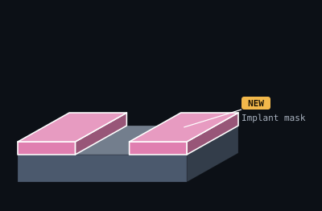
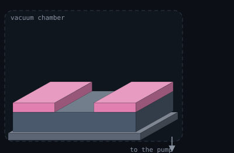
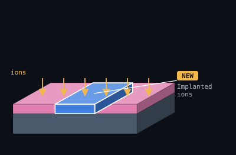
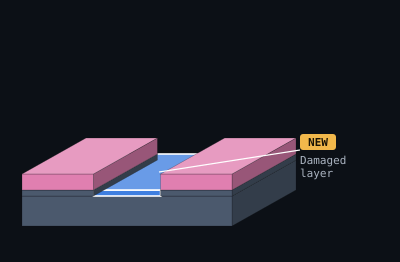
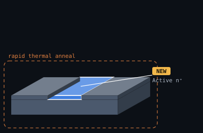
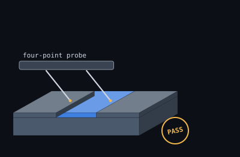

<!-- generated by scripts/build_manuals.py from data/manuals.json; edit there -->
# Manual 6B · Fire dopant atoms into the silicon

**Ion implantation: mask, tilt, implant, see the damage, anneal, measure.** An implanter turns dopant atoms into ions, speeds them up through a voltage and fires them into the wafer. The voltage sets how deep they go and a meter counts every one, so the dose and depth are far more precise than any furnace diffusion. The ion source uses institution-only gases, so that part stays conceptual.

Ranges follow the stopping-power model of the site’s implant simulator, checked against published examples[1](#sources); implanter practice and annealing follow Plummer, Deal and Griffin[2](#sources); Dennard’s scaled MOSFET shows why implantation took over[3](#sources).

[Open the web manual](https://normansrule.github.io/transistor-foundry-expedition/manuals/implant.html) (Save as PDF from there) · [All manuals](README.md)

> **Read this first.** This manual explains how a cleanroom does each step. It is not a procedure to try at home. Tier 2 and 3 steps use heat, vacuum and high-voltage equipment or hazardous chemicals that only trained staff may handle.

| You need | |
|---|---|
| Wafer with thick patterned resist | ×1 · Manual 4A · Lithography |
| Ion implanter (staff-run source) | ×1 |
| Anneal furnace or rapid thermal processor | ×1 |

## 1 · Check the mask is thick enough

**Do.** Measure the resist. It must stop every ion where the silicon should stay undoped, and its edges decide where the doped region starts.

- gates and spacers mask too: self-alignment[2](#sources)

**Check.** Resist thickness is well above the ion range for the planned energy.

Operation specification · Tier 1 · care

| | |
|---|---|
| Tool | Thickness gauge |
| Purpose | Make sure the mask will stop the ions |
| Control | Resist thickness against ion range |
| Out of control | Resist too thin: ions punch through; recoat |

**Process engineer.** High-energy implants need microns of resist. In a self-aligned MOS process the polysilicon gate itself masks the channel, so source and drain land exactly beside it[2](#sources).

## 2 · Make the ion beam

**Do.** Trained staff run the ion source, which ionises a dopant-bearing feed. A magnet then picks out only the ions of the right mass.

- feed gases are institution-only
- the analysing magnet sorts ions by mass

**Check.** The beam current is steady on the right mass.

Operation specification · Tier 3 · institution-only

| | |
|---|---|
| Tool | Ion source and analysing magnet, staff only |
| Purpose | Make a pure beam of one dopant |
| Control | Set by the lab |
| Out of control | Wrong mass peak: the lab retunes the magnet |

**Process engineer.** Many dopant feed gases are highly toxic and are handled only inside the tool by trained staff[2](#sources). Nothing about them is given here.

## 3 · Implant at a tilt

**Do.** Accelerate the ions and scan the beam across the tilted wafer until the meter has counted the full dose.

- energy sets depth: phosphorus at 100 keV stops near 0.12 µm[1](#sources)
- boron at 80 keV stops near 0.24 µm[1](#sources)
- a few degrees of tilt stops channelling[2](#sources)

**Check.** The integrated dose matches the recipe.

Operation specification · Tier 2 · heat or equipment

| | |
|---|---|
| Tool | Ion implanter |
| Purpose | Put a counted dose at a chosen depth |
| P at 100 keV, projected range | ≈ 0.12 µm[1](#sources) |
| B at 80 keV, projected range | ≈ 0.24 µm[1](#sources) |
| Control | Beam current integrated over time; scan uniformity |
| Out of control | Dose off: the run is held and the Faraday cup checked |

**Process engineer.** Each ion loses energy to nuclei and to electrons until it stops. The stopping depths form a near-Gaussian with projected range Rp and straggle ΔRp; the dose is the beam charge divided by the ion charge and the area[2](#sources).

## 4 · See the damage

**Do.** Look at what the ions left behind: every one displaced many silicon atoms, and a heavy dose leaves the top layer amorphous. Most dopant is not yet active.

- one ion displaces hundreds of atoms[2](#sources)

**Check.** A damage or sheet-resistance check on a monitor wafer.

Operation specification · Tier 1 · care

| | |
|---|---|
| Tool | Optical damage monitor |
| Purpose | Know the state before the anneal |
| Control | Damage signal against dose |
| Out of control | Unexpected damage level: check dose and beam heating |

**Process engineer.** Implanted atoms sit mostly between lattice sites at first. Pre-amorphising implants are sometimes used on purpose so the crystal regrows cleanly from the undamaged silicon below[2](#sources).

## 5 · Strip the resist and anneal

**Do.** Remove the resist, then heat the wafer briefly. The crystal repairs itself and the dopant moves onto lattice sites, where it conducts.

- spike and millisecond anneals activate with little diffusion[2](#sources)

**Check.** Sheet resistance falls to its target.

Operation specification · Tier 2 · heat or equipment

| | |
|---|---|
| Tool | Rapid thermal processor |
| Purpose | Activate the dopant and heal the crystal |
| Control | Peak temperature and time |
| Out of control | Sheet resistance high: too little activation; junction deep: too much heat |

**Process engineer.** Annealing also lets the dopant diffuse, widening the profile by about √(2Dt). Keeping junctions shallow while activating fully is one of the hardest trade-offs in a short-channel transistor[2](#sources).

## 6 · Measure the result

**Do.** Map the sheet resistance across a monitor wafer with a four-point probe. Less often, a lab sputters a crater and counts the dopant depth by depth.

- sheet resistance catches dose errors within minutes[2](#sources)

**Check.** Sheet resistance mean and spread within limits.

Operation specification · Tier 1 · care

| | |
|---|---|
| Tool | Four-point probe; SIMS for profiles |
| Purpose | Confirm dose and activation |
| Control | Sheet resistance map |
| Out of control | Non-uniform map: check the beam scan |

**Process engineer.** Secondary-ion mass spectrometry gives the real profile, including the channelling tail and the diffusion during the anneal, against which the simulator’s Gaussian can be checked[2](#sources).

## From furnace diffusion to ion implantation

Implantation sets dose and depth separately and precisely, which scaled transistors needed.

- Dennard’s 1974 scaled MOSFET was designed around ion-implanted doping[3](#sources)
- Implanted channel and source/drain doping replaced furnace diffusion in MOS during the 1970s[2](#sources)
- Phosphorus at 100 keV stops near 0.12 µm in silicon[1](#sources)
- Boron at 80 keV stops near 0.24 µm[1](#sources)

> **Institution-only.** Implanter ion sources use dopant feed gases that are institution-only, and implanters work at high voltage. Only trained staff run them.

## What the models leave out

- The profile is a Gaussian; real profiles are skewed and have a channelling tail.
- Damage, amorphisation and transient enhanced diffusion during the anneal are described, not modelled here.
- No feed gas, source setting or implanter procedure is given: those are institution-only.
- Lateral straggle under the mask edge is taken equal to the vertical straggle.

## Sources

1. [G. Tuttle, "Ion implantation examples," microfabrication notes, Iowa State University (B 80 keV: Rp ≈ 0.24 µm; P 100 keV: Rp ≈ 0.12 µm).](https://gtuttle.net/fabrication/topics/ion_implantation_examples.pdf) `tuttle_implant`
2. [J. D. Plummer, M. D. Deal, P. B. Griffin, Silicon VLSI Technology: Fundamentals, Practice and Modeling, Prentice Hall (2000).]() `plummer2000`
3. [R. H. Dennard et al., "Design of Ion-Implanted MOSFET's with Very Small Physical Dimensions," IEEE J. Solid-State Circuits 9(5), 256 (1974).](https://doi.org/10.1109/JSSC.1974.1050511) `dennard1974`
