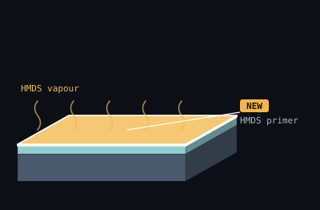
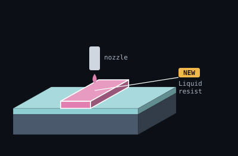
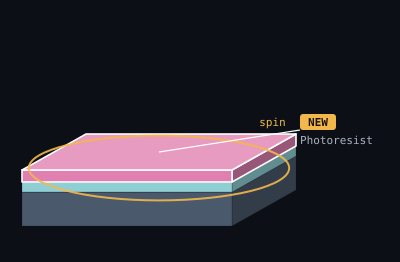
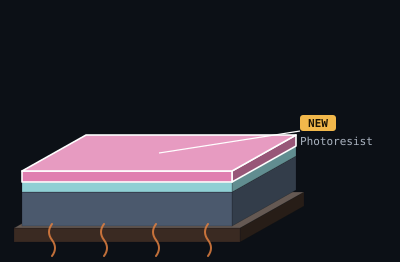
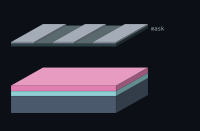
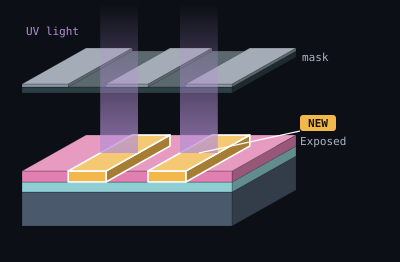
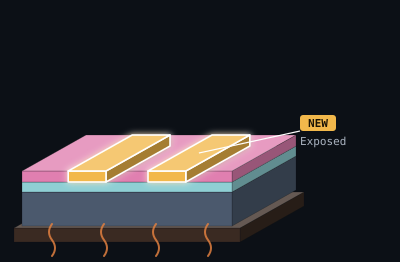
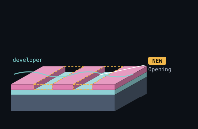
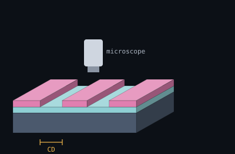
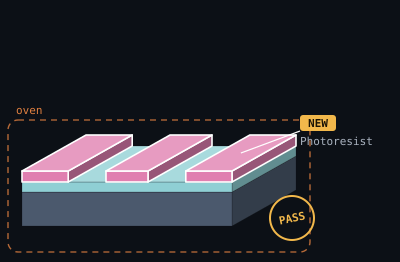

<!-- generated by scripts/build_manuals.py from data/manuals.json; edit there -->
# Manual 4A · Print a pattern with light

**Photolithography: prime, coat, bake, align, expose, develop, inspect.** Every layer of a chip starts as a picture. Lithography copies that picture from a mask into a thin light-sensitive film called photoresist. The film then protects some parts of the wafer while the next step (etch or implant) changes the rest. A modern chip goes through this loop dozens of times.

The step list follows a public baseline traveler, the UC Berkeley Marvell Nanolab cmos150 run card[1](#sources), and the run card of a real four-mask NMOS run in a university teaching cleanroom[2](#sources).

[Open the web manual](https://normansrule.github.io/transistor-foundry-expedition/manuals/lithography.html) (Save as PDF from there) · [All manuals](README.md)

> **Read this first.** This manual explains how a cleanroom does each step. It is not a procedure to try at home. Tier 2 and 3 steps use heat, vacuum and high-voltage equipment or hazardous chemicals that only trained staff may handle.

| You need | |
|---|---|
| Wafer with a grown oxide | ×1 · Area 3 · Oxidation |
| Photoresist (positive, chemically amplified) | ×1 |
| Photomask for this layer | ×1 |
| Stepper or scanner time | ×1 |

## 1 · Prime the surface

**Do.** Expose the wafer to hexamethyldisilazane (HMDS) vapour. It turns the oxide surface water-repellent so the resist sticks.

- HMDS prime, program 1 on the coat track[1](#sources)
- teaching run: 10 min dehydration bake at 110 °C, then 5 min of primer vapour[2](#sources)

**Check.** Water beads up on a test wafer instead of spreading.

Operation specification · Tier 1 · care

| | |
|---|---|
| Tool | Coat track, vapour-prime module |
| Purpose | Adhesion promotion before coat |
| Control | Contact angle on a monitor wafer |
| Out of control | Resist lifts during develop: re-clean and re-prime |

**Process engineer.** HMDS caps surface hydroxyl groups with methyl groups, so the surface stops attracting water. HMDS itself is a hazardous chemical and is handled only inside the closed prime oven.

## 2 · Dispense the resist

**Do.** Drop a few millilitres of liquid resist onto the centre of the wafer.

- a few ml per wafer[3](#sources)

**Check.** One round puddle, no bubbles.

Operation specification · Tier 1 · care

| | |
|---|---|
| Tool | Coat track, spin-coat cup |
| Purpose | Deliver resist |
| Control | Dispense volume; bubble-free supply |
| Out of control | Comets and streaks: filter or degas the resist |

**Process engineer.** Resist can be dispensed onto a still wafer (static) or onto a slowly turning one (dynamic). Air bubbles in the resist take about 20 minutes to escape from thin resists and hours from viscous ones[3](#sources).

## 3 · Spin it thin

**Do.** Spin the wafer fast. The resist flings outward and thins to an even film as its solvent evaporates.

- 2000–4000 rpm for 20–30 s[3](#sources)
- Berkeley baseline: 4500 Å of UV-210[1](#sources)
- teaching run: 3000 rpm for 30 s[2](#sources)

**Check.** An even colour across the wafer. A thicker ring at the edge (the edge bead) is normal and is removed.

Operation specification · Tier 1 · care

| | |
|---|---|
| Tool | Coat track, spin-coat cup |
| Purpose | Uniform resist film |
| Spin speed | 2000–4000 rpm[3](#sources) |
| Spin time | 20–30 s[3](#sources) |
| Ramp rate (smooth wafers) | above 1000 rpm/s[3](#sources) |
| Thickness (example) | 4500 Å UV-210[1](#sources) |
| Teaching run | 3000 rpm, 30 s[2](#sources) |
| Control | Film thickness by reflectometry; uniformity map |
| Out of control | Too thick: raise spin speed. Doubling the speed thins the film about 1.4× |

**Process engineer.** Thickness falls roughly as one over the square root of spin speed, so t ∝ 1/√ω and doubling the speed thins the film by about 1.4×[3](#sources). Thinning stops once enough solvent has evaporated that the film no longer flows. After spinning, about 10 % (thin resists) to 35 % (thick resists) of the film is still solvent[3](#sources).

## 4 · Soft bake

**Do.** Bake the wafer briefly on a hotplate to drive out most of the remaining solvent.

- solvent falls to about 3–5 %[3](#sources)
- teaching run: 90 °C for 90 s on a hotplate[2](#sources)

**Check.** The film is dry and no longer tacky.

Operation specification · Tier 2 · heat or equipment

| | |
|---|---|
| Tool | Coat track, hotplate |
| Purpose | Remove solvent, fix film |
| Residual solvent after bake | about 3–5 %[3](#sources) |
| Teaching run | 90 °C, 90 s[2](#sources) |
| Control | Hotplate temperature log; thickness after bake |
| Out of control | Under-baked film smears and dissolves too fast in develop |

**Process engineer.** The soft bake is also called the post-apply bake (PAB)[4](#sources). Too little bake leaves solvent that speeds dissolution everywhere; too much starts to destroy the light-sensitive compound.

## 5 · Align the mask

**Do.** Load the photomask, a glass plate with a chrome pattern, and line its marks up with the marks the last layer left on the wafer.

- chrome mask, one per layer[1](#sources)
- pre-alignment on[1](#sources)
- teaching run, manual aligner: 0.2–1.4 µm overlay error[2](#sources)

**Check.** The alignment marks overlap within the tool’s overlay limit.

Operation specification · Tier 0 · safe

| | |
|---|---|
| Tool | Stepper or scanner, reticle stage |
| Purpose | Register this layer to the last |
| Control | Overlay error on alignment marks |
| Out of control | Overlay out of limit: rework (strip resist and repeat from step 1) |

**Process engineer.** Each layer must land on top of the last. The error between them is called overlay, and it is measured on dedicated marks after develop. A failed layer is reworked: the resist is stripped and the module runs again, because nothing has yet changed the wafer underneath.

## 6 · Expose

**Do.** Flash ultraviolet light through the mask. Where light lands, the resist changes chemistry and will later wash away.

- dose 30 mJ/cm² in the Berkeley baseline[1](#sources)
- smallest pitch λ / (2·NA)[5](#sources)
- teaching run: i-line contact exposure, 9 s[2](#sources)

**Check.** The tool reports the planned dose and focus for every field.

Operation specification · Tier 1 · care

| | |
|---|---|
| Tool | Stepper or scanner (i-line, KrF, ArF, ArF immersion, EUV) |
| Purpose | Write the latent image |
| Dose (example) | 30 mJ/cm²[1](#sources) |
| Smallest pitch, one exposure | λ / (2·NA)[5](#sources) |
| Teaching run | i-line contact, 9 s[2](#sources) |
| Control | Dose and focus per field; focus-exposure matrix on monitors |
| Out of control | Lines too wide or narrow: adjust dose. Lines fade at the wafer edge: check focus and flatness |

**Process engineer.** The lens can only collect so many of the diffraction orders that a fine pattern sends out. With tilted (off-axis) light the smallest printable pitch is λ / (2·NA), which is k₁ = 0.25 in the Rayleigh form[5](#sources). The Physics Lab’s aerial-image simulator computes this image live.

## 7 · Post-exposure bake

**Do.** Bake again. In chemically amplified resist the light made a little acid, and the heat lets each acid molecule change many more.

- “chemical amplification”[4](#sources)
- post-exposure bake, program 1[1](#sources)

**Check.** Bake time and temperature match the resist’s sheet.

Operation specification · Tier 2 · heat or equipment

| | |
|---|---|
| Tool | Coat track, hotplate |
| Purpose | Amplify the latent image |
| Control | Hotplate uniformity; delay between expose and bake |
| Out of control | Line width drifts with bake temperature: requalify the hotplate |

**Process engineer.** One photon makes one acid molecule. During the post-exposure bake (PEB) that acid acts as a catalyst and changes many polymer groups, so the image is ‘amplified’[4](#sources). Acid also diffuses during the bake, which blurs the edge a little: one source of line-edge roughness.

## 8 · Develop

**Do.** Flood the wafer with developer. The exposed resist dissolves and the oxide shows through the openings.

- exposed areas dissolve quickly[4](#sources)
- aqueous alkaline developer: institution-only handling
- teaching run: 60 s[2](#sources)

**Check.** Openings are clear down to the oxide, with no scum.

Operation specification · Tier 2 · heat or equipment

| | |
|---|---|
| Tool | Coat track, develop module |
| Purpose | Turn the latent image into openings |
| Develop time, teaching run | 60 s[2](#sources) |
| Control | After-develop inspection; CD on test structures |
| Out of control | Scum in openings: descum in a short oxygen plasma, or rework |

**Process engineer.** In a positive resist the exposed regions become very soluble and are removed quickly[4](#sources). Developer chemistry is handled inside the track by trained staff; this manual describes it only conceptually.

## 9 · Inspect and measure

**Do.** Look at the pattern under a microscope, then measure line width and overlay.

- CD-SEM (critical-dimension scanning electron microscope)
- overlay metrology

**Check.** Critical dimension (CD) and overlay are inside their limits. If not, strip and redo the module.

Operation specification · Tier 0 · safe

| | |
|---|---|
| Tool | Optical microscope, CD-SEM, overlay tool |
| Purpose | Decide pass, rework or scrap |
| Control | CD and overlay against limits |
| Out of control | Rework: strip and repeat from step 1 |

**Process engineer.** This is the last moment a mistake is cheap. After etch or implant the wafer itself has changed and cannot be reworked.

## 10 · Hard bake

**Do.** Bake the patterned resist in an oven so it is tough enough to survive the etch or implant that comes next.

- more than 30 min at 120 °C in the oven[1](#sources)

**Check.** Resist edges stay sharp, not rounded.

Operation specification · Tier 2 · heat or equipment

| | |
|---|---|
| Tool | Convection oven |
| Purpose | Harden resist for etch or implant |
| Hard bake | > 30 min at 120 °C[1](#sources) |
| Control | Oven temperature log |
| Out of control | Resist flows and rounds: bake was too hot |

**Process engineer.** The Berkeley run card also lists a descum step here, skipped when no tool for the wafer size was available[1](#sources). Next the wafer goes to Manual 5, Etch, where the resist protects the oxide under it.

## Variant: extreme ultraviolet (EUV) at 2 nm-class nodes

EUV light is absorbed by glass and even by air, so an EUV scanner works in vacuum and uses mirrors instead of lenses. The mask is a mirror too.

- Wavelength 13.5 nm[6](#sources)
- Light is made when a CO₂ laser hits a falling tin droplet with two pulses, up to 50,000 times a second[6](#sources)
- Multilayer mirrors, typically 40 Mo/Si bilayers, reflect up to 70 %[7](#sources)
- The optics shrink the mask pattern 4× onto the wafer[6](#sources)
- NXE: NA 0.33, 13 nm resolution. EXE (High-NA): NA 0.55, 8 nm resolution[6](#sources)
- So few photons land per feature that random ‘stochastic’ defects appear: missing or bridged lines[8](#sources)

> **Institution-only.** The tin plasma source uses a high-power industrial laser inside a sealed machine. It is described here only to explain how the tool works.

**How each generation of light sets the smallest pitch**

| Light | λ | NA | λ / 2NA |
|---|---|---|---|
| i-line | 365 nm | 0.60 | 304.2 nm |
| KrF | 248 nm | 0.80 | 155.0 nm |
| ArF immersion | 193 nm | 1.35 | 71.5 nm |
| EUV | 13.5 nm | 0.33 | 20.5 nm |
| High-NA EUV | 13.5 nm | 0.55 | 12.3 nm |

Wavelength and NA as in the Physics Lab presets[9](#sources),[6](#sources). λ / 2NA is the single-exposure limit at k₁ = 0.25.

## What the models leave out

- Real recipes depend on the exact resist, film stack and tool. The ranges here are teaching ranges from public sources, not a qualified recipe.
- Reflections from the layers under the resist (standing waves) and anti-reflective coatings are not drawn.
- Optical proximity correction (OPC), source-mask optimisation and multiple patterning are covered in the lithography chapter, not in this module.
- Developer and primer chemistry are named but never given as concentrations or procedures.

## Sources

1. [UC Berkeley Marvell Nanolab, "Run Card for cmos150" (public baseline CMOS process traveler), step 3.0 Well Photo, Mask NWELL (2001).](https://nanolab.berkeley.edu/public/process/baseline/cmos150/step3.0.htm) `nanolab_cmos150`
2. [R. Loberg and A. Norman, "Four-mask NMOS fabrication run: process record and in-line measurements," university teaching cleanroom (2024), unpublished; measured data shared by the authors.]() `cleanroom_run_fab2024`
3. [MicroChemicals GmbH, "Basics of Microstructuring", chapter 1: Fundamentals of Microstructuring (spin coating and softbake).](https://cores.research.asu.edu/sites/default/files/2025-01/spin_coating_photoresist.pdf) `microchem_basics`
4. [Willson Research Group, University of Texas at Austin, "Lithography process flow" (post-apply bake, exposure, post-exposure bake and chemical amplification, development) (2002).](https://utw10104.utweb.utexas.edu/Research/Sub_Files/Resist_Modeling/processflow.htm) `willson_flow`
5. [C. Mack, Fundamental Principles of Optical Lithography: The Science of Microfabrication, Wiley (2007).](https://doi.org/10.1002/9780470723876) `mack2007`
6. [ASML, EUV lithography systems (NXE and EXE High-NA platforms).](https://www.asml.com/en/products/euv-lithography-systems) `asml_euv`
7. [University of Kassel, Institute of Nanostructure Technologies and Analytics, "Multilayer Structures for the Lithography in Extreme UV (EUVL)" (typically 40 Mo/Si bilayers, reflectivity up to 70 %).](https://www.uni-kassel.de/forschung/en/ina/technological-electronics/research/past-projects/multilayer-structures-for-the-lithography-in-extreme-uv-euvl.html) `kassel_euvml`
8. [V. Bakshi (ed.), EUV Lithography, 2nd ed., SPIE Press (2018).](https://doi.org/10.1117/3.2305675) `bakshi2018`
9. [H. J. Levinson, Principles of Lithography, 4th ed., SPIE Press (2019).](https://doi.org/10.1117/3.2525306) `levinson2019`
