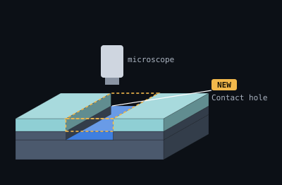
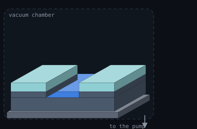
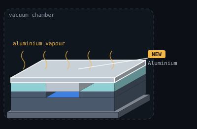
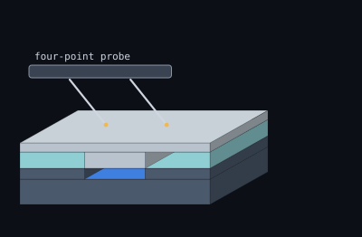
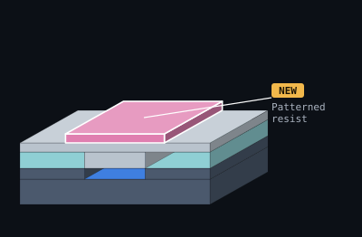
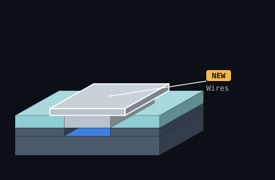
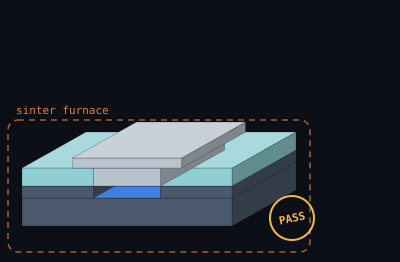

<!-- generated by scripts/build_manuals.py from data/manuals.json; edit there -->
# Manual 7A · Wire it up with aluminium

**Metallization in a teaching process: open contacts, evaporate aluminium, measure, pattern, etch, sinter.** Transistors are useless until they are wired together. In the planar era and in teaching cleanrooms today, a film of aluminium covers the whole wafer, touches the silicon through contact holes and is then etched into wires and pads. A low-temperature bake makes each contact conduct well.

The sequence and measurements follow a four-mask NMOS run in a university teaching cleanroom[1](#sources) and its process manual[2](#sources); deposition basics follow Plummer, Deal and Griffin[3](#sources); the film thickness uses the bulk resistivity of aluminium[4](#sources).

[Open the web manual](https://normansrule.github.io/transistor-foundry-expedition/manuals/metal.html) (Save as PDF from there) · [All manuals](README.md)

> **Read this first.** This manual explains how a cleanroom does each step. It is not a procedure to try at home. Tier 2 and 3 steps use heat, vacuum and high-voltage equipment or hazardous chemicals that only trained staff may handle.

| You need | |
|---|---|
| Wafer with contact holes etched | ×1 · Manual 5 · Etch |
| Aluminium charge | ×1 |
| Thermal evaporator | ×1 |

## 1 · Check the contact holes

**Do.** Under the microscope, look into each contact hole. The oxide must be gone right down to the doped silicon, or the metal will not touch it.

- teaching run: contact holes came out 2.39 µm wider than drawn[1](#sources)

**Check.** Every hole is open to silicon; widths are recorded.

Operation specification · Tier 1 · care

| | |
|---|---|
| Tool | Inspection microscope |
| Purpose | Confirm the contacts are open |
| Width change after etch | +2.39 µm[1](#sources) |
| Control | Hole width; colour of the hole floor |
| Out of control | Oxide left in a hole: an open contact, so etch again |

**Process engineer.** The wet contact etch undercuts the resist, so holes grow; in the teaching run agitation in the bath made the contacts the widest features of all[1](#sources).

## 2 · Load and pump down

**Do.** Mount the wafers face down above the source in the evaporator and pump the chamber to high vacuum.

- vacuum lets atoms fly straight to the wafer[3](#sources)

**Check.** The pressure gauge reaches the lab’s base pressure.

Operation specification · Tier 2 · heat or equipment

| | |
|---|---|
| Tool | Thermal evaporator |
| Purpose | Clear the path for the metal atoms |
| Control | Base pressure |
| Out of control | Pressure will not fall: look for a leak or a dirty chamber |

**Process engineer.** At high vacuum an evaporated atom travels further than the chamber is wide before it hits a gas molecule, so it lands in a straight line from the source[3](#sources). That is also why evaporation covers steep steps poorly.

## 3 · Evaporate the aluminium

**Do.** Heat the source until aluminium evaporates. A thin, even film condenses over the whole wafer and into every contact hole.

- aluminium heated in a tungsten boat in vacuum[1](#sources)
- the film covers the whole wafer[2](#sources)

**Check.** The thickness monitor reaches its target; the film is mirror-bright.

Operation specification · Tier 2 · heat or equipment

| | |
|---|---|
| Tool | Thermal evaporator with a resistance-heated boat |
| Purpose | Coat the wafer with metal |
| Control | Deposition rate and thickness monitor |
| Out of control | Hazy film: the vacuum or the source was dirty |

**Process engineer.** Evaporation is the oldest way to lay down metal; sputtering, which knocks atoms off a target with ions, replaced it in industry because it covers steps better and handles alloys[3](#sources). Noyce’s 1959 patent already ran evaporated aluminium leads over the oxide[5](#sources).

## 4 · Measure the film

**Do.** Put a four-point probe on the blanket aluminium and read its sheet resistance.

- teaching run: 0.1229 Ω per square[1](#sources)
- bulk aluminium: 2.65 µΩ·cm[4](#sources)

**Check.** Sheet resistance in the expected range.

Operation specification · Tier 1 · care

| | |
|---|---|
| Tool | Four-point probe |
| Purpose | Check the film thickness electrically |
| Sheet resistance | 0.1229 Ω/sq[1](#sources) |
| Bulk resistivity | 2.65 µΩ·cm[4](#sources) |
| Control | Sheet resistance |
| Out of control | Too high: a thin film; check the source charge and the monitor |

**Process engineer.** Thickness follows from t = ρ/R_s. With the bulk value of 2.65 µΩ·cm[4](#sources) the run’s 0.1229 Ω/sq[1](#sources) means about 216 nm of aluminium; thin films conduct a little worse than bulk, so the real film is probably slightly thicker.

## 5 · Pattern the wires

**Do.** Coat, expose and develop resist with the metal mask, exactly as in Manual 4A. Resist now covers the wires and pads you want to keep.

- the fourth and last mask of the teaching process[1](#sources)

**Check.** Resist lines line up with the contacts underneath.

Operation specification · Tier 1 · care

| | |
|---|---|
| Tool | Mask aligner and resist track |
| Purpose | Define the wiring |
| Control | Overlay to the contact layer |
| Out of control | Misaligned: strip the resist and repeat |

**Process engineer.** Overlay matters more here than anywhere: a wire shifted off its contact leaves a transistor unconnected. The teaching run measured its earlier layer-to-layer shifts at up to 1.4 µm[1](#sources).

## 6 · Etch the aluminium

**Do.** Exposed aluminium is etched away by trained staff, leaving wires and pads under the resist. The resist is then removed.

- lines come out a little narrower than drawn
- institution-only chemistry

**Check.** Wires are separate: no metal bridges between neighbours.

Operation specification · Tier 3 · institution-only

| | |
|---|---|
| Tool | Wet bench, staff only |
| Purpose | Turn the film into wiring |
| Control | Line width after etch |
| Out of control | Bridges between lines: more etch; missing lines: less |

**Process engineer.** A wet aluminium etch undercuts the resist like every wet etch. In the teaching run the metal lines came out 0.88 µm narrower than drawn on average[1](#sources). Industry etches aluminium in a plasma instead, so the walls stay vertical[3](#sources).

## 7 · Sinter the contacts

**Do.** Bake the wafer gently so the aluminium and silicon bond at every contact and the contact resistance falls.

- teaching run: 400 °C for 20 minutes[1](#sources)

**Check.** Contacts behave like resistors, not diodes, on a test structure.

Operation specification · Tier 2 · heat or equipment

| | |
|---|---|
| Tool | Tube furnace |
| Purpose | Make good ohmic contacts |
| Temperature | 400 °C[1](#sources) |
| Time | 20 min[1](#sources) |
| Control | Contact resistance on test structures |
| Out of control | Contacts rectify: sinter longer; junctions short: the sinter ran too hot |

**Process engineer.** Aluminium and silicon dissolve into each other a little at the interface, breaking through any thin oxide left in the hole[3](#sources). Too much and the aluminium spikes down through a shallow junction, which is why later processes added barrier layers.

## From evaporated aluminium to copper damascene

Aluminium wired chips for almost forty years. Copper conducts better but cannot be etched easily, so it is laid into trenches instead.

- Noyce’s patent, filed in 1959, ran aluminium leads over the oxide to the junctions[5](#sources)
- Teaching run: evaporated aluminium measured 0.1229 Ω per square[1](#sources)
- IBM announced full copper wiring in production CMOS in 1997[6](#sources)
- Bulk copper resists less than bulk aluminium: 1.68 against 2.65 µΩ·cm[4](#sources)

> **Institution-only.** The aluminium etch is a wet chemical step and is institution-only. Evaporators use high voltage and high vacuum and are run only by trained users.

## What the models leave out

- Step coverage over the contact edges is drawn as perfect; evaporation from a small source thins the film on steep walls.
- Thin-film resistivity is taken as the bulk value, so the film thickness is a slight underestimate.
- Junction spiking, hillocks and electromigration are mentioned but not modelled here.
- No etch chemistry is given: it is institution-only.

## Sources

1. [R. Loberg and A. Norman, "Four-mask NMOS fabrication run: process record and in-line measurements," university teaching cleanroom (2024), unpublished; measured data shared by the authors.]() `cleanroom_run_fab2024`
2. [Fabrication process manual for a four-mask NMOS teaching process, with records of earlier runs, university teaching cleanroom (2023), unpublished.]() `teaching_process_manual2023`
3. [J. D. Plummer, M. D. Deal, P. B. Griffin, Silicon VLSI Technology: Fundamentals, Practice and Modeling, Prentice Hall (2000).]() `plummer2000`
4. [D. Gall, "Electron Mean Free Path in Elemental Metals," J. Appl. Phys. 119, 085101 (2016).](https://doi.org/10.1063/1.4942216) `gall2016`
5. [R. N. Noyce, "Semiconductor Device-and-Lead Structure," U.S. Patent 2,981,877 (1961; filed 1959).](https://patents.google.com/patent/US2981877A) `noyce_patent`
6. [D. Edelstein et al., "Full Copper Wiring in a Sub-0.25 µm CMOS ULSI Technology," IEDM Tech. Dig., 773 (1997).]() `edelstein1997`
