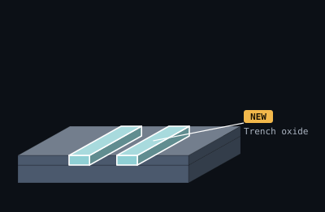
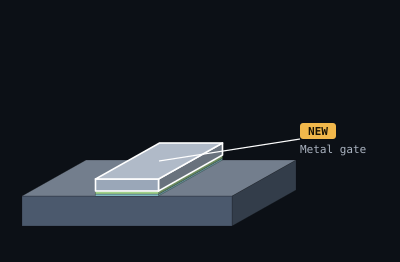
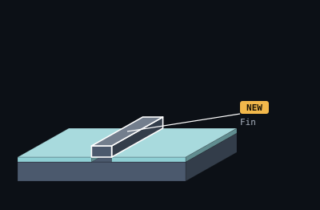
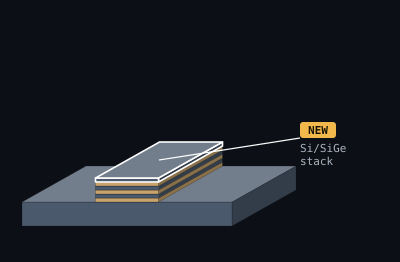
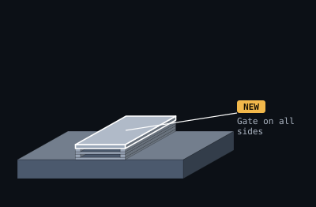
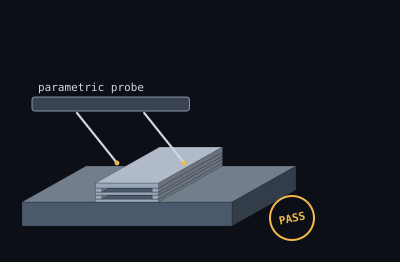

<!-- generated by scripts/build_manuals.py from data/manuals.json; edit there -->
# Manual 9 · Build the transistor in three dimensions

**Device modules: isolation, high-k metal gate, fins, a silicon–germanium stack, release and gate wrap.** A modern transistor is not a flat strip any more. To keep the gate in control of a channel only a few nanometres long, the channel was stood on edge as a fin and then split into stacked sheets that the gate wraps on every side. This manual walks through the modules that build it, each made of the operations in the earlier manuals.

The module sequence follows the multigate review by Ferain, Colinge and Colinge[1](#sources), the DELTA fin[2](#sources), Intel’s 45 nm high-k metal gate[3](#sources) and 14 nm FinFET[4](#sources), and IBM’s stacked nanosheets[5](#sources); the sheet release follows the Fab Journey’s release theatre.

[Open the web manual](https://normansrule.github.io/transistor-foundry-expedition/manuals/modules.html) (Save as PDF from there) · [All manuals](README.md)

> **Read this first.** This manual explains how a cleanroom does each step. It is not a procedure to try at home. Tier 2 and 3 steps use heat, vacuum and high-voltage equipment or hazardous chemicals that only trained staff may handle.

| You need | |
|---|---|
| Cleaned wafer | ×1 · Manual 2 · Cleaning |
| Lithography, etch, deposition, epitaxy and polish tools | ×1 |
| Cross-section microscope; parametric tester | ×1 |

## 1 · Isolate each transistor

**Do.** Etch shallow trenches around every active area, fill them with oxide and polish flat, so neighbouring transistors cannot talk to each other.

- shallow trench isolation replaced the older grown LOCOS oxide[6](#sources)

**Check.** Trenches filled with no voids; the surface is flat.

Operation specification · Tier 2 · heat or equipment

| | |
|---|---|
| Tool | Etcher, CVD, polisher |
| Purpose | Separate the transistors |
| Control | Trench depth; fill voids; step height after polish |
| Out of control | Void in the fill or dishing: rework the deposition or the polish |

**Process engineer.** The trench is etched, lined, filled by deposition and polished back to the silicon, combining Manuals 5, 7B and 8[6](#sources).

## 2 · Put a high-k metal gate on a flat channel

**Do.** Grow a thin interface oxide, deposit a high-k insulator by ALD and cap it with a metal gate. This was the planar transistor’s last big change.

- high-k metal gates entered volume production at 45 nm in 2007[3](#sources)

**Check.** Gate capacitance up, leakage down, threshold on target.

Operation specification · Tier 2 · heat or equipment

| | |
|---|---|
| Tool | ALD and metal deposition |
| Purpose | Thin the gate insulator electrically without the leakage |
| First volume high-k metal gate node | 45 nm (2007)[3](#sources) |
| Control | Equivalent oxide thickness, gate leakage, threshold voltage |
| Out of control | Threshold off: the gate-metal work function is wrong; leakage high: the high-k film is thin |

**Process engineer.** A higher dielectric constant gives the same capacitance from a thicker film, so electrons can no longer tunnel straight through it. Polysilicon gates were replaced by metals because they did not work with the new insulator[3](#sources).

## 3 · Stand the channel up as a fin

**Do.** Pattern and etch narrow silicon walls, then recess the isolation oxide so the top of each wall stands free. The gate will wrap three sides.

- the DELTA fin transistor was shown in 1989[2](#sources)
- 14 nm FinFETs needed self-aligned double patterning[4](#sources)

**Check.** Fin width and height on target; fins straight.

Operation specification · Tier 2 · heat or equipment

| | |
|---|---|
| Tool | Scanner with multiple patterning; etcher |
| Purpose | Give the gate control from three sides |
| Control | Fin width, height and pitch; fin bending |
| Out of control | Bent or thinned fins: tune the etch and the oxide recess |

**Process engineer.** A gate on three sides holds the channel off far better than a gate on one, so leakage stays low at short lengths[1](#sources). Fins narrower than the lithography can print are made by spacer patterning[4](#sources).

## 4 · Grow a silicon–germanium stack

**Do.** For nanosheets, grow alternating layers of silicon and silicon–germanium on the wafer, then etch them into fins.

- epitaxy gases are institution-only
- the silicon layers become the channels; the silicon–germanium is sacrificial

**Check.** Layer thicknesses and germanium content on target, with no defects.

Operation specification · Tier 3 · institution-only

| | |
|---|---|
| Tool | Epitaxy reactor, staff only |
| Purpose | Build the layers that become the stacked channels |
| Control | Set by the lab |
| Out of control | Defects in the stack: the lab requalifies the reactor |

**Process engineer.** Each layer grows in the crystal arrangement of the one below. The silicon–germanium is there only to hold the silicon sheets apart until the gate goes in[5](#sources). The reactor gases are institution-only.

## 5 · Release the sheets and wrap the gate

**Do.** With the source and drain in place, remove the dummy gate, etch the silicon–germanium away selectively and fill the gaps with high-k and gate metal, so the gate surrounds every sheet.

- the release etch chemistry is institution-only
- inner spacers protect the source and drain while the sheets are freed

**Check.** No silicon–germanium left; every sheet fully wrapped.

Operation specification · Tier 3 · institution-only

| | |
|---|---|
| Tool | Selective etch and replacement-gate tools, staff only |
| Purpose | Let the gate grip each channel from every side |
| Control | Set by the lab |
| Out of control | Leftover silicon–germanium or thinned sheets: the lab adjusts the etch |

**Process engineer.** The release etch removes silicon–germanium far faster than silicon, but not infinitely faster, so the sheet edges thin while the middle is still being freed. The Fab Journey’s release theatre computes that trade-off without giving any chemistry[5](#sources).

## 6 · Measure the transistors

**Do.** Probe test transistors for drive current, leakage and threshold, and cut cross-sections to check every sheet.

- nanosheet transistors entered volume production at the 2 nm class in 2025[7](#sources)

**Check.** Drive current and leakage on target across the wafer.

Operation specification · Tier 1 · care

| | |
|---|---|
| Tool | Parametric tester; cross-section microscope |
| Purpose | Confirm the transistors switch as designed |
| Control | On-current, off-current, threshold voltage, sheet thickness |
| Out of control | Threshold shifted: sheets thinned in the release; leakage: incomplete wrap |

**Process engineer.** Thinner sheets raise the threshold voltage and cut the drive current, so sheet thickness measured in cross-section is tied back to the electrical results[5](#sources).

## From a flat gate to a gate on every side

Each generation gave the gate more grip on the channel so the transistor could keep shrinking.

- High-k metal gates replaced oxide and polysilicon at 45 nm in 2007[3](#sources)
- The DELTA fin transistor was shown in 1989[2](#sources)
- Stacked nanosheets were shown as FinFET’s successor in 2017[5](#sources)
- Nanosheet transistors entered volume production at the 2 nm class in 2025[7](#sources)

> **Institution-only.** Epitaxy gases and the selective release etch are institution-only; every module runs in staff-operated tools.

## What the models leave out

- The pictures are schematic: real fins and sheets are a few nanometres thick and drawn far larger here.
- Source and drain epitaxy, inner spacers and the replacement-gate sequence are named, not drawn step by step.
- No epitaxy gas, etch chemistry or recipe is given: those are institution-only.
- Strain, work-function tuning and backside power delivery are left out.

## Sources

1. [I. Ferain, C. A. Colinge, J.-P. Colinge, "Multigate Transistors as the Future of Classical Metal–Oxide–Semiconductor Field-Effect Transistors," Nature 479, 310 (2011).](https://doi.org/10.1038/nature10676) `ferain2011`
2. [D. Hisamoto et al., "A Fully Depleted Lean-Channel Transistor (DELTA)—A Novel Vertical Ultrathin SOI MOSFET," IEDM (1989).](https://doi.org/10.1109/IEDM.1989.74182) `hisamoto1989`
3. [K. Mistry et al., "A 45nm Logic Technology with High-k+Metal Gate Transistors, Strained Silicon, 9 Cu Interconnect Layers, 193nm Dry Patterning, and 100% Pb-free Packaging," IEDM (2007).](https://doi.org/10.1109/IEDM.2007.4418914) `mistry2007`
4. [S. Natarajan et al., "A 14nm Logic Technology Featuring 2nd-Generation FinFET, Air-Gapped Interconnects, Self-Aligned Double Patterning and a 0.0588 µm² SRAM Cell Size," IEDM (2014).](https://doi.org/10.1109/IEDM.2014.7047058) `natarajan2014`
5. [N. Loubet et al., "Stacked Nanosheet Gate-All-Around Transistor to Enable Scaling Beyond FinFET," VLSI Technology Symp. (2017).](https://doi.org/10.23919/VLSIT.2017.7998183) `loubet2017`
6. [J. D. Plummer, M. D. Deal, P. B. Griffin, Silicon VLSI Technology: Fundamentals, Practice and Modeling, Prentice Hall (2000).]() `plummer2000`
7. [TSMC, "2nm Technology" (N2: volume production started Q4 2025).](https://www.tsmc.com/english/dedicatedFoundry/technology/logic/l_2nm) `tsmc_n2`
