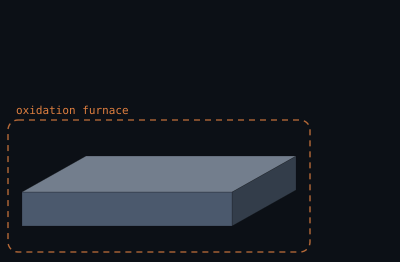
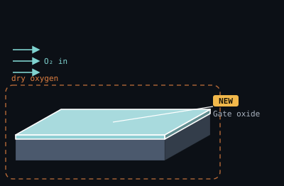
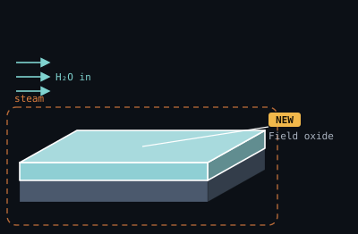
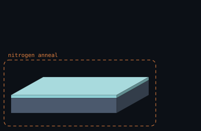
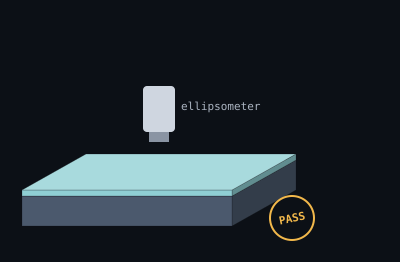

<!-- generated by scripts/build_manuals.py from data/manuals.json; edit there -->
# Manual 3 · Grow glass on the silicon

**Thermal oxidation: load, ramp, oxidise dry or wet, anneal, unload, measure.** Silicon makes its own insulator. Heat it in oxygen or steam and a layer of silicon dioxide grows from the surface down, part of it made of silicon taken from the wafer itself. That glass is the best-behaved interface any semiconductor has, and it made the planar process and the MOSFET possible.

Growth follows the Deal–Grove law[1](#sources) with the rate constants used across the site[2](#sources); furnace practice follows Plummer, Deal and Griffin[3](#sources); the recipes and thicknesses come from a four-mask NMOS run in a university teaching cleanroom[4](#sources).

[Open the web manual](https://normansrule.github.io/transistor-foundry-expedition/manuals/oxidation.html) (Save as PDF from there) · [All manuals](README.md)

> **Read this first.** This manual explains how a cleanroom does each step. It is not a procedure to try at home. Tier 2 and 3 steps use heat, vacuum and high-voltage equipment or hazardous chemicals that only trained staff may handle.

| You need | |
|---|---|
| Freshly cleaned wafer | ×1 · Manual 2 · Cleaning |
| Oxidation furnace | ×1 |
| Ellipsometer or reflectometer | ×1 |

## 1 · Load the boat

**Do.** Stand the wafers in a quartz boat with a monitor wafer at each end and push it slowly into the furnace while it idles under nitrogen.

- load straight from cleaning[3](#sources)
- slow push avoids warp and slip

**Check.** Every slot logged; monitors in place.

Operation specification · Tier 2 · heat or equipment

| | |
|---|---|
| Tool | Horizontal or vertical tube furnace |
| Purpose | Get clean wafers into the heat |
| Control | Load map and push speed |
| Out of control | Wafers waited too long after cleaning: clean again |

**Process engineer.** A wafer that waits after cleaning collects a native oxide and particles that would be sealed under the new film. Monitor wafers at both ends of the load show whether every position saw the same heat[3](#sources).

## 2 · Ramp up in nitrogen

**Do.** Raise the furnace to the oxidation temperature under nitrogen, so no oxide grows until the temperature is steady.

- the rate depends exponentially on temperature[1](#sources)

**Check.** All zones read the set point.

Operation specification · Tier 2 · heat or equipment

| | |
|---|---|
| Tool | Tube furnace with profiled zones |
| Purpose | Reach a stable temperature first |
| Control | Zone temperatures |
| Out of control | A zone off its set point: stop and recalibrate |

**Process engineer.** Both Deal–Grove rate constants follow Arrhenius laws, so a few degrees of error changes the thickness measurably[1](#sources),[2](#sources). Ramp rates and set points are part of every qualified recipe.

## 3 · Grow a gate oxide in dry oxygen

**Do.** Switch the gas to dry oxygen. A thin, dense oxide grows slowly and evenly from the surface down.

- teaching run: 1100 °C for 60 minutes gave 114 nm[4](#sources)
- Deal–Grove predicts 111 nm[1](#sources),[2](#sources)

**Check.** The monitor wafer will tell; nothing to see yet.

Operation specification · Tier 2 · heat or equipment

| | |
|---|---|
| Tool | Tube furnace |
| Purpose | Grow the insulator under the gate |
| Temperature | 1100 °C[4](#sources) |
| Time | 60 min[4](#sources) |
| Measured thickness | 114 nm[4](#sources) |
| Control | Time at temperature and gas flow |
| Out of control | Thin or thick on the monitor: check temperature profile and flow |

**Process engineer.** Oxygen diffuses through the oxide already grown and reacts at the silicon below. A thin film grows linearly, at B/A; a thick one slows to x² = Bt[1](#sources). For every nanometre of oxide, 0.44 nm of silicon is consumed[3](#sources).

## 4 · Grow a field oxide in steam

**Do.** For thick isolation, run a short dry step, a long step in steam, and a short dry step again. Steam carries far more oxidant through the oxide, so it grows many times faster.

- teaching run: dry–wet–dry, 5–90–5 minutes at 1000 °C[4](#sources)
- teaching run: 548 nm measured, 517 nm by Deal–Grove[4](#sources)

**Check.** The colour of the monitor wafer has changed through several orders of interference.

Operation specification · Tier 2 · heat or equipment

| | |
|---|---|
| Tool | Tube furnace with a steam source |
| Purpose | Grow a thick isolating oxide |
| Temperature | 1000 °C[4](#sources) |
| Dry–wet–dry | 5–90–5 min[4](#sources) |
| Measured thickness | 548 nm[4](#sources) |
| Control | Steam flow and time |
| Out of control | Thin oxide: the steam source may be running weak |

**Process engineer.** The dry steps give a clean interface underneath and a dense skin on top; the wet step does the bulk of the growth. Earlier runs of the same recipe gave 445 and 522 nm[5](#sources), so run-to-run spread is part of the lesson.

## 5 · Anneal in nitrogen

**Do.** Switch back to nitrogen and hold the temperature for a while. The oxide does not grow, but its charge settles.

- lowers the fixed charge near the interface[3](#sources)

**Check.** Gas switched; hold time logged.

Operation specification · Tier 2 · heat or equipment

| | |
|---|---|
| Tool | Tube furnace |
| Purpose | Reduce fixed oxide charge |
| Control | Anneal time and ambient |
| Out of control | High fixed charge on C–V tests: lengthen the anneal |

**Process engineer.** Charge left in the oxide near the interface shifts the threshold voltage of every transistor built on it. In the teaching run that charge pulled the thresholds negative, which the Process Lab works out from the measured values[6](#sources).

## 6 · Unload and measure

**Do.** Ramp down slowly, pull the boat out, and measure the monitor wafers at several points with an ellipsometer or a reflectometer.

- a colour chart gives a quick first estimate
- silicon consumed: 0.44 nm per nm of oxide[3](#sources)

**Check.** Mean and spread inside the limits for the recipe.

Operation specification · Tier 1 · care

| | |
|---|---|
| Tool | Ellipsometer or spectral reflectometer |
| Purpose | Confirm the thickness |
| Gate oxide, teaching run | 114 nm[4](#sources) |
| Field oxide, teaching run | 548 nm[4](#sources) |
| Control | Thickness map on monitors |
| Out of control | Out of limits: the lot is held and the furnace checked |

**Process engineer.** Ellipsometry fits the change in polarisation of reflected light to thickness and refractive index. A gate oxide is also tested electrically: capacitance against voltage gives its thickness, charge and interface quality[3](#sources).

## Dry oxygen versus steam

Dry oxide is slow and dense, for gates. Steam is fast, for thick isolation and masks.

- Grown oxide masks silicon against dopants[7](#sources)
- Thermal oxide passivates the silicon surface[8](#sources)
- Deal and Grove’s linear-parabolic law covers both dry and wet growth[1](#sources)
- Teaching run: the model lands within 6 % of the measured gate and field oxides[4](#sources)

## What the models leave out

- Deal–Grove underestimates very thin dry oxides, which grow faster at the start than the law predicts.
- The steam source is treated as one atmosphere of water vapour; a weak source gives less.
- Stress, orientation effects at edges and dopant-enhanced oxidation are not drawn.
- Furnace times and temperatures here are one teaching run’s values, not a qualified recipe for any tool.

## Sources

1. [B. E. Deal, A. S. Grove, "General Relationship for the Thermal Oxidation of Silicon," J. Appl. Phys. 36, 3770 (1965).](https://doi.org/10.1063/1.1713945) `dealgrove1965`
2. [C. Hollauer, "Modeling of Thermal Oxidation and Stress Effects," PhD thesis, TU Wien, Sec. 2.6: The Deal-Grove Model (Arrhenius parameters for dry and wet oxidation) (2007).](https://www.iue.tuwien.ac.at/phd/hollauer/node16.html) `hollauer_dg`
3. [J. D. Plummer, M. D. Deal, P. B. Griffin, Silicon VLSI Technology: Fundamentals, Practice and Modeling, Prentice Hall (2000).]() `plummer2000`
4. [R. Loberg and A. Norman, "Four-mask NMOS fabrication run: process record and in-line measurements," university teaching cleanroom (2024), unpublished; measured data shared by the authors.]() `cleanroom_run_fab2024`
5. [Fabrication process manual for a four-mask NMOS teaching process, with records of earlier runs, university teaching cleanroom (2023), unpublished.]() `teaching_process_manual2023`
6. [R. Loberg and A. Norman, "Four-mask NMOS fabrication run: electrical characterization," university teaching cleanroom (2024), unpublished; measured data shared by the authors.]() `cleanroom_run_char2024`
7. [C. J. Frosch, L. Derick, "Surface Protection and Selective Masking during Diffusion in Silicon," J. Electrochem. Soc. 104, 547 (1957).](https://doi.org/10.1149/1.2428650) `frosch1957`
8. [M. M. Atalla, E. Tannenbaum, E. J. Scheibner, "Stabilization of Silicon Surfaces by Thermally Grown Oxides," Bell Syst. Tech. J. 38, 749 (1959).](https://doi.org/10.1002/j.1538-7305.1959.tb03907.x) `atalla1959`
