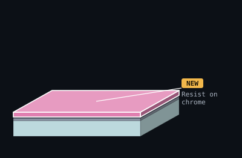
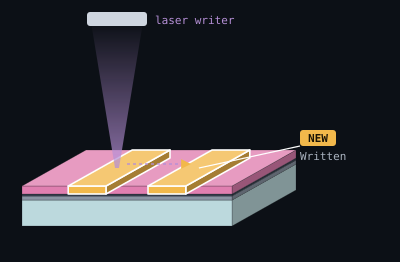
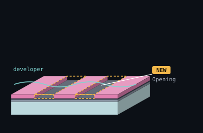
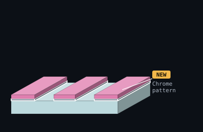
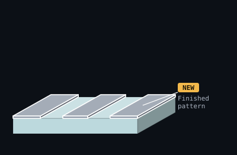
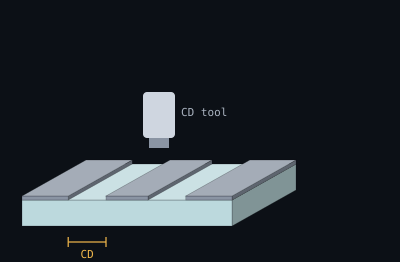
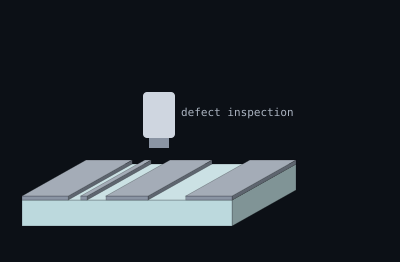
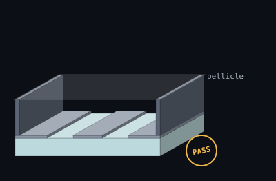

<!-- generated by scripts/build_manuals.py from data/manuals.json; edit there -->
# Manual 4B · Make the photomask

**Mask making: blank, write, develop, etch the chrome, strip, measure, inspect and repair, mount the pellicle.** Before a wafer can be patterned, the pattern has to exist as a mask: a plate of glass with a thin opaque film where light must be blocked. A mask is written once, checked obsessively and then used to print thousands of wafers. A device can need between 5 and 40 or more of them.

The sequence follows public descriptions from two mask makers[1](#sources),[2](#sources), with mask types and numbers from the Photomask article[3](#sources).

[Open the web manual](https://normansrule.github.io/transistor-foundry-expedition/manuals/photomask.html) (Save as PDF from there) · [All manuals](README.md)

> **Read this first.** This manual explains how a cleanroom does each step. It is not a procedure to try at home. Tier 2 and 3 steps use heat, vacuum and high-voltage equipment or hazardous chemicals that only trained staff may handle.

| You need | |
|---|---|
| Mask blank: quartz or glass with chrome and resist | ×1 |
| Laser or electron-beam writer time | ×1 |
| The layout file for this layer | ×1 |

## 1 · Start with a blank

**Do.** Take a plate of fused silica (quartz) or soda-lime glass coated with chrome, an anti-reflective layer and resist.

- fused silica (QZ) or soda-lime glass (SL)[1](#sources)
- reticles are typically quartz[1](#sources)

**Check.** No scratches, pinholes or particles on the blank.

Operation specification · Tier 0 · safe

| | |
|---|---|
| Tool | Blank stocker |
| Purpose | Supply a defect-free plate |
| Control | Blank defect map from the supplier |
| Out of control | Defect on blank: reject it |

**Process engineer.** Quartz transmits deep-ultraviolet light and barely expands with heat, so it is used for reticles in steppers and scanners; soda-lime glass is cheaper and serves for copy masks and contact printing[1](#sources). Chromium is used because it blocks ultraviolet light well[3](#sources).

## 2 · Write the pattern

**Do.** A laser or electron beam scans the layout into the resist, piece by piece, straight from the design file.

- laser writer with a micromirror array, 0.8 µm pixels[2](#sources)
- leading-edge masks: electron-beam writers[4](#sources)

**Check.** The writer logs every field as written.

Operation specification · Tier 2 · heat or equipment

| | |
|---|---|
| Tool | Laser or electron-beam mask writer |
| Purpose | Turn the layout into a latent image |
| Laser-writer pixel (example) | 0.8 µm[2](#sources) |
| Control | Writer calibration; stitching marks |
| Out of control | Stitching error between fields: rewrite on a new blank |

**Process engineer.** No mask exists yet to copy from, so the pattern is drawn directly. A laser writer flashes frames through a digital micromirror device and stitches them together[2](#sources). Masks for advanced nodes are written with electron beams[4](#sources).

## 3 · Develop

**Do.** Dissolve the written resist so the chrome shows through where the pattern must become clear.

- developer: institution-only handling

**Check.** Openings are clean down to the chrome.

Operation specification · Tier 2 · heat or equipment

| | |
|---|---|
| Tool | Mask developer |
| Purpose | Open the resist |
| Control | Visual and CD check |
| Out of control | Scum: rework or reject |

**Process engineer.** This is the same chemistry as wafer lithography (Manual 4A), on a glass plate instead of silicon[1](#sources).

## 4 · Etch the chrome

**Do.** Remove the chrome through the resist openings so light can pass there.

- a chemical process that removes chrome selectively[2](#sources)
- chrome etchant: institution-only

**Check.** Clear areas are fully transparent.

Operation specification · Tier 3 · institution-only

| | |
|---|---|
| Tool | Mask etch station |
| Purpose | Transfer the pattern into the chrome |
| Control | Clear-area transmission; CD |
| Out of control | Chrome left in openings: re-etch or reject |

**Process engineer.** The chrome etchant is hazardous chemistry handled only by trained staff, so this step is conceptual here. Advanced masks are etched in a plasma instead, for the same reason wafers are: straighter edges[4](#sources).

## 5 · Strip the resist

**Do.** Remove the remaining resist. What is left is the chrome pattern on glass.

- chrome on quartz or soda-lime, with the anti-reflective coating[2](#sources)

**Check.** No resist residue.

Operation specification · Tier 2 · heat or equipment

| | |
|---|---|
| Tool | Resist strip and clean |
| Purpose | Leave a clean chrome-on-glass pattern |
| Control | Particle count after clean |
| Out of control | Particles: clean again |

**Process engineer.** The plate now works like a stencil: it blocks light where chrome remains and passes it where chrome was etched.

## 6 · Measure the critical dimensions

**Do.** Measure line widths at many points and check them against the design.

- CD measurement[1](#sources)

**Check.** Every measured width is inside its tolerance.

Operation specification · Tier 0 · safe

| | |
|---|---|
| Tool | Mask CD metrology |
| Purpose | Prove the mask prints the right size |
| Control | CD mean and uniformity |
| Out of control | Out of tolerance: reject the mask |

**Process engineer.** A reticle used at 4× reduction prints features four times smaller than it carries[3](#sources), so a mask error also shrinks by four on the wafer.

## 7 · Inspect and repair

**Do.** Compare the whole mask against the design to find any defect, and repair it if possible.

- inspect, then repair if necessary[1](#sources)

**Check.** No printable defect remains.

Operation specification · Tier 2 · heat or equipment

| | |
|---|---|
| Tool | Mask inspection and repair tools |
| Purpose | Make the mask defect-free |
| Control | Defect list after inspection |
| Out of control | Unrepairable defect: rewrite the mask |

**Process engineer.** One defect on a mask repeats on every die it prints, on every wafer. That is why masks are inspected far more strictly than wafers. A small chrome spot (drawn here between the lines) would be removed or patched by repair tools.

## 8 · Mount the pellicle

**Do.** Glue a frame over the pattern with a thin transparent film stretched across it. Dust now lands on the film, out of focus.

- a protective pellicle is attached last[1](#sources)
- pellicle film on a frame glued over one side[3](#sources)

**Check.** The pellicle is flat and free of particles.

Operation specification · Tier 0 · safe

| | |
|---|---|
| Tool | Pellicle mounter |
| Purpose | Keep particles out of focus |
| Control | Particle check through the pellicle |
| Out of control | Particle under the pellicle: remove, clean, remount |

**Process engineer.** A particle sitting on the pellicle is millimetres above the pattern, far outside the depth of focus of the projection lens, so it does not print[3](#sources).

## From contact masks to EUV reticles

As features shrank, masks changed from simple chrome stencils to precision optical parts.

- Steppers and scanners project the mask pattern shrunk four or five times[3](#sources)
- Reduction ratios on offer include 1:1, 2.5:1, 4:1 and 5:1[1](#sources)
- Features of about 150 nm and below generally need phase-shifting masks[3](#sources)
- EUV masks reflect light from many alternating molybdenum and silicon layers[3](#sources),[5](#sources)
- One high-end phase-shift mask could cost up to $100,000 in 2006[3](#sources)
- A functioning device can need between 5 and 40+ masks[1](#sources)

**Which mask for which light**

| Exposure | Wavelength | Mask |
|---|---|---|
| Mask aligner (contact) | broadband or near-UV, 300–450 nm[1](#sources) | chrome on soda-lime or quartz, 1:1[1](#sources) |
| i-line to deep-UV stepper or scanner | 365, 248 or 193 nm[1](#sources) | chrome on quartz reticle, 4× or 5×[3](#sources) |
| EUV scanner | 13.5 nm[6](#sources) | reflective Mo/Si multilayer[3](#sources) |

## What the models leave out

- Optical proximity correction and inverse lithography reshape the drawn features on the mask; they are not drawn here.
- Mask writing times, data volumes and write strategies are only mentioned.
- Chrome etch and resist strip chemistry are named but never given as procedures.

## Sources

1. [Compugraphics Photomasks, "Education centre: what is a photomask?" (fused-silica or soda-lime substrates with an opaque film; write, develop, etch, measure, inspect, repair, pellicle; 5 to 40+ masks per device).](https://compugraphics-photomasks.com/education-centre/) `compugraphics_masks`
2. [S. Cargou, "Fabrication of glass and film photomasks," Elveflow microfluidic reviews (2022, updated 2025) (chrome blank with anti-reflective coating and resist; laser writer with micromirror array, 0.8 µm pixels).](https://elveflow.com/microfluidic-reviews/fabrication-of-glass-and-film-photomasks/) `elveflow_masks`
3. [Wikipedia, "Photomask" (chromium on fused silica; 4× or 5× reduction; phase shifting below about 150 nm; pellicles; reflective Mo/Si EUV masks; mask costs).](https://en.wikipedia.org/wiki/Photomask) `wiki_photomask`
4. [H. J. Levinson, Principles of Lithography, 4th ed., SPIE Press (2019).](https://doi.org/10.1117/3.2525306) `levinson2019`
5. [University of Kassel, Institute of Nanostructure Technologies and Analytics, "Multilayer Structures for the Lithography in Extreme UV (EUVL)" (typically 40 Mo/Si bilayers, reflectivity up to 70 %).](https://www.uni-kassel.de/forschung/en/ina/technological-electronics/research/past-projects/multilayer-structures-for-the-lithography-in-extreme-uv-euvl.html) `kassel_euvml`
6. [ASML, EUV lithography systems (NXE and EXE High-NA platforms).](https://www.asml.com/en/products/euv-lithography-systems) `asml_euv`
