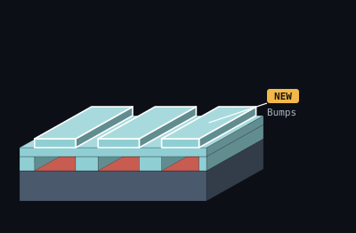
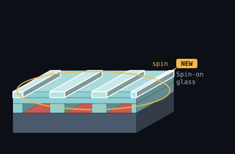
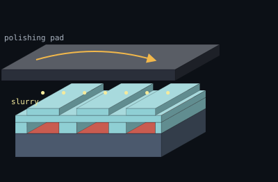
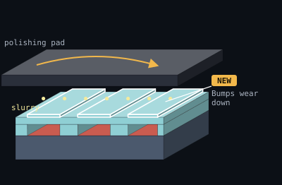
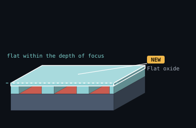
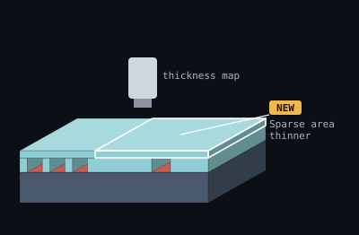
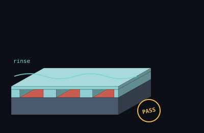

<!-- generated by scripts/build_manuals.py from data/manuals.json; edit there -->
# Manual 8 · Make the surface flat again

**Planarization: spin-on glass in older processes, chemical mechanical polishing (CMP) today.** Every patterned layer leaves bumps, and each new layer copies them. After a few layers the surface is too uneven for the next lithography step to focus on. Planarization flattens it again: first with liquid spin-on glass, and since the 1990s with chemical mechanical polishing, which grinds the wafer flat with a pad and a slurry.

CMP follows Preston’s law[1](#sources) and the pattern-density model the Fab Journey’s CMP theatre uses[2](#sources); tool facts come from the CMP article[3](#sources).

[Open the web manual](https://normansrule.github.io/transistor-foundry-expedition/manuals/planarize.html) (Save as PDF from there) · [All manuals](README.md)

> **Read this first.** This manual explains how a cleanroom does each step. It is not a procedure to try at home. Tier 2 and 3 steps use heat, vacuum and high-voltage equipment or hazardous chemicals that only trained staff may handle.

| You need | |
|---|---|
| Wafer with a bumpy oxide over lines | ×1 · Manual 7B · Deposition |
| Polisher with pad and slurry | ×1 |

## 1 · See the problem

**Do.** Look at the wafer after deposition. The oxide copies every line underneath, so the top is a row of bumps.

- lithography needs the surface inside the depth of focus[3](#sources)

**Check.** Measure the step height across the lines.

Operation specification · Tier 0 · safe

| | |
|---|---|
| Tool | Profilometer |
| Purpose | Know the step height before polishing |
| Control | Step height across the die |
| Out of control | Steps too tall for the next layer: planarize |

**Process engineer.** Each new film follows the shape under it. Without planarization the steps add up layer after layer, and a lens with a shallow depth of focus cannot image the top and bottom of a step at once[3](#sources).

## 2 · Older fix: spin-on glass

**Do.** Spin a liquid glass onto the wafer like resist. It flows into the low places, then a bake turns it solid.

- spun, then cured in a furnace[4](#sources)
- smooths but does not fully flatten

**Check.** Gaps are filled and the film has no cracks.

Operation specification · Tier 2 · heat or equipment

| | |
|---|---|
| Tool | Spin coater and cure furnace |
| Purpose | Fill gaps and soften steps |
| Control | Thickness and crack inspection |
| Out of control | Cracks: thinner coats or a slower cure |

**Process engineer.** Spin-on glass fills narrow gaps and rounds steps off, but it only smooths the surface locally: wide features still leave a step. It was widely used before chemical mechanical polishing took over[4](#sources).

## 3 · Mount face down on the pad

**Do.** Hold the wafer upside down in a carrier and press it onto a rotating polishing pad wetted with slurry.

- porous polymer pad, 30–50 µm pores[3](#sources)
- abrasive slurry, often cerium dioxide[3](#sources)

**Check.** Pad conditioned, slurry flowing, carrier pressure set.

Operation specification · Tier 2 · heat or equipment

| | |
|---|---|
| Tool | CMP polisher: platen, pad, carrier, slurry arm, pad conditioner |
| Purpose | Set up the polish |
| Pad pore size | 30–50 µm[3](#sources) |
| Control | Pad condition; slurry flow; down-force |
| Out of control | Glazed pad, slow removal: recondition the pad |

**Process engineer.** The pad is consumed as it works and is regularly reconditioned[3](#sources). The slurry is both chemical and mechanical: its chemistry softens the surface and its abrasive particles wipe the softened layer away[3](#sources).

## 4 · Polish the high spots first

**Do.** Spin pad and wafer. The pad touches the bumps first, so they wear away fastest.

- Preston: rate = Kₚ · P · V[1](#sources)
- raised areas carry the pressure[2](#sources)

**Check.** Removal rate on a monitor wafer matches the expected value.

Operation specification · Tier 2 · heat or equipment

| | |
|---|---|
| Tool | CMP polisher |
| Purpose | Remove the topography |
| Control | Removal rate (Preston) and time |
| Out of control | Rate drifts: check pad and slurry |

**Process engineer.** Preston’s law says removal rate is proportional to pressure times sliding speed[1](#sources). Over a pattern the pad rests only on the high areas at first, so their local pressure is higher and they polish faster until the step is gone[2](#sources).

## 5 · Stop when it is flat

**Do.** Keep polishing until the bumps are gone and the oxide over the lines has the target thickness.

- brings the surface within the depth of field[3](#sources)

**Check.** The surface is flat within what lithography can focus on.

Operation specification · Tier 2 · heat or equipment

| | |
|---|---|
| Tool | CMP polisher with endpoint or timed polish |
| Purpose | Reach a flat surface at target thickness |
| Control | Remaining thickness by reflectometry |
| Out of control | Too thin: the lines may be exposed; scrap or add oxide |

**Process engineer.** On metal layers the polish is designed to stop on the interface between copper and oxide[3](#sources), so the metal is left only inside the trenches: the damascene method.

## 6 · Mind the pattern density

**Do.** Check dense and sparse regions. Dense patterns polish more slowly, sparse ones faster, so the die is not perfectly flat.

- dense regions planarize more slowly[2](#sources)
- fix: dummy fill in empty areas

**Check.** Thickness difference between dense and sparse areas is within limit.

Operation specification · Tier 0 · safe

| | |
|---|---|
| Tool | Film-thickness mapping |
| Purpose | Catch layout-dependent unevenness |
| Control | Within-die thickness range |
| Out of control | Too uneven: add dummy fill to the layout |

**Process engineer.** Because the pad shares its pressure over the raised area, local removal depends on the layout’s pattern density[2](#sources). Designers add dummy fill so every region has a similar density. Copper lines can also be dished below the oxide, and dense arrays eroded: both are density effects.

## 7 · Clean off the slurry

**Do.** Scrub and rinse the wafer so no slurry particles stay behind.

- post-CMP clean[4](#sources)

**Check.** Particle count after clean is within limit.

Operation specification · Tier 2 · heat or equipment

| | |
|---|---|
| Tool | Post-CMP brush cleaner |
| Purpose | Remove slurry and debris |
| Control | Particle count; scratch inspection |
| Out of control | Scratches or particles: check the pad, slurry filter and cleaner |

**Process engineer.** Slurry particles left on the wafer become defects in the next layer. CMP can also cause stress cracking, delamination at weak interfaces and corrosion from the slurry chemicals[3](#sources).

## Three polishes in every modern chip

CMP is not one step but a family, each tuned to stop on a different material.

- Shallow trench isolation: the oxide overburden left after trench fill is polished away[3](#sources)
- Tungsten contacts and plugs are polished back to the oxide[3](#sources)
- Copper damascene: the polish stops at the copper–oxide interface[3](#sources)
- Removal rate follows pressure × speed (Preston’s law)[1](#sources)
- Pattern density sets how fast each region planarizes[2](#sources)

**Spin-on glass versus CMP**

|  | Spin-on glass | CMP |
|---|---|---|
| How | liquid glass spun on and cured[4](#sources) | pad and abrasive slurry[3](#sources) |
| Flatness | local smoothing only | flat across the die, within the depth of field[3](#sources) |
| Main risk | cracking | dishing, erosion, scratches[2](#sources),[3](#sources) |

## What the models leave out

- Removal rates, pad materials and slurries vary widely; the model uses teaching values.
- Pad wear, temperature and slurry chemistry are not modelled.
- Spin-on glass chemistry and cure recipes are not given.

## Sources

1. [F. W. Preston, "The Theory and Design of Plate Glass Polishing Machines," J. Soc. Glass Technol. 11, 214 (1927).]() `preston1927`
2. [B. E. Stine, D. O. Ouma, R. R. Divecha, D. S. Boning, J. E. Chung et al., "Rapid Characterization and Modeling of Pattern-Dependent Variation in Chemical-Mechanical Polishing," IEEE Trans. Semicond. Manuf. 11(1), 129 (1998).]() `stine1998`
3. [Wikipedia, "Chemical-mechanical polishing" (abrasive slurry, porous polymer pads with 30–50 µm pores, use for oxide, tungsten and copper, STI overburden, defects).](https://en.wikipedia.org/wiki/Chemical-mechanical_polishing) `wiki_cmp`
4. [J. D. Plummer, M. D. Deal, P. B. Griffin, Silicon VLSI Technology: Fundamentals, Practice and Modeling, Prentice Hall (2000).]() `plummer2000`
