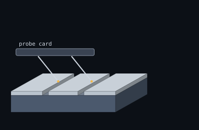
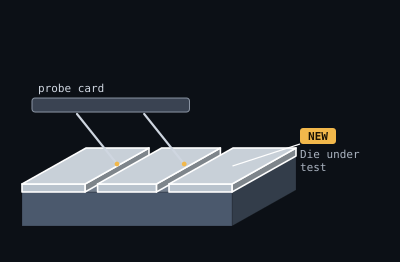
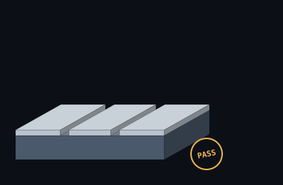
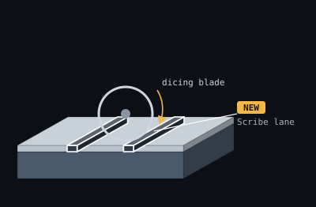
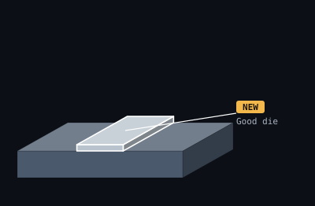
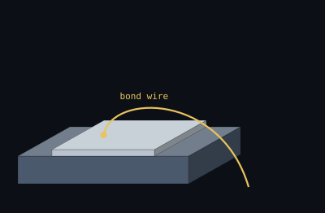
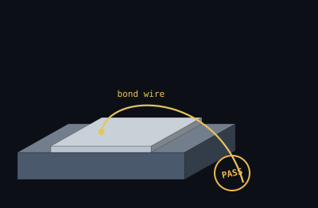

<!-- generated by scripts/build_manuals.py from data/manuals.json; edit there -->
# Manual 11 · Find the good dies and package them

**Back end: probe test structures, test every die, map, saw, pick, bond and test again.** A finished wafer holds anything from a handful to hundreds of chips, and some are dead. Probing finds them, a saw cuts the wafer apart, and only the good dies are packaged and wired to the outside world. No test catches every fault, so the last question is how many bad chips slip through.

Yield follows Stapper’s negative-binomial model[1](#sources) and Murphy’s cost argument[2](#sources); escaped defects follow Williams and Brown[3](#sources); the teaching-run results come from its electrical characterization[4](#sources). The probe theatre computes all of it.

[Open the web manual](https://normansrule.github.io/transistor-foundry-expedition/manuals/probe.html) (Save as PDF from there) · [All manuals](README.md)

> **Read this first.** This manual explains how a cleanroom does each step. It is not a procedure to try at home. Tier 2 and 3 steps use heat, vacuum and high-voltage equipment or hazardous chemicals that only trained staff may handle.

| You need | |
|---|---|
| Finished, sintered wafer | ×1 · Manual 7A · Metal |
| Wafer prober and probe card | ×1 |
| Dicing saw, die picker, wire bonder | ×1 |

## 1 · Probe the test structures

**Do.** Lower needles onto the test resistors, capacitors and transistors beside the dies and measure them first. They tell you whether the process worked before any chip is tested.

- teaching run: 8 of 9 test MOSFETs switched[4](#sources)
- test structures sit in the scribe lanes

**Check.** Threshold voltages and sheet resistances are inside their limits.

Operation specification · Tier 0 · safe

| | |
|---|---|
| Tool | Wafer prober with a parametric analyser |
| Purpose | Check the process before the product |
| Working MOSFETs, teaching run | 8 of 9[4](#sources) |
| Control | Device parameters against limits |
| Out of control | Parameters out of range: hold the lot and tell process engineering |

**Process engineer.** Parametric tests measure the process, not the design. In the teaching run they showed thresholds pulled negative by charge in the oxide, and one short-channel device that never turned off[4](#sources).

## 2 · Test every die

**Do.** Step the wafer under the probe card die by die and run the test patterns. Each die passes or is put in a failure bin.

- fault coverage: the share of modelled faults the patterns catch[3](#sources)

**Check.** Every die has a result.

Operation specification · Tier 0 · safe

| | |
|---|---|
| Tool | Wafer prober and automatic tester |
| Purpose | Sort good dies from bad |
| Control | Fault coverage and test time per die |
| Out of control | A whole region fails: look for a tool problem, not random defects |

**Process engineer.** Scan chains let a few pins reach millions of internal flip-flops, so patterns can be generated automatically for a fault model. Test time costs money, so patterns that fail bad dies early run first[3](#sources).

## 3 · Make the wafer map

**Do.** Colour each die by its result. The pattern of failures says as much as their number.

- Y = (1 + A·D₀/α)^(−α)[1](#sources)
- big dies catch more defects[2](#sources)

**Check.** The map is saved with the lot record.

Operation specification · Tier 0 · safe

| | |
|---|---|
| Tool | Wafer map software |
| Purpose | Record yield and failure patterns |
| Control | Yield per wafer and per lot |
| Out of control | Rings, scratches or clusters: trace them to a tool |

**Process engineer.** Defects cluster, so the negative-binomial model with a clustering parameter α fits real wafers better than a random scatter[1](#sources). Murphy showed in 1964 that yield and die size together set the cost of a chip[2](#sources).

## 4 · Saw the wafer apart

**Do.** Mount the wafer on tape in a frame and cut along the scribe lanes with a diamond blade. The dies stay on the tape.

- the cut destroys the test structures in the lanes
- some wafers are cut by laser instead

**Check.** Clean cuts; no chipped die edges.

Operation specification · Tier 2 · heat or equipment

| | |
|---|---|
| Tool | Dicing saw with water cooling |
| Purpose | Separate the dies |
| Control | Kerf width and edge chipping |
| Out of control | Chipped edges: slow the feed or change the blade |

**Process engineer.** Cooling water carries heat and debris away. An edge chip that looks harmless can grow into a crack once the die is stressed in its package.

## 5 · Pick the good dies

**Do.** The picker reads the wafer map and lifts only the dies that passed. Each is inspected before it goes into a tray or onto a package.

- cost per good die is wafer cost divided by good dies[2](#sources)

**Check.** Only passing dies leave the tape.

Operation specification · Tier 0 · safe

| | |
|---|---|
| Tool | Die picker with vision |
| Purpose | Keep only known-good dies |
| Control | Map-to-die matching |
| Out of control | Picker and map disagree: stop and re-align |

**Process engineer.** Chiplets and 3D stacks join several dies in one package, so a single bad die wastes all the good ones beside it: every die must be known good before it is assembled[5](#sources).

## 6 · Bond wires to the pads

**Do.** Glue the die into its package, then join each pad to a package lead with a fine wire.

- gold or copper wire, welded by heat and ultrasound
- advanced packages use bumps instead[5](#sources)

**Check.** Every wire passes a pull test on samples.

Operation specification · Tier 2 · heat or equipment

| | |
|---|---|
| Tool | Wire bonder |
| Purpose | Connect the die to the outside |
| Control | Bond pull and shear strength |
| Out of control | Weak bonds: clean the pads and recheck the bond settings |

**Process engineer.** Wire bonds have joined chips to packages since the planar era. Modern high-performance packages replace them with solder bumps or direct copper-to-copper bonding between stacked dies[5](#sources).

## 7 · Test again, packaged

**Do.** Test the packaged part at speed and temperature. Assembly can damage a die, and some faults are only reachable through the package.

- defect level DL = 1 − Y^(1 − T)[3](#sources)
- 90 % coverage lets about ten times more bad parts through than 99 %[3](#sources)

**Check.** The part passes, and is marked and shipped.

Operation specification · Tier 0 · safe

| | |
|---|---|
| Tool | Final tester and burn-in ovens |
| Purpose | Ship only good parts |
| Control | Defect level in parts per million |
| Out of control | Escapes at the customer: raise test coverage |

**Process engineer.** Williams and Brown showed that the share of bad parts that pass the test depends on both yield and fault coverage, DL = 1 − Y^(1 − T)[3](#sources). The probe theatre lets you change both.

## How many bad chips slip through

Yield says how many dies are good. Test coverage says how many of the bad ones you catch.

- Murphy related die size to yield and cost in 1964[2](#sources)
- Stapper modelled defect clustering with the negative binomial in 1973[1](#sources)
- Williams and Brown linked fault coverage to the defect level customers see in 1981[3](#sources)
- Teaching run: 8 of 9 test MOSFETs switched; the shortest never turned off[4](#sources)

## What the models leave out

- Every defect is treated as a killer; real tests bin dies by speed and repair memory with spare rows.
- The defect-level formula assumes faults are equally likely and independent.
- Saw, pick and bond are drawn, not modelled; their own yield losses are left out.
- Burn-in, reliability screens and packaging stress are only mentioned.

## Sources

1. [C. H. Stapper, "Defect Density Distribution for LSI Yield Calculations," IEEE Trans. Electron Devices 20, 655 (1973).](https://doi.org/10.1109/T-ED.1973.17715) `stapper1973`
2. [B. T. Murphy, "Cost-Size Optima of Monolithic Integrated Circuits," Proc. IEEE 52, 1537 (1964).](https://doi.org/10.1109/PROC.1964.3442) `murphy1964`
3. [T. W. Williams, N. C. Brown, "Defect Level as a Function of Fault Coverage," IEEE Trans. Computers C-30(12), 987 (1981).]() `williams1981`
4. [R. Loberg and A. Norman, "Four-mask NMOS fabrication run: electrical characterization," university teaching cleanroom (2024), unpublished; measured data shared by the authors.]() `cleanroom_run_char2024`
5. [TSMC, "3DFabric" (CoWoS, InFO and SoIC packaging family).](https://3dfabric.tsmc.com/english/dedicatedFoundry/technology/3DFabric.htm) `tsmc_3dfabric`
