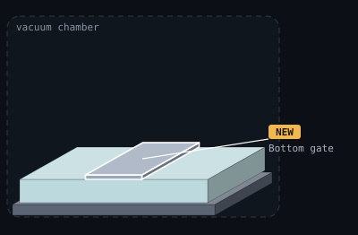
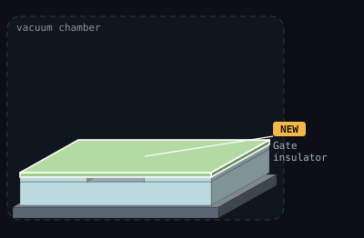
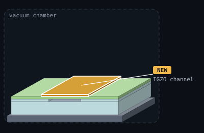
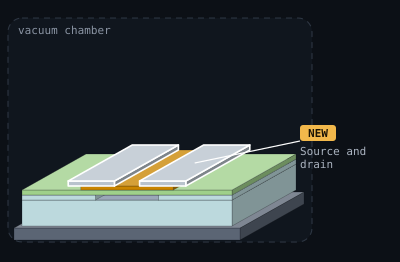
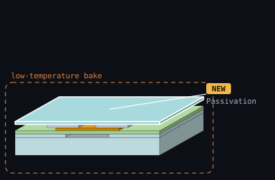
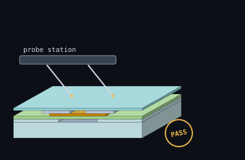

<!-- generated by scripts/build_manuals.py from data/manuals.json; edit there -->
# Manual 12 · Make a transistor on glass

**An oxide thin-film transistor (IGZO): another process family, built at low temperature with no crystal at all.** Not every transistor starts from a silicon crystal. The screen you are reading is driven by thin-film transistors built on glass, layer by deposited layer. Amorphous oxide semiconductors such as indium–gallium–zinc oxide (IGZO) can even be made at room temperature on plastic. This manual builds a bottom-gate oxide transistor with the operations from the earlier manuals.

The device follows the thin-film transistor of Weimer[1](#sources) and the room-temperature amorphous-oxide transistor of Nomura et al.[2](#sources); the flexible processor example is Ozer et al.[3](#sources); deposition and patterning follow Manuals 4A, 5 and 7B and Plummer, Deal and Griffin[4](#sources).

[Open the web manual](https://normansrule.github.io/transistor-foundry-expedition/manuals/tft.html) (Save as PDF from there) · [All manuals](README.md)

> **Read this first.** This manual explains how a cleanroom does each step. It is not a procedure to try at home. Tier 2 and 3 steps use heat, vacuum and high-voltage equipment or hazardous chemicals that only trained staff may handle.

| You need | |
|---|---|
| Clean glass (or plastic) sheet | ×1 |
| Sputter and deposition tools | ×1 |
| Lithography and etch; probe station | ×1 |

## 1 · Pattern a metal gate on the glass

**Do.** Deposit a metal film on the glass and pattern it into gate lines. The gate sits at the bottom of this transistor.

- the first thin-film transistor was shown in 1962[1](#sources)

**Check.** Gate lines continuous; edges smooth.

Operation specification · Tier 2 · heat or equipment

| | |
|---|---|
| Tool | Sputter, aligner, etch |
| Purpose | Make the gate first, on an insulating sheet |
| Control | Line width; sheet resistance |
| Out of control | Rough edges: they will thin the insulator above them |

**Process engineer.** With no crystal to build on, every layer is deposited. Putting the gate first lets the semiconductor go on last, over a smooth insulator[1](#sources).

## 2 · Deposit the gate insulator

**Do.** Cover everything with a thin insulating film by CVD or sputtering.

- deposited, not grown: there is no silicon to oxidise[4](#sources)

**Check.** Thickness and leakage on target.

Operation specification · Tier 2 · heat or equipment

| | |
|---|---|
| Tool | CVD or sputter chamber |
| Purpose | Separate the gate from the channel |
| Control | Thickness; breakdown on capacitors |
| Out of control | Leaky capacitors: pinholes; deposit thicker or cleaner |

**Process engineer.** On silicon the best insulator is grown from the wafer itself. On glass it has to be deposited, so its quality sets much of the transistor’s behaviour[4](#sources).

## 3 · Sputter the oxide semiconductor

**Do.** Sputter a thin amorphous IGZO film over the gate and pattern it into islands. It works without being crystallised, and it can be made at room temperature.

- amorphous oxide transistors made at room temperature on plastic[2](#sources)

**Check.** Island thickness and resistance on monitors on target.

Operation specification · Tier 2 · heat or equipment

| | |
|---|---|
| Tool | Sputter chamber |
| Purpose | Lay the channel over the gate |
| Control | Film thickness; oxygen content set by the lab |
| Out of control | Channel too conductive: the transistor will not switch off |

**Process engineer.** Electrons in these oxides travel through overlapping metal orbitals, which work even when the atoms are disordered, so the film needs no crystal and no high temperature[2](#sources).

## 4 · Add source and drain

**Do.** Deposit and pattern metal over the ends of each island, leaving a gap over the gate: that gap is the channel length.

- the gap between source and drain is the channel length[1](#sources)

**Check.** Gap length on target; contacts ohmic.

Operation specification · Tier 2 · heat or equipment

| | |
|---|---|
| Tool | Sputter, aligner, etch |
| Purpose | Connect the channel |
| Control | Gap length; contact resistance |
| Out of control | Gap bridged: short; rework the etch |

**Process engineer.** The etch that separates source from drain must not eat the thin semiconductor below it, so the chemistries are chosen for selectivity, as in Manual 5[4](#sources).

## 5 · Seal and anneal

**Do.** Cover the transistor with a protective film and give it a mild bake, which steadies the oxide semiconductor.

- sealing keeps moisture and oxygen from shifting the threshold[2](#sources)

**Check.** Threshold stable under bias stress.

Operation specification · Tier 2 · heat or equipment

| | |
|---|---|
| Tool | CVD chamber; oven |
| Purpose | Protect and stabilise the transistor |
| Control | Threshold shift under bias |
| Out of control | Threshold drifts: improve the seal or the bake |

**Process engineer.** Oxide semiconductors respond to the gases around them, so an unsealed transistor drifts. The bake stays far below what a silicon furnace uses, which is why plastic sheets survive it[2](#sources).

## 6 · Measure and compare

**Do.** Probe the transfer curve: drain current against gate voltage. Compare its on–off ratio and threshold with the silicon transistors in the other manuals.

- a bendable RISC-V processor was built from 0.6 µm IGZO transistors[3](#sources)

**Check.** On–off ratio and threshold within spec across the sheet.

Operation specification · Tier 1 · care

| | |
|---|---|
| Tool | Probe station |
| Purpose | Confirm the transistors switch |
| Flexible IGZO processor, transistor length | 0.6 µm[3](#sources) |
| Control | Transfer curve: threshold, on–off ratio, subthreshold slope |
| Out of control | Low on-current: thick insulator or poor contacts |

**Process engineer.** Oxide transistors are far slower than crystalline silicon but cheap, transparent and buildable on anything flat, which is why they drive displays and are starting to carry simple processors on plastic[3](#sources).

## No crystal, no furnace

Thin-film transistors trade speed for building on glass and plastic.

- Weimer showed the thin-film transistor in 1962[1](#sources)
- Amorphous oxide transistors were made at room temperature on plastic in 2004[2](#sources)
- A bendable RISC-V processor used 0.6 µm IGZO transistors in 2024[3](#sources)
- Every layer is deposited, because there is no silicon to grow oxide from[4](#sources)

> **Institution-only.** Sputter and CVD tools run under vacuum and some CVD gases are institution-only; the etches are staff-run.

## What the models leave out

- The cross-section is schematic; real films are tens of nanometres thick.
- No sputter target composition, gas mix or etch is given: those are set by the lab.
- Bias-stress drift, light sensitivity and contact resistance are described, not modelled.
- Top-gate and self-aligned oxide transistors, and low-temperature polysilicon, are left out.

## Sources

1. [P. K. Weimer, "The TFT—A New Thin-Film Transistor," Proc. IRE 50, 1462 (1962).](https://doi.org/10.1109/JRPROC.1962.288190) `weimer1962`
2. [K. Nomura et al., "Room-Temperature Fabrication of Transparent Flexible Thin-Film Transistors Using Amorphous Oxide Semiconductors," Nature 432, 488 (2004).](https://doi.org/10.1038/nature03090) `nomura2004`
3. [E. Ozer et al., "Bendable Non-Silicon RISC-V Microprocessor" (Flex-RV, 0.6 µm IGZO TFTs on polyimide), Nature 634, 341 (2024).](https://doi.org/10.1038/s41586-024-07976-y) `ozer2024`
4. [J. D. Plummer, M. D. Deal, P. B. Griffin, Silicon VLSI Technology: Fundamentals, Practice and Modeling, Prentice Hall (2000).]() `plummer2000`
