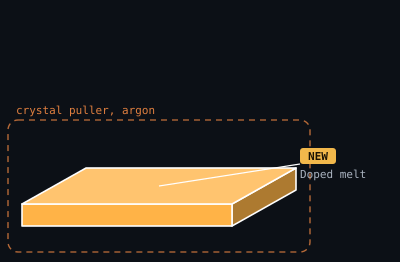
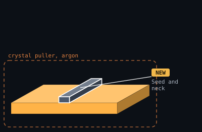
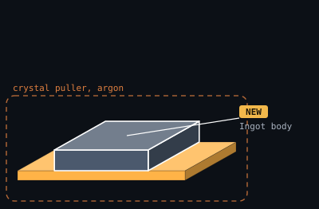
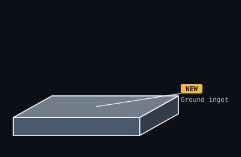
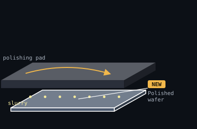
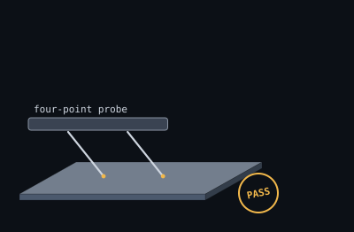

<!-- generated by scripts/build_manuals.py from data/manuals.json; edit there -->
# Manual 1 · Grow the crystal and cut the wafer

**Czochralski growth: melt, seed, neck, body, grind, slice, polish, sort.** Every chip starts as one perfect crystal. Ultra-pure silicon is melted with a pinch of dopant, a seed crystal is dipped in and slowly pulled up, and the melt freezes onto it atom by atom in the seed’s own arrangement. The ingot is then ground, sliced into wafers and polished to a mirror. The dopant does not freeze in evenly, which is why resistivity changes along the ingot.

Dopant along the ingot follows the Scheil equation[1](#sources) with segregation coefficients from Trumbore[2](#sources) and the effective-k theory of Burton, Prim and Slichter[3](#sources), as in the Fab Journey’s crystal theatre; crystal pulling follows Czochralski[4](#sources), Teal and Little[5](#sources) and Dash[6](#sources); wafer practice follows Plummer, Deal and Griffin[7](#sources).

[Open the web manual](https://normansrule.github.io/transistor-foundry-expedition/manuals/wafer.html) (Save as PDF from there) · [All manuals](README.md)

> **Read this first.** This manual explains how a cleanroom does each step. It is not a procedure to try at home. Tier 2 and 3 steps use heat, vacuum and high-voltage equipment or hazardous chemicals that only trained staff may handle.

| You need | |
|---|---|
| Electronic-grade polysilicon chunks | ×1 |
| Crystal puller with quartz crucible (staff-run) | ×1 |
| Grinder, wire saw, polisher, four-point probe | ×1 |

## 1 · Melt the silicon and add the dopant

**Do.** Load polysilicon into a quartz crucible, add the dopant and melt it all under argon. The melt is doped richer than the target, because the crystal will take in only a fraction k of it.

- the crystal takes in only a fraction k of the dopant[3](#sources)
- boron k ≈ 0.8, phosphorus k ≈ 0.35[2](#sources)

**Check.** Melt temperature steady; dopant weight logged.

Operation specification · Tier 2 · heat or equipment

| | |
|---|---|
| Tool | Czochralski crystal puller |
| Purpose | Make a melt that freezes to the target resistivity |
| Segregation coefficient, boron | ≈ 0.8[2](#sources) |
| Segregation coefficient, phosphorus | ≈ 0.35[2](#sources) |
| Control | Charge weight, dopant weight, melt temperature |
| Out of control | Wrong dopant weight: the ingot misses its resistivity and is sold to a looser spec |

**Process engineer.** The melt is doped to N_seed / k so that the first part of the crystal hits the target. Silicon melts at about 1414 °C, so the puller is a staff-run, water-cooled furnace[7](#sources).

## 2 · Dip the seed and pull a thin neck

**Do.** Lower a small seed crystal of the chosen orientation into the melt, let it wet, then pull a thin neck before widening.

- a thin neck lets dislocations grow out: dislocation-free silicon[6](#sources)
- the seed sets the orientation of the whole ingot, (100) for MOS[7](#sources)

**Check.** The neck is thin and even; the meniscus is stable.

Operation specification · Tier 2 · heat or equipment

| | |
|---|---|
| Tool | Crystal puller |
| Purpose | Start one perfect crystal |
| Control | Seed rotation, pull speed, neck diameter |
| Out of control | Dislocations in the neck: melt back and dip again |

**Process engineer.** The thermal shock of dipping makes dislocations in the seed. Pulling a thin, fast neck lets them run out to the surface and vanish, so the ingot above it grows free of them, as Dash showed in 1959[6](#sources).

## 3 · Pull the body

**Do.** Widen to the full diameter, then pull the crystal slowly upward while seed and crucible turn in opposite directions.

- a slower pull or a cooler melt makes the crystal wider[7](#sources)
- the dopant piles up in the melt, so resistivity falls along the ingot[1](#sources)

**Check.** Diameter on target along the whole body.

Operation specification · Tier 2 · heat or equipment

| | |
|---|---|
| Tool | Crystal puller with diameter control |
| Purpose | Grow the full-diameter crystal |
| Control | Pull rate, rotation, melt temperature, diameter camera |
| Out of control | Diameter swing: the controller adjusts pull rate and heater power |

**Process engineer.** As the crystal grows, the interface rejects a fraction 1 − k of the dopant back into the shrinking melt, so the melt and the next slice of crystal get richer. The solid follows C_s = kC₀(1 − f)^(k−1), where f is the fraction already frozen[1](#sources). Stirring and pull rate shift the effective k[3](#sources).

## 4 · Grind and mark the orientation

**Do.** Grind the ingot to an exact diameter and cut a notch or flat along it that marks the crystal orientation.

- the notch tells every later tool which way the crystal faces[7](#sources)

**Check.** Diameter and notch position within tolerance.

Operation specification · Tier 1 · care

| | |
|---|---|
| Tool | Cylindrical grinder; X-ray orientation |
| Purpose | Make every wafer the same size and orientation |
| Control | Diameter; notch angle by X-ray |
| Out of control | Notch misplaced: regrind or downgrade |

**Process engineer.** Lithography and etching depend on the crystal planes, so every wafer carries its orientation with it. X-ray diffraction finds the planes before the notch is ground[7](#sources).

## 5 · Slice, flatten and polish

**Do.** Saw the ingot into thin wafers, remove the sawing damage and polish one face to a mirror.

- the damage-removal etch is institution-only chemistry
- the final polish is chemical-mechanical, like planarization[7](#sources)

**Check.** Thickness, flatness and surface meet the spec.

Operation specification · Tier 2 · heat or equipment

| | |
|---|---|
| Tool | Wire saw, lapper, polisher |
| Purpose | Turn the ingot into flat, mirror-smooth wafers |
| Control | Thickness, total thickness variation, roughness |
| Out of control | Scratches or haze: repolish; warp: reject |

**Process engineer.** Sawing leaves a damaged layer that would crack and trap impurities, so it is lapped and chemically etched away before the polish. The etch chemistry stays with the wafer maker[7](#sources).

## 6 · Measure and sort

**Do.** Measure resistivity at points along the ingot and on each wafer. Wafers inside the customer’s band are prime; the rest go to looser uses.

- resistivity falls from seed to tail for any k below 1[1](#sources)
- resistivity comes from doping through the mobility[8](#sources)

**Check.** Resistivity within the band; no dislocations or particles.

Operation specification · Tier 1 · care

| | |
|---|---|
| Tool | Four-point probe; particle scanner |
| Purpose | Keep only wafers that meet the spec |
| Control | Resistivity map; particle count |
| Out of control | Out of band: sold to a looser spec or recycled |

**Process engineer.** Only part of each ingot stays inside a tight resistivity band; the crystal theatre shows how much for each dopant and tolerance. Resistivity follows ρ = 1/(qμN) with the mobility falling as doping rises[8](#sources).

## From a metals experiment to 300 mm wafers

A method for measuring how fast metals crystallise became the start of every chip.

- Czochralski pulled metal crystals from a melt in 1918 to measure crystallisation speed[4](#sources)
- Teal and Little pulled single crystals of germanium at Bell Labs in 1950[5](#sources)
- Dash’s thin neck gave dislocation-free silicon in 1959[6](#sources)
- Boron’s segregation coefficient is about 0.8, phosphorus’s about 0.35[2](#sources)

> **Institution-only.** Crystal pullers hold molten silicon above 1400 °C under argon and are run only by trained staff; the damage-removal etch uses institution-only chemistry.

## What the models leave out

- Dopant follows the Scheil equation with one effective k; real pulls vary it with pull rate and stirring.
- Oxygen from the quartz crucible, which every Czochralski wafer contains, is described, not modelled.
- Float-zone growth and silicon-on-insulator wafers are left out.
- No etch chemistry or furnace setting is given: the puller and the etch are staff-run.

## Sources

1. [E. Scheil, "Bemerkungen zur Schichtkristallbildung," Z. Metallkd. 34, 70 (1942).]() `scheil1942`
2. [F. A. Trumbore, "Solid Solubilities of Impurity Elements in Germanium and Silicon," Bell Syst. Tech. J. 39, 205 (1960).]() `trumbore1960`
3. [J. A. Burton, R. C. Prim, W. P. Slichter, "The Distribution of Solute in Crystals Grown from the Melt. Part I. Theoretical," J. Chem. Phys. 21, 1987 (1953).]() `bps1953`
4. [J. Czochralski, "Ein neues Verfahren zur Messung der Kristallisationsgeschwindigkeit der Metalle," Z. Phys. Chem. 92, 219 (1918).]() `czochralski1918`
5. [G. K. Teal, J. B. Little, "Growth of Germanium Single Crystals," Phys. Rev. 78, 647 (1950).]() `teal1950`
6. [W. C. Dash, "Growth of Silicon Crystals Free from Dislocations," J. Appl. Phys. 30, 459 (1959).]() `dash1959`
7. [J. D. Plummer, M. D. Deal, P. B. Griffin, Silicon VLSI Technology: Fundamentals, Practice and Modeling, Prentice Hall (2000).]() `plummer2000`
8. [D. M. Caughey, R. E. Thomas, "Carrier Mobilities in Silicon Empirically Related to Doping and Field," Proc. IEEE 55, 2192 (1967).](https://doi.org/10.1109/PROC.1967.6123) `caughey1967`
